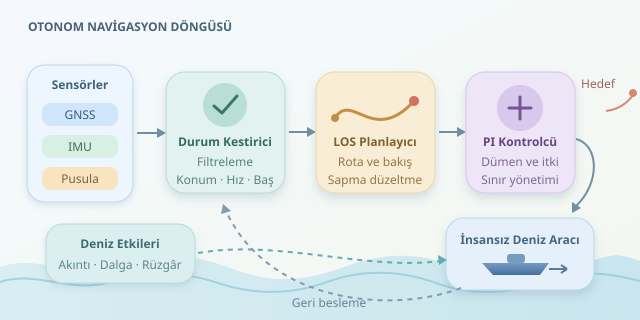

Karada çizdiğiniz rota genellikle yerinde durur; denizde ise yolun kendisi sizi yana doğru taşır! İnsansız bir deniz aracının hedefe ulaşması, yalnızca pusulayı doğru yöne çevirmek değildir. Dalga, akıntı ve rüzgâr altında konumunu anlaması, sapmayı hesaplaması ve fiziksel sınırlarına uygun düzeltmeler yapması gerekir.



``

## Navigasyonun üç katmanı

Otonom navigasyonu üç çalışanı olan küçük bir köprüüstü gibi düşünün: durum kestirici nerede olduğunuzu söyler, rota planlayıcı güvenli yolu seçer, kontrolcü ise dümen ve itkiyi yönetir. Bu görevleri ayırmak, hem yazılımı test etmeyi hem de arızaların kaynağını bulmayı kolaylaştırır.

GNSS konumu ve yer üzerindeki hızı sağlar. IMU ivme ve açısal hareketleri ölçer; pusula baş açısına yardımcı olur. Ancak hiçbiri kusursuz değildir. GNSS kesilebilir, pusula manyetik etkilerden sapabilir, IMU hataları zamanla birikebilir. Genişletilmiş Kalman filtresi gibi yöntemler, hareket modeliyle ölçümleri birleştirerek daha tutarlı bir durum tahmini üretir. Zaman damgalarının uyumu da en az sensör seçimi kadar önemlidir.

| Kaynak | Güçlü tarafı | Dikkat edilmesi gereken |
|---|---|---|
| GNSS | Mutlak konum | Kesinti ve ölçüm sıçraması |
| IMU | Hızlı hareket takibi | Biriken hata |
| Pusula | Baş açısı desteği | Manyetik bozulma |
| Hareket modeli | Ölçümler arasında tahmin | Parametre belirsizliği |

## Baş açısı ile rota açısı aynı değildir

Aracın burnunun baktığı yön, baş açısı $ψ$; yer üzerindeki hareket yönü ise rota açısı $χ$ olsun. Akıntı varsa bu iki açı farklı olabilir. Burnunu kuzeye çevirmiş bir araç, doğuya akan su nedeniyle kuzeydoğuya ilerleyebilir.

Basitleştirilmiş yatay düzlem modeli şöyledir:

$$\mathbf{v}_g=R(ψ)\mathbf{v}_b+\mathbf{v}_c$$

Burada $\mathbf{v}_b$ suya göre hızı, $\mathbf{v}_c$ akıntıyı, $R(ψ)$ gövde koordinatlarından dünya koordinatlarına dönüşümü temsil eder. Yer hızından $χ=\operatorname{atan2}(v_{g,y},v_{g,x})$ hesaplanır. Dolayısıyla yalnızca baş açısını sabitlemek, çizilen rotayı korumaya yetmez.

## Rotayı kovalamak yerine önüne bakmak

Yaygın çözümlerden biri, görüş hattı anlamına gelen LOS yönlendirmesidir. Sistem, rota üzerinde ileride bulunan hayali bir noktaya yönelir. Böylece küçük sapmalarda sert dönüşler yerine yumuşak yaklaşmalar üretir.

Düz bir rota parçasında yanal hata $e$, rota yönü $γ$ ve ileri bakış mesafesi $Δ$ için:

$$χ_d=γ-\arctan(e/Δ),\qquad ψ_d=χ_d-β$$

Buradaki $β$, süzülmüş $χ-ψ$ farkıyla yaklaşık olarak kestirilebilen sürüklenme açısıdır. Küçük $Δ$ daha çevik fakat daha salınımlı davranış yaratabilir. Büyük $Δ$ ise dönüşleri yumuşatırken rotaya dönüşü yavaşlatır. Çok düşük hızlarda rota açısı güvenilir olmadığından sürüklenme kestirimi sınırlandırılmalıdır.

## Python ile yönlendirme ve dümen kontrolü

Aşağıdaki örnek, LOS hedefini hesaplar ve baş açısı hatasını PI kontrolcüyle dümen komutuna dönüştürür. Koordinatlar metre cinsinden yerel düzlemde, açılar radyan cinsindedir. İntegral terimi kalıcı sapmayı azaltırken koşullu güncelleme, dümen doygunluğunda gereksiz birikimi önler.

```python
import math


def wrap(angle):
    return (angle + math.pi) % (2 * math.pi) - math.pi


def los_heading(position, start, end, beta, lookahead=15.0):
    dx, dy = end[0] - start[0], end[1] - start[1]
    length = math.hypot(dx, dy)
    if length == 0 or lookahead <= 0:
        raise ValueError("Geçersiz rota veya bakış mesafesi")
    px, py = position[0] - start[0], position[1] - start[1]
    error = (dx * py - dy * px) / length
    course = math.atan2(dy, dx) - math.atan2(error, lookahead)
    return wrap(course - beta)


def steering(target, heading, integral, dt):
    if dt <= 0:
        raise ValueError("dt pozitif olmalı")
    error = wrap(target - heading)
    raw = 1.2 * error + 0.04 * integral
    command = max(-0.6, min(0.6, raw))
    if abs(raw) < 0.6 or raw * error < 0:
        integral += error * dt
    return command, integral
```

`wrap`, açı sınırında yanlışlıkla tam tur dönülmesini engeller. İntegral değeri kontrol döngüleri arasında korunmalıdır. Katsayılar yalnızca örnektir; gerçek araçta hız, gövde dinamiği ve dümen sınırlarına göre ayarlanır. Ayrıca dümen işaretinin modelle uyumu doğrulanmalıdır. Bu kod, waypoint geçişlerini veya engelden kaçınmayı kapsamaz.

## Her dalgayla kavga etmeyin

Dalga kaynaklı hızlı salınımları sürekli dümenle düzeltmek enerji tüketir ve mekanizmayı yorar. Uygun filtreleme ve kontrol bant genişliği, yavaş rota sapmalarını hızlı yalpalamadan ayırmaya yardımcı olur. Ancak aşırı filtreleme gecikme yaratır; bu yüzden kontrolcü, sensör ve gövde birlikte değerlendirilmelidir.

İtki kontrolü de önemlidir: birçok dümenli araç düşük hızda yönlendirme otoritesini kaybeder. Akıntı aracın kapasitesini aşıyorsa hiçbir yazılım istenen rotayı garanti edemez. Sistem güvenli bekleme, alternatif rota veya operatöre devretme davranışına geçmelidir. Trafikte ise çarpışma riski ve uygulanabilir COLREG kuralları ayrıca ele alınmalıdır.

Başarılı otonomi, denizi yenmek değil, etkilerini ölçüp yönetmektir. Önce simülasyonda akıntı, sensör kesintisi ve aktüatör sınırlarını deneyin; ardından kontrollü deniz testlerinde yanal hata, enerji tüketimi ve güvenlik davranışlarını karşılaştırın.
