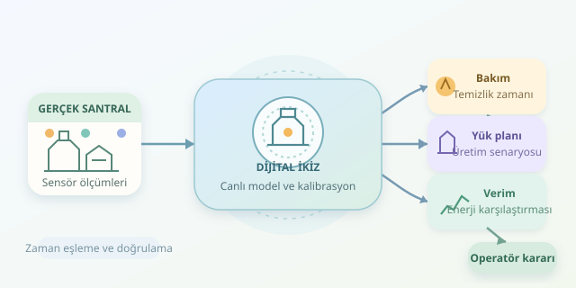

Bir enerji santralinde yanlış bakım zamanı, hem üretimi hem bütçeyi yakabilir. Peki türbini durdurmadan önce kararınızı sanal bir santralde deneseydiniz? Dijital ikiz, gerçek tesisten gelen verilerle güncellenen bir modeldir: Operatörlerin pahalı sürprizler yaşamadan “Ya şöyle yapsak?” sorusunu araştırmasını sağlar.

``

## Sanal kopya, ama dekor değil

Dijital ikiz yalnızca üç boyutlu bir santral görüntüsü değildir. Asıl değer; sıcaklık, basınç, yakıt debisi, titreşim ve elektrik üretimini açıklayan modellerdedir. Fiziksel ekipman veri üretir, model mevcut durumu tahmin eder, simülasyon gelecekteki seçenekleri karşılaştırır. Böylece bakım takvimi veya yük değişimi, gerçek ekipmana uygulanmadan önce sınanabilir. Modelin canlı verilerle düzenli güncellenmesi, onu sıradan bir simülasyondan ayıran temel özelliklerden biridir.

| Özellik | Geleneksel simülasyon | Dijital ikiz |
|---|---|---|
| Veri kaynağı | Önceden tanımlanan değerler | Güncel sensör ölçümleri |
| Durum | Sabit başlangıç varsayımı | Düzenli güncellenen tahmin |
| Kullanım | Tasarım seçenekleri | İşletme ve bakım senaryoları |

Veri hattında zaman damgalarının eşleşmesi ve sensörlerin kalibrasyonu kritiktir. Örneğin elektrik gücüyle yakıt debisini farklı dakikalardan eşleştirirseniz, model olmayan bir verim kaybını keşfedebilir. Dijital dedektifinizin önce saatini doğru ayarlaması gerekir!

## Teorik temel: enerji ve bozulma

Basitleştirilmiş bir termik santral için net elektrik gücünü şöyle yazabiliriz:

$$P_{net}=\eta(f)Q_{in}-P_{aux}$$

Burada $Q_{in}$ yakıtın ısıl gücü, $P_{aux}$ yardımcı sistemlerin tüketimi, $f$ ise boyutsuz kirlenme göstergesidir. Güçlerin birimi MW olduğunda sonuç da MW olur. Kirlenmenin verimi düşürdüğünü varsayalım:

$$\eta(f)=\eta_0(1-\alpha f)$$

$\eta_0$ temiz ekipmanın verimi, $\alpha$ kirlenmeye duyarlılıktır. Saatlik ilerlemede basit bir bozulma modeli kullanabiliriz:

$$f_{t+1}=\min(1,f_t+kL^2\Delta t)$$

$L$ nominal kapasiteye göre yük oranıdır. Kare terimi, yüksek yükün kirlenmeyi daha hızlı artırdığı varsayımını temsil eder. Bu, evrensel bir fizik yasası değil; saha verileriyle doğrulanması gereken öğretici bir yaklaşımdır. Gerçek modeller sıcaklık dinamiklerini, ortam koşullarını ve ekipman sınırlarını da içerir.

## Python ile üç alternatif gelecek

Aşağıdaki model, 100 MW nominal yakıt ısıl girdisini kullanır. Temizliğin kirlenmeyi yüzde 80 azalttığını, fakat dört saat üretim kaybettirdiğini varsayar. Her senaryo bağımsız bir kopyada çalışır; böylece biri diğerinin başlangıç durumunu değiştirmez.

```python
from dataclasses import dataclass, replace

@dataclass
class Twin:
    fouling: float = 0.5
    eta0: float = 0.40
    alpha: float = 0.12
    auxiliary_mw: float = 2.0

    def forecast(self, load, hours=24, clean=False):
        if not 0 < load <= 1 or hours < 1:
            raise ValueError("Yük ve süre geçersiz")

        model = replace(self)
        if clean:
            model.fouling *= 0.2

        energy_mwh = 0.0
        for hour in range(hours):
            if clean and hour < 4:
                continue
            heat_mw = 100 * load
            efficiency = model.eta0 * (
                1 - model.alpha * model.fouling
            )
            power_mw = max(
                0, efficiency * heat_mw - model.auxiliary_mw
            )
            energy_mwh += power_mw  # Bir saatlik adım
            model.fouling = min(
                1, model.fouling + 0.004 * load**2
            )
        return round(energy_mwh, 1)

plant = Twin()
print("Tam yük:", plant.forecast(1.0))
print("Temizlik:", plant.forecast(1.0, clean=True))
print("Düşük yük:", plant.forecast(0.8))
```

Kod, saatlik gücü bir saatle çarparak toplam enerjiyi MWh cinsinden toplar. Temizlik sırasında üretimi sıfır kabul eder; bakımın yardımcı tüketimini ayrıca modellemez. Sonuçlar yaklaşık 849,1, 746,8 ve 671,2 MWh olur. Temizlik verimi yükseltse de ilk gün kaybedilen saatleri telafi edemez. Daha uzun ufukta sonuç değişebilir; ancak bu model arıza olasılığı hesaplamaz. Dolayısıyla düşük kirlenmeyi doğrudan “arıza önlendi” diye yorumlamak doğru değildir.

## Sonuçları karara dönüştürmek

Uygulamada dört adımlı bir döngü kurabilirsiniz:

1. **Ölç:** Sensör verilerini topla; eksik, gecikmiş veya fiziksel olarak tutarsız kayıtları işaretle.
2. **Kalibre et:** Verim ve bozulma katsayılarını geçmiş işletme verileriyle belirle; ayrı dönemlerde doğrula.
3. **Karşılaştır:** Bakım tarihlerini, yük programlarını, yakıt giderlerini ve elektrik fiyatlarını birlikte değerlendir.
4. **Denetle:** Önerileri ekipman limitleri ve işletme prosedürleriyle kontrol ederek operatör onayına sun.

Tek bir tahmine güvenmek yerine parametreleri farklı aralıklarda çalıştırın. Sensör hatası veya beklenenden uzun bakım, kazanan senaryoyu değiştirebilir. Ayrıca santral ağına bağlantıda erişim kontrolü ve ağ ayrımı gerekir; deneysel model doğrudan kontrol komutları üretmemelidir.

Dijital ikizin hedefi kristal küre olmak değildir. Hedef, kararların varsayımlarını görünür kılmak ve seçenekleri güvenle karşılaştırmaktır. Santral gerçek dünyada çalışırken, fikirleriniz önce sanal dünyada ter döksün!
