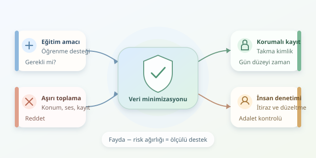

Bir eğitim platformu, öğrencinin hangi soruda zorlandığını bilerek yardımcı olabilir. Peki aynı platformun gece kaçta bağlandığını, evdeki sesleri veya arkadaşlık ilişkilerini bilmesi gerekir mi? Dijital sınıflarda asıl mesele, toplanabilecek veri miktarı değil, toplanması haklı gösterilebilen veri miktarıdır. İyi bir ürün, öğrenciyi daha görünür kılarken özel hayatını camdan bir sınıfa dönüştürmez. Gelin bu sınırı hem etik hem teknik açıdan çizelim.

``

## Önce amaç, sonra veri

Mahremiyet yalnızca bilgiyi başkalarından saklamak değildir; kişinin kendisi hakkındaki bilgilerin hangi bağlamda, kim tarafından ve nasıl kullanılacağını anlayabilmesidir. Güvenlik ise bu bilgileri yetkisiz erişimden korur. Aradaki fark önemlidir: Şifrelenmiş bir veritabanı, gereksiz yere toplanmış kamera görüntülerini etik hâle getirmez. Çelik kasa sağlamdır ama içine koyduğunuz her şey meşru olmayabilir.

Temel yaklaşım, **amaçla sınırlılık ve veri minimizasyonudur**. Her alan için şu soruyu sorun: “Bu veri olmadan tanımladığımız eğitim hizmeti gerçekten verilemez mi?” Öğrenme desteği amacıyla alınan verilerin sonradan reklam hedeflemesine aktarılması, öğrencinin beklediği bağlamı değiştirir. Ürün ekibinin merakı, tek başına yeterli gerekçe değildir.

## Fayda ile risk aynı terazide

Kararları tartışmak için basit bir düşünce modeli kullanabiliriz:

$$F(D)=U(D)-aR(D)$$

Burada $D$ veri kümesi, $U(D)$ eğitimsel fayda, $R(D)$ mahremiyet riski, $a$ ise riske verilen ağırlıktır. Bu, hukuki uygunluğu hesaplayan sihirli bir formül değildir. Daha çok, “Biraz daha veri gerçekten anlamlı fayda sağlıyor mu?” sorusunu görünür kılar. Çocukların verilerinde risk değerlendirmesi özellikle ihtiyatlı yapılmalıdır.

| Veri veya uygulama | Olası eğitimsel fayda | Daha ölçülü tercih |
|---|---|---|
| Soruya verilen cevap | Konu eksiklerini belirlemek | Gereken cevap ve kazanım bilgisi |
| Kesintisiz ekran kaydı | Sınav gözetimi | Daha az müdahaleci değerlendirme tasarımı |
| Tam konum bilgisi | Çoğu derste sınırlı | Gerekmiyorsa hiç toplamamak |
| Yüzden duygu çıkarımı | Güvenilirliği tartışmalı | Öğrencinin gönüllü geri bildirimi |




Önemli nokta şudur: Bir yöntemin teknik olarak mümkün olması, pedagojik olarak gerekli olduğu anlamına gelmez. Özellikle sürekli gözetim, öğrencinin davranışlarını ve kendini ifade etme isteğini değiştirebilir.

## Minimizasyonu kodun kapısına koymak

Aşağıdaki Python örneği, yalnızca izin verilen olayları kabul eder, ham öğrenci kimliğini anahtarlı bir takma kimliğe dönüştürür ve zamanı gün düzeyine indirger:

```python
import hashlib
import hmac
import os
from datetime import datetime

KEY = bytes.fromhex(os.environ["PSEUDONYM_KEY_HEX"])
if len(KEY) < 32:
    raise ValueError("En az 32 baytlık anahtar gerekli")

ALLOWED = {"exercise_completed", "hint_requested"}

def minimize(event):
    if event["type"] not in ALLOWED:
        raise ValueError("Desteklenmeyen olay")

    student = str(event["student_id"]).encode("utf-8")
    reference = hmac.new(KEY, student, hashlib.sha256).hexdigest()
    day = datetime.fromisoformat(event["time"]).date().isoformat()
    return {
        "student_ref": reference,
        "event": event["type"],
        "day": day,
    }
```

Anahtar, güvenli biçimde üretilmiş rastgele baytların onaltılık gösterimi olarak yapılandırılmalı ve gizli tutulmalıdır. HMAC, düz kimlik özeti kullanımına göre tahmin saldırılarına karşı daha uygun bir yaklaşım sunar. Ancak **takma adlandırma anonimleştirme değildir**: Kayıtlar ilişkilendirilebilir ve hâlâ kişisel veri sayılabilir. Bu örnek ayrıca erişim kontrolü, silme veya hukuki uygunluk sağlamaz; yalnızca toplama sınırını gösterir.

## Rıza, güç dengesi ve algoritmalar

“Kutuyu işaretledi, sorun çözüldü” yaklaşımı eğitimde özellikle kırılgandır. Öğrenci, derse katılmak için platformu kullanmak zorundaysa gerçek bir seçim yapabiliyor mu? Temel hizmet için gerekli işlemlerle isteğe bağlı analizler ayrılmalı; ret kararı öğrenciyi cezalandırmamalıdır.

KVKK, uygulanıyorsa GDPR ve ilgili eğitim mevzuatı kapsamında uygun hukuki dayanak belirlenmelidir; her işlem otomatik olarak rızaya dayanmaz. Çocuklara ve gerektiğinde velilere anlaşılır açıklamalar sunulmalıdır. Risk puanları da kader değildir: Bir öğrenciyi “başarısız olacak” diye etiketleyen model, önyargıları büyütebilir. Sonuçlar insan incelemesine, düzeltmeye ve itiraza açık olmalıdır.

## Sorumluluk, yayına çıkınca bitmez

- **Saklama:** Her veri türü için gerekçeli süre belirleyin; “belki lazım olur” arşivi oluşturmayın.
- **Erişim:** Öğretmen, destek çalışanı ve yöneticiye yalnızca görevleri için gereken yetkiyi verin.
- **Paylaşım:** Tedarikçilerin veriyi hangi amaçlarla kullanabileceğini ve silebileceğini sözleşmelerle netleştirin.
- **Denetim:** Kayıtları, ihlal müdahalesini ve öğrenci taleplerini düzenli test edin.
- **Adalet:** Model hatalarının farklı öğrenci gruplarını eşitsiz etkileyip etkilemediğini değerlendirin.

Kısacası iyi eğitim teknolojisi, en çok veriyi toplayan değil, en az müdahaleyle anlamlı destek sağlayandır. Öğrenci bir veri madeni değil; hakları, merakı ve geleceği olan bir insandır.
