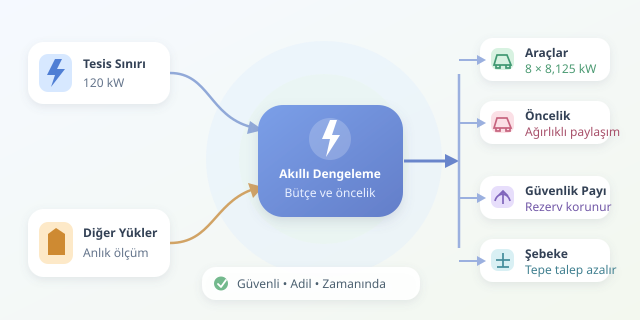

Bir otoparkta sekiz elektrikli aracın aynı anda prize bağlandığını düşünün. Her sürücü hızlı şarj ister; bina ise asansörleri, klimaları ve aydınlatmasıyla zaten enerji tüketmektedir. İşte yük dengeleme, bu elektrikli açık büfede herkesin tabağını doldururken mutfağın sigortasını attırmamayı sağlar. Üstelik mesele yalnızca gücü kısmak değil, mevcut kapasiteyi akıllıca paylaşmaktır.

``

## Önce temel mantık: Güç bütçesi

Şarj istasyonlarının etiket güçlerini toplamak, altyapının gerçek ihtiyacını anlamak için yeterli değildir. Önemli olan, tesisin bağlantı kapasitesiyle o anda tüketilen diğer yükler arasındaki farktır. Dinamik yük dengeleme, ölçüm cihazlarından aldığı verilerle bu farkı düzenli olarak hesaplar ve araçlara ayrılabilecek toplam gücü günceller.

Basitleştirilmiş aktif güç modeli şöyledir:

$$
P_{EV}(t)=\max(0, P_{tesis}-P_{diger}(t)-P_{pay})
$$

Burada $P_{pay}$ güvenlik rezervidir. Her aracın aldığı güç için de şu sınırlar geçerlidir:

$$
\sum_i p_i(t) \le P_{EV}(t), \qquad 0 \le p_i(t) \le P_{i,max}
$$

Örneğin tesis sınırı 120 kW, diğer tüketimler 45 kW ve rezerv 10 kW ise araçlara 65 kW kalır. Sekiz aracın her biri 11 kW isterse toplam talep 88 kW olur. Eşit paylaşımda araç başına yaklaşık 8,125 kW ayrılır; böylece toplam tüketim rezerv dahil belirlenen sınırı aşmaz.

## Statik mi, dinamik mi, öngörülü mü?

| Yaklaşım | Nasıl çalışır? | Güçlü yanı | Sınırlaması |
|---|---|---|---|
| Statik | Şarja sabit bir üst sınır koyar | Basit ve öngörülebilir | Boş kapasiteyi kullanamayabilir |
| Dinamik | Anlık bina tüketimine göre bütçeyi değiştirir | Kapasiteyi daha verimli kullanır | Güvenilir ölçüm ve iletişim ister |
| Öngörülü | Tüketim, tarife ve ayrılış tahminleriyle planlar | Maliyet ve zaman hedeflerini birlikte yönetir | Tahmin hatalarından etkilenir |

Statik sistem, restoranın her akşam aynı sayıda masa açmasına benzer. Dinamik sistem müşteri yoğunluğunu izler; öngörülü sistem ise rezervasyon defterini de okur. Ancak hiçbir yöntem fiziksel bağlantı sınırını sihirli biçimde büyütmez.

## Gücü adil dağıtmak: Ağırlıklı paylaşım

Eşit paylaşım anlaşılırdır, fakat ihtiyaçlar eşit olmayabilir. Yarım saat sonra ayrılacak servis aracı, gece boyunca park edecek araçtan daha yüksek öncelik alabilir. Ağırlıklı paylaşımda öncelikler sayısallaştırılır; araçların kabul edebileceği güç sınırları da korunur.

Aşağıdaki Python fonksiyonu bütçeyi ağırlıklara göre dağıtır. Sınırına ulaşan aracın kullanamadığı pay, sonraki turda diğerlerine aktarılır:

```python
def paylastir(butce, araclar):
    if any(a['max_kw'] < 0 or a['agirlik'] <= 0 for a in araclar):
        raise ValueError('Güç negatif, ağırlık sıfır veya negatif olamaz.')

    kalan = max(0.0, butce)
    sonuc = [0.0] * len(araclar)
    aktif = [i for i, a in enumerate(araclar) if a['max_kw'] > 0]

    while aktif and kalan > 1e-6:
        toplam_agirlik = sum(araclar[i]['agirlik'] for i in aktif)
        tur_butcesi = kalan

        for i in aktif:
            arac = araclar[i]
            pay = tur_butcesi * arac['agirlik'] / toplam_agirlik
            ek = min(pay, arac['max_kw'] - sonuc[i])
            sonuc[i] += ek
            kalan -= ek

        aktif = [
            i for i in aktif
            if araclar[i]['max_kw'] - sonuc[i] > 1e-6
        ]

    return sonuc

araclar = [{'max_kw': 11.0, 'agirlik': 1.0} for _ in range(8)]
print(paylastir(65.0, araclar))
```

Bu örnek sekiz araç için yaklaşık 8,125 kW üretir. `max_kw`, yalnızca istasyonun etiketini değil, aracın ve bağlantının güncel sınırını temsil etmelidir. Fonksiyon sürekli güç paylaşımını gösterir; üretim sistemindeki haberleşme, hata yönetimi ve minimum akım koşullarını uygulamaz.

## Sahada matematiğin yanına mühendislik koyun

Gerçek tesislerde toplam kW sınırı tek başına yeterli değildir. Özellikle tek fazlı araçlar, toplam kapasite uygun görünürken bir fazı aşırı yükleyebilir. Bu nedenle faz akımları, kablo sınırları, koruma elemanları ve gerektiğinde görünür güç de izlenmelidir. Yazılım, elektriksel korumanın yerine geçmez.

AC şarjda izin verilen minimum akımın altında kesintisiz paylaşım mümkün olmayabilir. Böyle durumlarda bazı oturumları sırayla bekletmek gerekir. Ölçüm gecikmesine karşı rezerv bırakmak, komut değişimlerini yumuşatmak ve iletişim kesildiğinde güvenli sınırlara dönmek de önemlidir.

## Optimizasyonun gerçek hedefi

Güç, anlık hızdır; enerji ise zaman boyunca biriken miktardır. Sabit güçte bataryaya aktarılan yaklaşık enerji $E=\eta P\Delta t$ ile hesaplanır. Burada $\eta$ verim, $\Delta t$ saat cinsinden süredir. Ayrılış zamanına kadar gereken enerjiyi tamamlamak, her aracı sürekli maksimum güçte tutmaktan daha anlamlıdır.

Ucuz saatlere kaydırma, güneş üretimini değerlendirme ve tesisin tepe talebini azaltma aynı planın parçaları olabilir. Fakat düşük öncelikli araçların sürekli beklememesi için bekleme süresi de hesaba katılmalıdır. Başarılı yük dengeleme, en yüksek anlık gücü değil; güvenli, adil ve zamanında tamamlanan şarjı hedefler.



