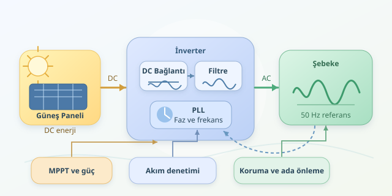

Çatınızdaki güneş panelleri öğle vakti elektrik üretirken şehir şebekesi kendi ritminde çalışmaya devam eder. Peki bu iki kaynak birbirine bağlandığında neden elektriksel bir kakofoni oluşmaz? Çünkü arada, enerjiyi dönüştürmenin yanında şebekenin temposunu izleyen bir inverter bulunur. Bu yazıda küçük üreticilerin dev elektrik orkestrasına nasıl katıldığını, kontrol teorisi ve küçük bir Python deneyiyle keşfedeceğiz.
``

## Önce aynı dili konuşmak gerekir

Güneş paneli doğru akım, yani DC üretir. Şebeke ise Türkiye’de nominal olarak 50 Hz alternatif akımla çalışır. İnverter, DC enerjiyi anahtarlama elemanlarıyla AC’ye dönüştürür; filtreler de anahtarlamanın yüksek frekanslı bileşenlerini azaltır. Ancak yalnızca sinüs benzeri bir dalga üretmek yetmez: bağlantı noktasındaki gerilim, frekans ve faz ilişkisi kontrol edilmelidir.

| Özellik | Güneş paneli tarafı | Şebeke tarafı |
|---|---|---|
| Elektrik biçimi | DC | AC |
| Gerilim davranışı | Işınım ve yüke bağlı | Şebeke koşullarına bağlı |
| Temel kontrol | Çalışma noktasını seçmek | Uyumlu akım enjekte etmek |
| Aradaki köprü | DC bağlantı devresi | İnverter ve filtre |

Önemli ayrıntı şudur: Yaygın şebeke takip eden inverterler, güçlü şebekeye kendi gerilimlerini zorla dayatmaz. Şebeke gerilimini referans alarak verecekleri akımı düzenler. Kalabalıkta yürüyüş temposunu tutturmak gibi düşünün; herkesi kendi adımınıza uydurmaya çalışmazsınız.

## Faz neden bu kadar önemli?

İki AC büyüklüğünün faz farkı, enerjinin nasıl aktarıldığını belirler. Tek fazlı, sinüzoidal temel bileşen için aktif ve reaktif güç ilişkileri şöyledir:

$$P=VI\cos\varphi, \qquad Q=VI\sin\varphi$$

Burada $V$ ve $I$ etkin değerler, $\varphi$ ise gerilim ile akım arasındaki faz farkıdır. Aktif güç $P$, işe dönüşen enerji akışını temsil eder. Reaktif güç $Q$ ise elektrik ve manyetik alanlarla ilişkili alışveriştir; uygun kontrol edildiğinde yerel gerilim yönetimine yardımcı olabilir.

Birçok inverter, aktif güç aktarırken akımı gerilimle aynı fazda tutmaya çalışır. Gerektiğinde reaktif güç de sağlar. Ancak bu görevler bağımsız sınırsız düğmeler değildir: inverterin akım ve görünür güç kapasitesi paylaşılır. Daha fazla reaktif destek, bazı koşullarda aktarılabilecek aktif gücü azaltabilir.

## PLL: Elektronik bir ritim dedektifi

Faz kilitlemeli döngü, yani **PLL**, ölçülen şebeke geriliminden faz açısını tahmin eder. Yaygın yaklaşım, gerilim bileşenlerini dönen bir koordinat sistemine taşımaktır. Tahmin doğruysa uygun eksendeki hata yaklaşık sıfıra iner. PI denetleyici bu hatadan frekans düzeltmesi üretir:

$$\hat{\omega}=\omega_0+K_p e+K_i\int e\,dt, \qquad \frac{d\hat{\theta}}{dt}=\hat{\omega}$$

Aşağıdaki örnek, ideal ve normalize edilmiş iki dik gerilim bileşeniyle çalışan basitleştirilmiş bir PLL simülasyonudur. Gerçek donanıma komut göndermez.

```python
import math

dt = 0.0005
theta = 0.0
integral = 0.0
omega_ref = 2 * math.pi * 50
kp, ki = 80.0, 1600.0

for k in range(3000):
    t = k * dt
    grid_phase = 2 * math.pi * 50.1 * t + 0.4
    alpha = math.cos(grid_phase)
    beta = math.sin(grid_phase)

    error = beta * math.cos(theta) - alpha * math.sin(theta)
    integral += error * dt
    omega = omega_ref + kp * error + ki * integral
    theta = (theta + omega * dt) % (2 * math.pi)

    if k % 1000 == 0:
        print(f"t={t:.2f}s, tahmin={omega / (2 * math.pi):.3f}Hz")
```

`error`, gerçek faz ile tahmin arasındaki farkın sinüsüdür. İntegral terimi kalıcı frekans sapmasını giderir; `theta` ise tahmin edilen açıyı ilerletir. Tahmin, bu ideal koşullarda 50,1 Hz’e yaklaşır. Kazançlar örnektir: gerçek tasarımda gürültü, harmonikler, gecikme ve sınırlandırmalar değerlendirilir. Tek fazlı uygulamalarda dik bileşenin ayrıca oluşturulması gerekir.

## Senkronizasyon yalnızca başlangıçtır

Panel tarafındaki MPPT algoritması en verimli çalışma noktasını ararken, DC bağlantı gerilimi kontrolü enerji dengesini yönetir. Daha hızlı akım döngüsü de şebekeye verilen akımı referansa uydurur. Bu katmanların bant genişlikleri uyumlu seçilmezse kontrolcüler birbirinin işine karışabilir.

| Yaklaşım | Ana referans | Tipik rol |
|---|---|---|
| Şebeke takip eden | Ölçülen şebeke gerilimi | Mevcut şebekeye güç vermek |
| Şebeke oluşturan | İç gerilim ve frekans referansı | Özellikle zayıf şebeke veya ada işletimini desteklemek |

Şebeke oluşturan kontrol de sınırsız güç üretmez; enerji kaynağı ve akım sınırları hâlâ belirleyicidir. Özellikle çok sayıda inverter bağlandığında, şebekenin empedansı ve kontrol döngülerinin etkileşimi kararlılık analizinin merkezine yerleşir.

## Güvenli bağlantı, iyi ritimden fazlasıdır

Şebeke kesildiğinde üretimin kontrolsüz biçimde hattı beslememesi için adalanma koruması gerekir. Gerilim ve frekans korumaları, topraklama, bağlantı izinleri ve yerel şebeke kuralları da entegrasyonun parçasıdır. Gerçek bağlantı sertifikalı ekipman ve yetkin uzmanlarla yapılmalıdır. Kısacası başarılı entegrasyon; ritmi yakalamak, doğru miktarda enerji aktarmak ve gerektiğinde güvenle sahneden çekilmektir.
