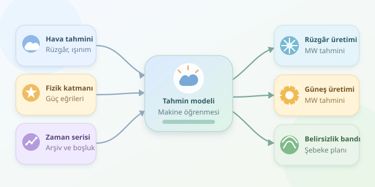

Bir güneş santralinin yarın ne kadar elektrik üreteceğini bilmek, yalnızca gökyüzüne bakıp “Bulutlar biraz kararsız görünüyor” demekten fazlasını gerektirir. Rüzgâr türbinleri için de durum benzerdir: Esinti güzel olabilir, fakat şebekenin ihtiyacı sayısal bir tahmindir. Hava durumu verileri, fizik ve makine öğrenmesi birleştiğinde bu belirsizlik yönetilebilir hâle gelir.

``

## Önce fizik: Hava neden üretimi değiştirir?

Rüzgâr türbininin üretebileceği güç, çalışma aralığının bir bölümünde rüzgâr hızının küpüyle ilişkilidir:

$$P_{wind} = 0.5 \rho A C_p \eta v^3$$

Burada $\rho$ hava yoğunluğu, $A$ rotorun süpürdüğü alan, $C_p$ aerodinamik güç katsayısı, $\eta$ dönüşüm verimi ve $v$ rüzgâr hızıdır. Diğer değişkenler sabitken hızdaki küçük artış, güçte büyük fark yaratabilir. Ancak gerçek türbinler sınırsız güç üretmez: Devreye girme, nominal güç ve güvenlik nedeniyle durma eşikleri bulunur.

Güneşte temel ilişki daha doğrusaldır:

$$P_{solar} \approx G_{POA} A \eta(T)$$

$G_{POA}$ panel düzlemine ulaşan ışınımdır. Panel sıcaklığı yükseldiğinde verim genellikle azalır. Dolayısıyla “daha sıcak gün, daha çok elektrik” sezgisi her zaman doğru değildir. Ayrıca inverter kapasitesi, üretimi üstten sınırlar.

| Özellik | Rüzgâr santrali | Güneş santrali |
|---|---|---|
| Ana belirleyici | Göbek yüksekliğindeki rüzgâr | Panel düzlemindeki ışınım |
| Önemli yardımcı veri | Yön, yoğunluk, türbülans | Bulutluluk, panel sıcaklığı |
| Temel doğrusal olmayanlık | Güç eğrisi ve durma eşikleri | Sıcaklık etkisi ve inverter sınırı |
| Gece üretimi | Mümkün | Beklenmez |

## Veriyi hazırlarken zaman makinesini kapatın

İlk adım, saatlik üretim ölçümlerini meteorolojik tahminlerle eşleştirmektir. Saat dilimleri, eksik kayıtlar, sensör hataları ve bakım dönemleri kontrol edilmelidir. Üretimin MW cinsinden ortalama güç mü, MWh cinsinden enerji mi olduğunu da netleştirin.

En kritik ayrıntı şudur: Yarın için model kurarken yarının gerçekleşmiş hava durumunu kullanamazsınız. Eğitimde, geçmişte gerçekten yayımlanmış hava tahminlerinin arşivini kullanmalısınız. Aksi hâlde model sınava cevap anahtarıyla girer ve gerçek kullanımda şaşırır.

Rüzgâr hızını mümkünse türbin göbek yüksekliğinde alın. Güneşte yatay ışınımı panel eğimi ve yönüne göre dönüştürün. Tahminin yayımlanma zamanı ile geçerli olduğu zaman ayrı sütunlarda tutulmalıdır.

## Python ile iki üretimi birlikte tahmin edin

Aşağıdaki örnekte her satır bir hedef saattir. Meteorolojik sütunlar, o saatten 24 saat önce yayımlanan tahminden gelir. Kapasiteler örnek olarak 50 ve 20 MW seçilmiştir.

```python
import numpy as np
import pandas as pd
from sklearn.ensemble import HistGradientBoostingRegressor
from sklearn.multioutput import MultiOutputRegressor
from sklearn.model_selection import TimeSeriesSplit
from sklearn.metrics import mean_absolute_error

# df: arşivlenmiş hava tahminleri ve gerçekleşen üretim

df['valid_time'] = pd.to_datetime(df['valid_time'], utc=True)
df = df.sort_values('valid_time').reset_index(drop=True)
hour = df['valid_time'].dt.hour
df['hour_sin'] = np.sin(2 * np.pi * hour / 24)
df['hour_cos'] = np.cos(2 * np.pi * hour / 24)

features = ['wind_speed_100m', 'poa_irradiance',
            'temperature', 'cloud_cover', 'hour_sin', 'hour_cos']
X = df[features]
y = df[['wind_mw', 'solar_mw']]
errors = []

for train, test in TimeSeriesSplit(n_splits=4, gap=24).split(X):
    model = MultiOutputRegressor(
        HistGradientBoostingRegressor(max_iter=150, max_leaf_nodes=15)
    )
    model.fit(X.iloc[train], y.iloc[train])
    prediction = model.predict(X.iloc[test])
    prediction = np.clip(prediction, 0, [50, 20])
    errors.append(mean_absolute_error(
        y.iloc[test], prediction, multioutput='raw_values'
    ))

print('Ortalama MAE, MW:', np.mean(errors, axis=0))
```

Sinüs ve kosinüs özellikleri, günün döngüsünü temsil eder; böylece 23.00 ile 00.00 birbirinden kopuk görünmez. Model, iki hedef için ayrı regresyonlar öğrenir. Zaman sıralı bölme geleceğin eğitim kümesine karışmasını engeller. Saatlik, kesintisiz kayıt varsayımındaki 24 satırlık boşluk ise tahmin ufkuna uygun bir güvenlik aralığı sağlar.

## Başarıyı nasıl ölçersiniz?

MAE, hatayı üretimle aynı birimde gösterir:

$$MAE = \frac{1}{n}\sum_{i=1}^{n}\vert y_i-\hat{y}_i\vert $$

Örneğin 3 MW MAE, ortalama mutlak sapmanın 3 MW olduğunu söyler. Farklı büyüklükteki santralleri karşılaştırmak için hatayı kurulu güce bölebilirsiniz. Gece güneş üretimi sıfır olduğundan MAPE yanıltıcı veya tanımsız olabilir.

Modeli mevsimlere, tahmin ufuklarına ve gündüz saatlerine göre ayrıca değerlendirin. Basit kalıcılık tahminiyle ve fiziksel güç eğrisiyle karşılaştırmadan başarı ilan etmeyin. Bakım kaynaklı duruşlar için kullanılabilirlik bilgisi eklemek, meteorolojinin açıklayamadığı hataları azaltır.

## Tek sayıdan belirsizlik aralığına

Operasyonda yalnızca beklenen üretim değil, olası sapmalar da önemlidir. Meteorolojik ansambllar veya kuantil modelleriyle tahmin aralıkları üretilebilir. Ancak bu aralıkların geçmiş testlerde gerçekten beklenen kapsama oranını sağladığını doğrulayın. Sonuçta amaç havayı kusursuz bilmek değil; şebeke planlamasını, depolama kararlarını ve enerji ticaretini daha sağlam verilere dayandırmaktır.
