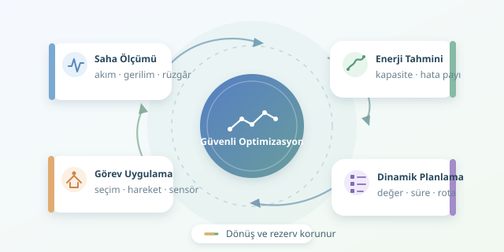

Bir insansız aracın başarılı olması, yalnızca hedefe ulaşmasına değil, geri dönecek enerjiyi de saklamasına bağlıdır. Pil göstergesi yüzde yirmiyi gösterirken son bir fotoğraf çekmek cazip gelebilir; ancak algoritmanın romantizme değil, enerji bütçesine ihtiyacı vardır. Peki görev değeri, uçuş süresi ve güvenlik nasıl birlikte optimize edilir?
``

## Önce enerjinin muhasebesini tutalım

Pil kapasitesi, görev boyunca kullanılabilecek enerjiyle aynı şey değildir. Sıcaklık, yaşlanma, yüksek akım çekişi ve gerilim düşümü gerçek kapasiteyi etkiler. Bu nedenle yalnızca nominal amper-saat değerine bakmak yanıltıcıdır. Enerji yaklaşık olarak gerilim ve kapasitenin çarpımıyla hesaplanabilir; ancak planlama sırasında ölçümlerle güncellenen bir tahmin kullanmak daha güvenilirdir.

Anlık güç tüketimi $P(t)=V(t)I(t)$ şeklindedir. Güç watt, zaman saniye olduğunda tüketilen enerji:

$$E_{\mathrm{Wh}}=\frac{1}{3600}\int_0^{T_{\mathrm{s}}}P(t)\,dt$$

Buradaki önemli ayrım şudur: güç, tüketim hızıdır; enerji ise toplam harcamadır. Daha güçlü çalışan bir motor, görevi yeterince hızlı bitirirse toplamda daha az enerji tüketebilir. Tersine, yavaş ilerlemek elektroniklerin daha uzun süre açık kalmasına neden olabilir.

| Etken | Enerjiye etkisi | Planlamadaki karşılığı |
|---|---|---|
| Hız | Süreyi ve hareket gücünü değiştirir | Ekonomik hız seçimi |
| Rüzgâr veya eğim | Güzergâha bağlı maliyet oluşturur | Yön duyarlı rota |
| Sensör kullanımı | Ek güç tüketir | Gerektiğinde etkinleştirme |
| Pil sıcaklığı | Kullanılabilir kapasiteyi etkiler | Dinamik kapasite tahmini |

Örneğin bir kara aracında aerodinamik güç, uygun koşullarda hızın yaklaşık küpüyle büyür. Drone içinse askıda kalma, ileri uçuş ve tırmanış farklı modeller gerektirir. Tek bir “kilometre başına tüketim” sabiti her platforma uymaz.

## Görevi bir optimizasyon problemine çevirmek

Her alt göreve bir ödül $r_i$, enerji maliyeti $e_i$ ve süre $t_i$ atayalım. Seçim değişkeni $x_i\in\{0,1\}$ olsun. Amaç, toplam görev değerini artırmaktır:

$$\max \sum_i r_i x_i$$

Enerji kısıtı ise şöyledir:

$$\sum_i e_i x_i \le E_{\text{tahmini}}-E_{\text{dönüş}}-E_{\text{rezerv}}$$

Benzer biçimde toplam süre, dönüş süresi çıkarılmış zaman bütçesini aşmamalıdır. Dönüş enerjisi planlı dönüş içindir; rezerv ise tahmin hataları ve beklenmeyen koşullar için ayrı tutulur.

Bu sade model, iki kısıtlı sırt çantası problemidir. Görev sırası ve aralarındaki mesafeler de karar değişkeniyse rota optimizasyonu devreye girer. Dolayısıyla en kısa yol, en değerli veya en güvenli görev planı olmayabilir.

## Python ile enerji ve süre bütçelemesi

Aşağıdaki dinamik programlama örneği, bağımsız görevlerden en değerli birleşimi seçer. Maliyetler hareket ve sensör tüketimini içeren önceden hesaplanmış değerlerdir. Görevler arası geçiş maliyetinin seçim sırasına bağlı olduğu gerçek rotalar için bu varsayım yeterli değildir.

```python
from math import ceil, floor

gorevler = [
    ("harita", 14, 8, 6),
    ("ornek", 18, 10, 9),
    ("tarama", 30, 16, 12),
    ("fotograf", 9, 5, 4),
]

adim = 0.5  # Wh
enerji_limiti = floor((80 - 12 - 8) / adim)
sure_limiti = 30 - 5  # dakika; dönüş hariç
# Anahtar: (enerji dilimi, dakika)
# Değer: (toplam ödül, seçilen görevler)
dp = {(0, 0): (0, [])}

for ad, enerji, sure, odul in gorevler:
    yeni = dict(dp)
    for (e, t), (puan, secim) in dp.items():
        ne = e + ceil(enerji / adim)
        nt = t + sure
        if ne <= enerji_limiti and nt <= sure_limiti:
            aday = (puan + odul, secim + [ad])
            if aday[0] > yeni.get((ne, nt), (-1, []))[0]:
                yeni[(ne, nt)] = aday
    dp = yeni

print(max(dp.values(), key=lambda sonuc: sonuc[0]))
```

Algoritma enerji maliyetlerini yukarı, bütçeyi aşağı yuvarlayarak enerji açısından ihtiyatlı davranır. Süreler burada tam dakika kabul edilmiştir. Sonuç, 19 puanlık harita, örnek ve fotoğraf birleşimidir. Bütçenin tamamını tüketmek zorunlu değildir; amaç pili boşaltmak değil, kısıtlar altında en yüksek değeri üretmektir.

## Planı sahada yeniden hesaplamak

Başlangıçta kusursuz görünen plan, karşı rüzgârla birkaç dakika içinde eskir. Model öngörülü kontrol yaklaşımında araç belirli aralıklarla kalan enerjiyi tahmin eder, kısa bir planlama ufkunu optimize eder ve yalnızca ilk kararı uygular. Ardından ölçümlerle yeniden planlar.

Pil doluluk tahmini için akım entegrasyonu, gerilim modeliyle birleştirilebilir; Kalman filtresi bu birleşimin yaygın yöntemlerinden biridir. Planlayıcı ayrıca dönüş maliyetini mevcut konuma göre güncellemelidir. Beklenen tüketim yerine ihtiyatlı senaryolarla hesaplanan tüketim kullanmak, özellikle rüzgârlı görevlerde güvenliği artırır.

En iyi sistem üç metriği birlikte izler: tamamlanan görev değeri, enerji tahmin hatası ve dönüşte kalan rezerv. Böylece optimizasyon, yalnızca simülasyonda güzel görünen bir sayı olmaktan çıkar; ölçülebilir ve güvenli bir operasyon politikasına dönüşür.
