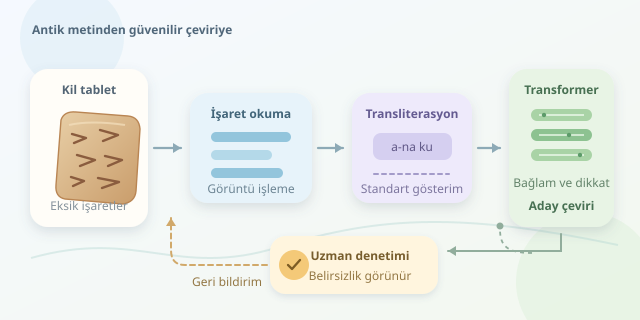

Binlerce yıllık bir kil tablette yazan alışveriş listesini yapay zekaya okutmak, tarihle sohbet etmek gibi görünebilir. Ancak antik dillerin otomatik çevirisi, sihirli bir sözlükten çok daha karmaşıktır. Eksik işaretler, az sayıda örnek ve değişken yazım alışkanlıkları arasında modeller, dilbilimcilerin rehberliğinde geçmişin cümlelerini modern dillere taşımayı öğrenir.




``

## Önce işaretleri okumak, sonra anlamı çevirmek

Antik metinlerle çalışırken üç işi ayırmak gerekir: görüntüdeki işaretleri tanımak, bunları standart bir gösterime aktarmak ve ortaya çıkan metni çevirmek. Örneğin çivi yazılı bir tabletin fotoğrafından işaret çıkarmak görüntü işleme problemidir; transliterasyon ise işaretleri Latin harfli bir gösterimle yazmaktır. Çeviri, bu gösterimin anlamını Türkçe gibi bir hedef dilde ifade eder.

Akadca gibi önemli ölçüde çözümlenmiş dillerde uzman çevirileri eğitim verisi olabilir. Buna karşılık Linear A gibi henüz çözümlenmemiş yazılarda, yalnızca güçlü bir model kullanarak güvenilir çeviri üretmek mümkün değildir. Model örüntü bulabilir; fakat örüntü, anlamın kanıtı değildir.

## Modelin öğrendiği şey nedir?

Makine çevirisi, kaynak metin $x$ verildiğinde uygun hedef metin $y$ için $P(y\mid x)$ olasılığını öğrenmeye çalışır. Transformer mimarisindeki dikkat mekanizması, bir sözcüğü yorumlarken cümlenin başka bölümlerindeki ipuçlarına ağırlık verir. Böylece birbirinden uzak duran özne, fiil ve ekler arasındaki ilişkiler yakalanabilir.

| Yaklaşım | Güçlü tarafı | Antik metinlerde zorluğu |
|---|---|---|
| Kural tabanlı sistem | Dilbilgisi kararları açıklanabilir | Kuralları uzmanlar hazırlamalıdır |
| İstatistiksel çeviri | Paralel örneklerden eşleşme öğrenir | Az veriyle kapsamı daralır |
| Transformer | Bağlamı ve uzun ilişkileri modeller | Akıcı ama yanlış sonuç üretebilir |
| Bayt tabanlı model | Farklı karakter gösterimlerini işler | Diziler uzar, hesaplama maliyeti artar |

Bayt tabanlı olmak, antik dili zaten bilmek anlamına gelmez. Yalnızca alışılmadık karakterleri temsil etmeyi kolaylaştırır; dilsel anlam yine uygun örneklerden öğrenilir.

## Asıl hazine: düzgün hazırlanmış veri

Eğitim için kaynak metin ile uzman çevirisinin eşleştirildiği paralel bir derlem gerekir. Tablet numarası, dönem, tür ve hasarlı bölümler de kaydedilmelidir. Bir hukuk belgesiyle bir dua aynı sözcüğü farklı anlamlarda kullanabilir.

Az veri olduğunda aktarım öğrenmesi devreye girer: önceden eğitilmiş bir model, antik dilin örnekleriyle ince ayarlanır. Tek dilli metinlerle ek ön eğitim ve sözlük destekli yöntemler de yardımcı olabilir. Sentetik çeviriler veri miktarını artırabilir, ancak hataları çoğaltabileceğinden uzman kontrolü gerektirir.

Eğitim kaybı şöyle gösterilebilir:

$$\mathcal{L}=-\sum_{t=1}^{T}\log P_\theta(y_t\mid y_{<t},x)$$

Burada $T$ hedef dizinin uzunluğu, $\theta$ model parametreleridir. Model, kaynak metni ve hedef cümlenin önceki parçalarını kullanarak sıradaki parçayı tahmin eder. Doğru parçaya düşük olasılık verirse kayıp yükselir. Eğitim, bu cezayı azaltacak parametreleri arar; tarihsel doğruluğu doğrudan ölçmez.

## Küçük bir ince ayar örneği

Aşağıdaki Python kodu, `transformers`, `datasets` ve `accelerate` paketleriyle çalışır. JSONL dosyalarının her satırında transliterasyon içeren `source` ve uzman çevirisi içeren `target` alanları bulunmalıdır. ByT5 başlangıç modelidir; hazır bir antik dil çevirmeni değildir.

```python
from datasets import load_dataset
from transformers import (
    AutoTokenizer, AutoModelForSeq2SeqLM,
    DataCollatorForSeq2Seq, Seq2SeqTrainer,
    Seq2SeqTrainingArguments,
)

name = "google/byt5-small"
tokenizer = AutoTokenizer.from_pretrained(name)
model = AutoModelForSeq2SeqLM.from_pretrained(name)
raw = load_dataset("json", data_files={
    "train": "train.jsonl",
    "validation": "validation.jsonl",
})

def prepare(batch):
    return tokenizer(
        batch["source"], text_target=batch["target"],
        truncation=True, max_length=512,
    )

data = raw.map(prepare, batched=True,
               remove_columns=raw["train"].column_names)
args = Seq2SeqTrainingArguments(
    output_dir="antik-model",
    per_device_train_batch_size=2,
    gradient_accumulation_steps=8,
    learning_rate=5e-5, num_train_epochs=3,
    eval_strategy="epoch",
)
trainer = Seq2SeqTrainer(
    model=model, args=args,
    train_dataset=data["train"],
    eval_dataset=data["validation"],
    data_collator=DataCollatorForSeq2Seq(tokenizer, model=model),
)
trainer.train()
trainer.save_model("antik-model")
tokenizer.save_pretrained("antik-model")
```

Hazırlama fonksiyonu metinleri sayısal dizilere dönüştürür. Veri düzenleyici, farklı uzunlukları aynı partiye sığdırır ve hedefteki doldurma konumlarını kayıptan dışlar. Uzun belgeler kesilebileceğinden, eğitimden önce anlamlı parçalara ayrılmalıdır.

## Akıcılık doğruluk değildir

BLEU ve chrF gibi ölçüler, çıktıyı referans çevirilerle karşılaştırır; fakat anlam doğruluğunu tek başına garanti etmez. Özellikle olumsuzluk, kişi adları ve miktarlar uzmanlarca denetlenmelidir. Aynı tabletin parçalarını eğitim ve test kümelerine dağıtmak veri sızıntısı yaratabilir; ayırma belge düzeyinde yapılmalıdır.

Sonuçlarda hasarlı bölümler ve alternatif okumalar görünür tutulmalıdır. Yapay zekanın en değerli rolü, araştırmacıya aday çeviriler sunup tekrar eden işleri hızlandırmaktır. Geçmişin sesini anlaşılır kılabilir; ama kırık bir tabletin sustuğu yerde kendinden emin bir hikaye uydurmamalıdır.
