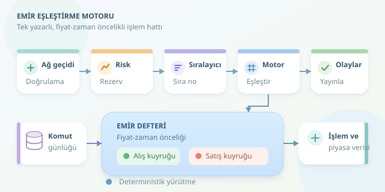

Bir kripto borsasında “Al” düğmesine bastığınızda, arka planda dijital bir müzayede başlar. Ancak tokmak tutan bir görevli yoktur: Binlerce emri sıralayan, uygun karşı tarafı bulan ve işlemleri kaydeden bir eşleştirme motoru vardır. Bu motorun sırrı yalnızca hız değil, herkes için aynı kuralları uygulamasıdır.
``

## Önce Mantık: Emir Defteri Nedir?

Emir defteri, gerçekleşmeyi bekleyen alış ve satış emirlerini tutar. Alış tarafındaki en yüksek fiyat **en iyi alış**, satış tarafındaki en düşük fiyat ise **en iyi satış** olarak adlandırılır. Aralarındaki fark, yani spread:

$$s = P_{satış} - P_{alış}$$

Bir limit alış emri, ödemeye razı olduğunuz azami fiyatı belirtir. Limit satış emri ise kabul edeceğiniz asgari fiyatı söyler. Alıcının limiti satıcının fiyatına eşit veya yüksekse eşleşme mümkündür. Piyasa emri fiyat sınırı koymadan mevcut likiditeyi tüketir; büyük emirlerde bu nedenle kayma oluşabilir.

Örneğin satış defterinde 100 USDT’den iki, 101 USDT’den üç token bulunsun. Dört tokenlık, 101 USDT limitli alış emri önce iki tokenı 100’den, sonra iki tokenı 101’den alır. İşlem fiyatı, bu modelde defterde bekleyen emrin fiyatıdır.

## Kim Önce İşlem Görür?

Yaygın yaklaşım **fiyat-zaman önceliğidir**: Daha iyi fiyat önce gelir; aynı fiyatta daha önce kabul edilen emir önceliklidir. Bu yüzden her fiyat seviyesinde bir FIFO kuyruğu tutulabilir.

| Veri yapısı | Seviye ekleme/silme | Temel karşılık |
|---|---|---|
| Sıralı dizi | $O(L)$ | Basit yapı, kaydırma maliyeti |
| Dengeli arama ağacı | $O(\log L)$ | Dinamik fiyat seviyelerinde verimlilik |
| Sırasız sözlük | Ortalama $O(1)$ | En iyi fiyatı ayrıca bulmak gerekir |




Burada $L$, fiyat seviyesi sayısıdır. Ağaç kullanılan bir tasarımda en iyi seviyeye işaretçi tutulabilir; seviyenin içindeki kuyruk başını kaldırmak ise $O(1)$ maliyetlidir.

Fiyat ve miktarlar genellikle kayan noktalı sayılar yerine tam sayı olarak saklanır:

$$P = p \times tick, \qquad Q = q \times lot$$

Böylece yuvarlama sürprizleri yerine açık fiyat adımları ve miktar kuralları kullanılır.

## Milisaniyelik İşlem Hattı

Tipik akış şu istasyonlardan geçer:

1. **Ağ geçidi:** Kimlik doğrulama, mesaj biçimi ve hız sınırları kontrol edilir.
2. **Risk kontrolü:** Bakiye, minimum miktar ve fiyat adımı doğrulanır; gerekli varlık rezerve edilir.
3. **Sıralayıcı:** Kabul edilen emir ve iptal komutlarına kesin bir sıra numarası atanır.
4. **Motor:** Komutlar bu sırayla uygulanır; gerçekleşmeler ve defter değişiklikleri üretilir.

Aynı defteri birçok iş parçacığının gelişigüzel değiştirmesi yarış koşulları yaratır. Yaygın çözüm, her defter için tek yazarlı deterministik işlemektir. Ölçekleme farklı işlem çiftlerine dağıtılarak yapılabilir; birden fazla defter aynı süreçte de çalışabilir.

Önceliğin hakemi istemci saati değil, sunucunun kabul sırasıdır. Aksi hâlde bilgisayarının saatini değiştiren kullanıcı sırada öne geçmeye çalışabilir!

## Küçük Bir Eşleştirme Prototipi

Aşağıdaki Python kodu, önceden doğrulanmış bir limit alış emrini satış kuyruklarıyla eşleştirir:

```python
from collections import deque
from dataclasses import dataclass

@dataclass
class Order:
    oid: int
    price: int
    qty: int

def match_buy(limit, qty, asks):
    trades = []
    while qty > 0 and asks:
        price = min(asks)
        if price > limit:
            break
        queue = asks[price]
        maker = queue[0]
        filled = min(qty, maker.qty)
        trades.append((maker.oid, price, filled))
        qty -= filled
        maker.qty -= filled
        if maker.qty == 0:
            queue.popleft()
        if not queue:
            del asks[price]
    return trades, qty

asks = {
    10000: deque([Order(1, 10000, 2)]),
    10100: deque([Order(2, 10100, 3)]),
}
trades, remaining = match_buy(10100, 4, asks)
```

Fiyat adımı 0,01 USDT kabul edilirse `10000`, 100 USDT’yi temsil eder. Kod kısmi gerçekleşmeleri işler ve boş seviyeleri kaldırır. Ancak `min(asks)` her turda seviyeleri tarar: Bu bir öğretim örneğidir, üretim motoru değildir. Eşleşmeyen miktar, GTC limit emrinde alış defterine eklenir; IOC emrinde iptal edilir.

## Hız Yetmez: Çökünce Ne Olacak?

Motorun bellekte çalışması, kayıtların unutulabileceği anlamına gelmez. Komut günlüğü ve periyodik snapshot kullanılarak durum yeniden oluşturulur. Dışarıya kesin kabul veya işlem sonucu bildirilmeden önce gereken kalıcılık garantisi sağlanmalıdır. Günlük senkronizasyonu ve çoğaltma tercihleri gecikmeyi etkiler.

Yeniden oynatma aynı komutlardan aynı sonucu üretmelidir. Emir kimlikleriyle yinelenen istekler ayıklanır; piyasa verisi sıra numaralarıyla yayınlanır, kayıp mesajlar snapshot üzerinden tamamlanır. Bakiye muhasebesi de gerçekleşme olaylarını güvenilir biçimde işlemelidir.

Son olarak yalnızca ortalama gecikmeyi ölçmeyin: **p99 gecikmesi**, yoğunluk altında kuyruk büyümesi ve iptal performansı da önemlidir. İyi motor, hızlı bir çöpçatan olduğu kadar, sırası şaşmayan titiz bir muhasebecidir.
