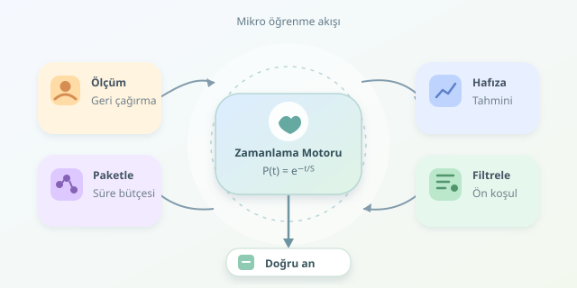

Telefonunuza gelen üç dakikalık bir ders, rastgele seçilmiş küçük bir bilgi paketi olmak zorunda değil. İyi bir mikro öğrenme platformu, neyi bildiğinizi ve neyi unutmak üzere olduğunuzu tahmin ederek içerik dağıtır. İşin sırrı yalnızca dersleri küçültmek değil, onları zihninizin ritmine göre zamanlamaktır.
``

## Kısa içerik neden tek başına yeterli değil?

Mikro öğrenme, bir öğrenme hedefini kısa ve odaklı etkinliklere böler. Ancak kısa olmak, otomatik olarak öğretici olmak anlamına gelmez. Bir dakikalık videoyu izlemekle aynı bilgiyi yardım almadan hatırlamak farklı şeylerdir.

Burada iki eğriyi ayırmak gerekir: **Öğrenme eğrisi**, pratik arttıkça performansın nasıl geliştiğini; **unutma eğrisi**, tekrar yapılmadığında hatırlamanın zamanla nasıl azaldığını gösterir. Dağıtım algoritması ikisini birlikte değerlendirmelidir.

Örneğin kullanıcı döngü sorularını hızla çözüyorsa daha zor bir uygulamaya geçebilir. Aynı kullanıcı önceki sözdizimini unutuyorsa yeni konu yerine kısa bir hatırlama sorusu daha faydalı olabilir. Hedef, sürekli yeni içerik sunmak değil, kullanılabilir bilgiyi büyütmektir.

## Hafızayı basit bir modelle temsil etmek

Başlangıç için hatırlama olasılığını şu yaklaşık modelle düşünebiliriz:

$$P(t)=e^{-t/S}$$

Burada $t$, son tekrardan beri geçen süre; $S$ ise bilginin hafızadaki dayanıklılığıdır. İkisi aynı zaman birimini kullanmalıdır. Büyük $S$, daha yavaş unutma anlamına gelir. Gerçek hafıza bundan karmaşıktır; bu denklem evrensel yasa değil, anlaşılır bir mühendislik yaklaşımıdır.

Tekrarı hedef olasılık $p_*$ seviyesinde yapmak istersek:

$$t_*=-S\ln(p_*)$$

Örneğin $S=6$ gün ve $p_*=0.85$ için tekrar yaklaşık $0.98$ gün sonra planlanır. Hedef olasılık yükseldikçe tekrarlar sıklaşır; öğrenme yükü de artar. Yani algoritmanın elinde bedava bir hafıza sihirbazı yoktur!

| Yaklaşım | Zamanlama mantığı | Temel sınır |
|---|---|---|
| Sabit takvim | Her gün aynı aralık | Bireysel farkları kaçırır |
| Aralıklı tekrar | Hatırlama tahminine göre | İyi ölçüm gerektirir |
| Uyarlanabilir akış | Hafıza, zorluk ve bütçe birlikte | Daha karmaşıktır |

## Dağıtım algoritmasının karar zinciri

Platform, yalnızca içerik değil, **kullanıcı–beceri–içerik ilişkisi** tutmalıdır. Aynı kullanıcı iki konuda farklı dayanıklılığa sahip olabilir.

1. **Ölç:** İzleme tamamlanmasını değil, kısa bir geri çağırma sorusunu değerlendir.
2. **Güncelle:** Doğruluk, önceki tekrarlar ve geçen süreyle hafıza tahminini yenile.
3. **Filtrele:** Ön koşulları karşılanmamış veya erişilebilir olmayan içerikleri çıkar.
4. **Sırala:** Tekrarı gelen kartları, öğrenme hedeflerini ve beklenen kazanımı birlikte değerlendir.
5. **Paketle:** Seçimi günlük süre bütçesine sığdır; örneğin sekiz dakikaya.

Tepki süresi yardımcı sinyaldir, fakat tek başına başarı ölçüsü değildir. Yavaş okuyan kullanıcıyı bilgisiz saymak, algoritmanın kendi sınavından kalmasıdır.

## Python ile küçük bir zamanlama motoru

Aşağıdaki fonksiyon, soru sonucundan sonra dayanıklılığı günceller ve sonraki tekrar zamanını üretir. `kart`, gün cinsinden `S` değerini içeren bir sözlüktür; `simdi` ise bir `datetime` nesnesidir.

```python
import math
from datetime import timedelta


def tekrar_planla(kart, dogru, simdi, hedef=0.85):
    if not 0 < hedef < 1:
        raise ValueError("Hedef 0 ile 1 arasında olmalı")

    katsayi = 1.35 if dogru else 0.60
    yeni_s = min(180.0, max(0.5, kart["S"] * katsayi))
    aralik = -yeni_s * math.log(hedef)

    return {
        **kart,
        "S": yeni_s,
        "son_tekrar": simdi,
        "sonraki_tekrar": simdi + timedelta(days=aralik),
    }
```

Doğru cevap aralığı büyütür; yanlış cevap küçültür. Alt ve üst sınırlar aşırı değerleri engeller. Ancak katsayılar **örnek sezgisellerdir**; bilimsel olarak doğrulanmış kişisel parametreler değildir. Üretimde geçmiş denemelerle kalibre edilmelidir. Yanlış cevaptan sonra açıklayıcı geri bildirim hemen verilmeli, sonraki kalıcı tekrar ayrıca planlanmalıdır.

## Başarıyı tıklamayla karıştırmayın

Zamanı gelen bütün kartları aynı anda göndermek kullanıcıyı bildirim yağmuruna tutar. Bu nedenle zamanlayıcı, tekrar ihtiyacını belirlerken dağıtım katmanı sessiz saatleri, günlük bütçeyi ve konu çeşitliliğini gözetmelidir. Geciken içerikler kuyrukta önceliklendirilebilir; hatırlama tahmini geçen süreyle yeniden hesaplanır.

Başarı ölçümü de uzun vadeli olmalıdır: Bir hafta sonraki hatırlama, yeni sorulara transfer, tamamlanan hedefler ve kullanıcı yükü birlikte izlenebilir. A/B testlerinde yalnızca tıklama oranına bakmak, eğlenceli ama öğretmeyen içerikleri ödüllendirebilir. Kullanıcı verilerini gereğinden fazla toplamak da kişiselleştirmenin zorunlu bedeli değildir.

Kısacası iyi mikro öğrenme, bilgiyi küçük lokmalara bölmekten fazlasıdır: Her lokmayı doğru zamanda sunar, gerçekten sindirilip sindirilmediğini ölçer ve menüyü buna göre değiştirir.
