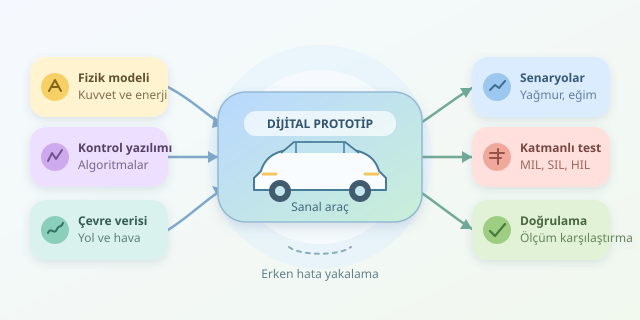

Henüz fabrikada tek bir vidası sıkılmamış bir otomobil düşünün: Yağmurda fren yapıyor, yokuşta hızlanıyor ve sensör arızasıyla karşılaşıyor. Üstelik hiçbir tampon zarar görmüyor! Dijital ikiz yaklaşımı, mühendislerin yeni bir aracın davranışını sanal ortamda incelemesini sağlar. Ancak mesele güzel bir üç boyutlu modelden çok daha fazlasıdır.
``

## Dijital ikiz gerçekten nedir?

Dijital ikiz, fiziksel bir sistemin davranışını temsil eden, verilerle güncellenebilen sayısal karşılığıdır. Araç geliştirmede mekanik yapı, elektronik bileşenler, kontrol yazılımları ve çevre koşulları birlikte modellenir. Böylece yalnızca parçalar değil, parçaların birbirini nasıl etkilediği de araştırılır.

Burada önemli bir ayrım var: Yeni araç henüz üretilmediyse onun gerçek kullanım verisi de yoktur. Bu aşamadaki yapı, daha doğru ifadeyle bir **dijital prototip** veya dijital ikizin geliştirme temelidir. Önceki araçlardan, bileşen deneylerinden ve tedarikçi ölçümlerinden yararlanılır. Fiziksel araç ortaya çıktığında ölçümlerle bağlantı kurularak model güncellenir; ikiz olgunlaşır.

## Sanal aracın arkasındaki fizik

Bir otomobilin ileri hareketi, kuvvetlerin toplamıyla açıklanabilir:

$$m a = F_{çekiş} - F_{hava} - F_{yuvarlanma} - F_{eğim}$$

Burada $m$ kütle, $a$ ivmedir. Hava direnci yaklaşık olarak hızın karesiyle büyür. Dolayısıyla otoyolda hız artışı, enerji tüketimini beklenenden fazla yükseltebilir. Simülasyon, bu ilişkileri zaman adımları boyunca hesaplar.

Modelin ayrıntı seviyesi soruya göre seçilir. Menzil tahmini için enerji akışları önemliyken, ani şerit değişiminde lastik kuvvetleri ve gövde hareketleri belirleyicidir. Her şeyi en ince ayrıntısıyla modellemek, hesaplama süresini gereksizce uzatabilir. İyi model, en karmaşık olan değil, hedef soruyu yeterli doğrulukla cevaplayandır.

## Testler hangi katmanlarda yapılır?

Sanal test süreci tek bir yazılımı çalıştırmaktan ibaret değildir. Geliştirme ilerledikçe gerçek bileşenler kontrollü biçimde sisteme katılır:

| Yaklaşım | Test edilen unsur | Temel avantaj |
|---|---|---|
| Model-in-the-Loop | Kontrol algoritmasının modeli | Erken tasarım karşılaştırması |
| Software-in-the-Loop | Gerçek kontrol yazılımı | Kod davranışını inceleme |
| Hardware-in-the-Loop | Gerçek elektronik kontrol ünitesi | Zamanlama ve arayüz testi |

Son yaklaşımda tüm otomobil gerekmez. Gerçek kontrol ünitesi, aracı ve çevreyi taklit eden gerçek zamanlı simülatöre bağlanabilir. Böylece fiziksel araç prototipi olmadan donanım-yazılım etkileşimi sınanır.

## Senaryo üretmek: Sanal pistin gizli gücü

Mühendisler önce ölçülebilir gereksinimler tanımlar: Belirli hızda durma mesafesi, batarya sıcaklığı veya direksiyon tepkisi gibi. Ardından hız, yol tutuşu, yük ve sensör gecikmesi değiştirilerek senaryo matrisi oluşturulur.

Normal sürüş yeterli değildir. Islak zemin, düşük batarya seviyesi ve geciken fren komutu aynı anda denenebilir. Parametre taramaları ve Monte Carlo örneklemesi, tek bir testin gizlediği sınır durumlarını arar. Ancak rastgele çok test yapmak, önemli senaryoların kapsandığını tek başına kanıtlamaz.

## Python ile küçük bir fren deneyi

Aşağıdaki örnek, hız ve yol tutuşu kombinasyonlarında durma mesafesini hesaplar. Tepki gecikmesinde araç sabit hızla ilerler; ardından sınırlı, sabit yavaşlama uygulanır.

```python
from dataclasses import dataclass
from itertools import product

@dataclass(frozen=True)
class Scenario:
    speed_kmh: float
    friction: float
    delay_s: float

def stopping_distance(s: Scenario, dt=0.01):
    speed = s.speed_kmh / 3.6
    distance = speed * s.delay_s
    deceleration = min(6.0, s.friction * 9.81)

    while speed > 0:
        step = min(dt, speed / deceleration)
        next_speed = max(0.0, speed - deceleration * step)
        distance += (speed + next_speed) * step / 2
        speed = next_speed

    return distance

for values in product([50, 90], [0.35, 0.8], [0.2, 0.6]):
    scenario = Scenario(*values)
    distance = stopping_distance(scenario)
    status = "İNCELE" if distance > 65 else "SINIR İÇİNDE"
    print(scenario, round(distance, 1), status)
```

`dataclass` senaryoları düzenler; `product` tüm kombinasyonları üretir. Ortalama hızla yapılan entegrasyon mesafeyi toplar. Son adımın kısaltılması, duruş anını aşmayı önler. Buradaki 65 metre yalnızca örnek inceleme eşiğidir; mevzuat sınırı değildir.

Bu oyuncak model; eğimi, lastik sıcaklığını, ABS davranışını ve fren kuvvetinin oluşma süresini içermez. Basitleştirilmiş sonuçlar, gerçek aracın güvenliğini kanıtlamaz.

## Sonuçlara ne zaman güvenebiliriz?

Önce modelin ve sayısal çözümün doğru uygulanması kontrol edilir; ardından tahminler bağımsız ölçümlerle karşılaştırılır. Bileşen testleri ve benzer araç verileri başlangıçta yardımcı olur. Yeni fiziksel prototip çıktığında doğrulama genişletilir.

Parametre belirsizliği de raporlanmalıdır: Tek bir durma mesafesi yerine olası aralıkları görmek daha değerlidir. Simülasyon, fiziksel test ihtiyacını azaltabilir; güvenlik değerlendirmelerinin ve gerekli onay süreçlerinin yerini otomatik olarak alamaz.

Dijital ikizin asıl kazancı, hataları metal kesilmeden yakalamaktır. Sanal pistte bulunan bir tasarım sorunu, üretim hattında bulunan aynı sorundan çok daha ucuz bir sürprizdir!



