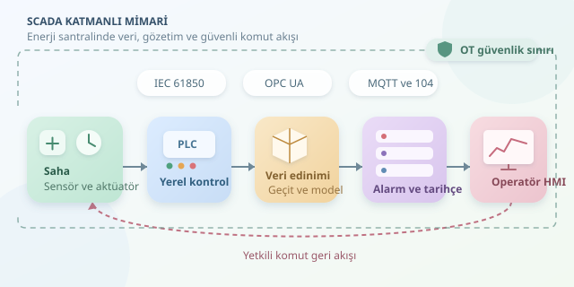

Bir enerji santralini uzaktan yönetmek, bilgisayar ekranından birkaç düğmeye basmaktan çok daha fazlasıdır. Türbinler, jeneratörler ve kesiciler aynı orkestranın üyeleridir; SCADA ise operatörün bu orkestrayı duymasını ve yönlendirmesini sağlar. Ancak burada yanlış nota, yalnızca kulağı değil, üretimi de etkileyebilir!

``

## SCADA neyi kontrol eder?

SCADA, *Supervisory Control and Data Acquisition* ifadesinin kısaltmasıdır: gözetleyici kontrol ve veri toplama. Temel görevleri ölçümleri toplamak, durumları görselleştirmek, alarm üretmek ve yetkilendirilmiş komutları sahaya iletmektir.

Kritik ayrım şudur: hızlı kontrol döngüleri genellikle PLC veya yerel kontrolörlerde çalışır. SCADA, bunların üzerinde gözetleyici bir katmandır. Türbinin milisaniyelik tepkisini uzak sunucuya bırakmak, reflekslerinizi görüntülü toplantıyla yönetmeye benzer. Haberleşme kesildiğinde yerel kontrol ve bağımsız koruma sistemleri görevlerini sürdürebilmelidir.

## Katmanlar ve veri yolculuğu

Tipik mimari, saha cihazlarından kontrolörlere, haberleşme ağından merkezi servislere ve operatör ekranlarına uzanır. Her katmanın sorumluluğunu ayırmak, bakım sırasında bütün santrali yazılımsal bir domino gösterisine çevirmeyi önler.

| Katman | Bileşenler | Temel sorumluluk |
|---|---|---|
| Saha | Sensör, sayaç, aktüatör | Ölçüm ve fiziksel işlem |
| Yerel kontrol | PLC, RTU | Kontrol mantığı ve saha haberleşmesi |
| Veri edinimi | Sürücü, protokol geçidi | Ölçümleri ortak modele dönüştürme |
| Uygulama | Alarm servisi, tarihçi | Değerlendirme ve kalıcı kayıt |
| Sunum | HMI, raporlama | Operatöre anlaşılır görünürlük |




OPC UA yapılandırılmış veri alışverişinde; IEC 60870-5-104 ve DNP3 telekontrolde; IEC 61850 ise özellikle trafo merkezi otomasyonunda kullanılır. MQTT, uygun geçitlerle üst katmanlara telemetri taşımada yararlıdır; bu protokollerin yerine otomatik olarak geçmez. Seçim, mevcut cihazlara ve işletme gereksinimlerine bağlıdır.

## Değer tek başına yeterli değildir

“Güç: 80 MW” bilgisi eksiktir. Ölçümün hangi noktadan geldiği, kaynak zamanı, birimi ve kalite durumu da bilinmelidir. Eski fakat düzgün görünen veri, açıkça hatalı veriden daha yanıltıcı olabilir.

Bu nedenle veri edinim katmanı ortak bir olay modeli üretir. Alarm servisi kuralları değerlendirir; tarihçi zaman serilerini saklar; HMI güncel görünümü sunar. Mesaj kuyruğu bileşenleri gevşek bağlayabilir, fakat sınırsız tampon değildir. Yoğunlukta ekran güncellemeleri birleştirilebilirken kritik alarm ve denetim kayıtları için kayıp politikası açıkça tanımlanmalıdır.

## Küçük bir telemetri işleyicisi

Aşağıdaki Python örneği, canlı ekran için gecikmiş, kalitesi düşük ve sırası bozulmuş ölçümleri ayıklar. Giriş katmanının zamanları UTC'ye, değerleri ortak birime dönüştürdüğü varsayılır. Eşik yalnızca örnektir; gerçek saha ayarı değildir.

```python
from dataclasses import dataclass
from datetime import datetime, timezone

@dataclass(frozen=True)
class Reading:
    tag: str
    value: float
    timestamp: datetime
    quality: str

latest: dict[str, Reading] = {}
limits = {'generator.active_power': 85.0}

def process(reading: Reading) -> str:
    age = (datetime.now(timezone.utc) - reading.timestamp).total_seconds()
    if reading.quality != 'GOOD' or not 0 <= age <= 10:
        return 'Geçersiz veya gecikmiş ölçüm'

    previous = latest.get(reading.tag)
    if previous and reading.timestamp <= previous.timestamp:
        return 'Tekrarlanan veya eski ölçüm'

    latest[reading.tag] = reading
    limit = limits.get(reading.tag)
    if limit is not None and reading.value > limit:
        return 'Alarm adayı'
    return 'Normal'
```

`latest`, her ölçüm noktasının son kabul edilen kaydını tutar. Bu örnek koruma sistemi değildir ve ham olayların tarihçiye ayrıca yazılmasını engellememelidir. Üretimde eşzamanlı erişim, yeniden başlatma ve durumun kalıcılığı ayrıca tasarlanır. Alarm motorunda histerezis ve süre koşulları kullanılması, eşik çevresindeki dalgalanmanın sürekli alarm üretmesini önler.

## Kesintiye dayanıklılık ve güvenlik

Basitleştirilmiş kullanılabilirlik modeli şöyledir:

$$A = \frac{MTBF}{MTBF + MTTR}$$

Burada MTBF arızalar arasındaki ortalama süreyi, MTTR ortalama onarım süresini ifade eder. MTBF 1000 saat, MTTR 1 saat olduğunda kullanılabilirlik yaklaşık yüzde 99,90'dır. Yedeklilik faydalıdır; ancak iki sunucunun aynı anda komut göndermemesi için liderlik ve bölünmüş ağ senaryoları tasarlanmalıdır.

Uzaktan erişim, internete açık bir HMI adresi demek değildir. OT/IT ayrımı, endüstriyel DMZ, kontrollü erişim geçitleri, çok faktörlü kimlik doğrulama ve rol tabanlı yetkilendirme birlikte düşünülmelidir. Komutlar yetki, ekipman durumu ve işletme kilitlemeleri açısından doğrulanmalı; kimlik, zaman ve sonuç denetim kaydına yazılmalıdır.

Son sınav, gösterişli ekran değil, arıza senaryosudur. Bağlantı kopması, saat sapması, kuyruk taşması ve sunucu değişimi simülasyonda denenmelidir. İyi SCADA mimarisi yalnızca çalışırken değil, işler ters gittiğinde de anlaşılır ve kontrollü davranır.
