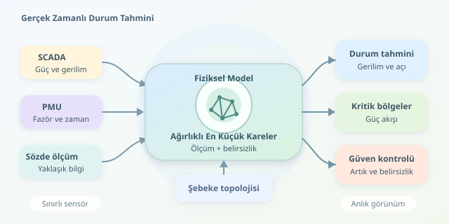

Bir elektrik şebekesindeki her noktaya sensör yerleştirmek pahalıdır; üstelik sensörler bile bazen yanlış konuşur! Buna rağmen operatörlerin gerilimleri, güç akışlarını ve kritik bölgeleri anlık olarak görmesi gerekir. Durum tahmini, sınırlı ölçümleri şebekenin fiziksel modeliyle birleştirerek bu resmi tamamlar. Ancak yaptığı şey sihirli bir veri doldurma işlemi değil, belirsizlik altında tutarlı bir durum bulmaktır.

``

## Şebekenin “durumu” tam olarak nedir?

Alternatif akım şebekelerinde temel durum değişkenleri, baraların gerilim büyüklükleri ve faz açılarıdır. Bir baranın açısını referans olarak sıfır seçersek, $n$ baralı sistemde genellikle $2n-1$ bilinmeyen kalır:

$$x=[\theta_2,\ldots,\theta_n,v_1,\ldots,v_n]^\top$$

Hat empedansları, trafo özellikleri ve bağlantı durumları kullanılarak admitans matrisi $Y$ oluşturulur. Karmaşık gerilim vektörü $U$ için bara güç enjeksiyonları şu fiziksel ilişkiye uyar:

$$S_i=U_i\overline{(YU)_i}$$

Buradaki $S_i=P_i+jQ_i$, aktif ve reaktif gücü birlikte temsil eder. Böylece ölçülmeyen büyüklükler de tahmin edilen gerilimlerden hesaplanabilir. Model, sensörler arasındaki fiziksel bağdır: Bir baradaki değişiklik komşularından tamamen bağımsız davranamaz.

## Ölçümleri aynı masaya oturtmak

Ölçüm modeli $z=h(x)+e$ biçimindedir. $z$ sensör verilerini, $h$ fiziksel modeli, $e$ ise ölçüm hatalarını gösterir. Bağımsız, sıfır ortalamalı hatalar varsayılırsa ağırlıklı en küçük kareler problemi şöyledir:

$$\hat{x}=\arg\min_x\sum_i\left(\frac{z_i-h_i(x)}{\sigma_i}\right)^2$$

Küçük standart sapmalı ölçüm daha fazla ağırlık alır. Yani hassas sensörün sesi daha yüksek çıkar; ama diğerleri tamamen susturulmaz. Hatalar ilişkiliyse yalnızca standart sapmalar yerine tam kovaryans matrisi kullanılmalıdır.

| Veri kaynağı | Güçlü tarafı | Dikkat edilmesi gereken |
|---|---|---|
| SCADA | Yaygın güç ve gerilim ölçümleri | Güncelleme hızı ve zaman uyumu |
| PMU | Zaman eşlenmiş fazörler | İletişim gecikmesi ve kapsama |
| Sözde ölçüm | Eksik bölgeler için yaklaşık bilgi | Yüksek belirsizlik ve olası yanlılık |

Ölçüm sayısının bilinmeyen sayısını aşması tek başına yeterli değildir. Ölçüm Jacobianının sütunları bağımsız olmalıdır. Buna yerel gözlemlenebilirlik denir. Aynı bölgeye yığılmış çok sayıda sensör, başka bir bölgenin karanlıkta kalmasını engellemeyebilir. Sözde ölçümler boşlukları doldurabilir, fakat sonucu varsayımlara bağımlı hâle getirir.

## Python ile küçük bir şebeke dedektifi

Aşağıdaki örnek, kayıpsız ve eşit hatlı üç baralı bir şebekede beş durum değişkenini yedi gürültülü ölçümden tahmin eder. İki gerilim, iki aktif güç ve üç reaktif güç ölçülür. Büyüklükler ortak bazlara göre per-unit cinsindedir; gerçek veri yerine kontrollü sentetik veri kullanıyoruz.

```python
import numpy as np
from scipy.optimize import least_squares

Y = 1j * np.array([
    [-10, 5, 5],
    [5, -10, 5],
    [5, 5, -10]
])

def measurement_model(x):
    angles = np.r_[0.0, x[:2]]
    magnitudes = x[2:]
    voltage = magnitudes * np.exp(1j * angles)
    power = voltage * np.conj(Y @ voltage)
    return np.r_[magnitudes[:2], power[1:].real, power.imag]

truth = np.array([-0.04, -0.07, 1.02, 0.99, 0.98])
sigma = np.array([0.005, 0.005, 0.02, 0.02, 0.02, 0.02, 0.02])
rng = np.random.default_rng(7)
z = measurement_model(truth) + rng.normal(0, sigma)

result = least_squares(
    lambda x: (measurement_model(x) - z) / sigma,
    x0=[0, 0, 1, 1, 1],
    bounds=([-np.pi, -np.pi, 0.8, 0.8, 0.8],
            [np.pi, np.pi, 1.2, 1.2, 1.2])
)
if not result.success:
    raise RuntimeError(result.message)
if np.linalg.matrix_rank(result.jac) < 5:
    raise RuntimeError("Yerel gözlemlenebilirlik yetersiz")
print("Tahmin edilen durum:", result.x)
```

`measurement_model`, aday gerilimleri sensörlerin göreceği değerlere dönüştürür. Çözücü, standart sapmalarla ölçeklenmiş artıkların karelerini küçültür. Başlangıç noktası düz gerilim profilidir; sınırlar bu oyuncak örnekteki çalışma aralığını tanımlar. Jacobian kontrolü ise çözüm çevresinde ölçümlerin beş bilinmeyeni ayırt edip edemediğini sınar. Tam rank, iyi sayısal koşullanmayı veya küresel tekliği garanti etmez.

## Gerçek zamanlı olmak, geleceği bilmek değildir

Üretimde her döngüde zaman damgaları hizalanır, kesici durumları güncellenir ve önceki çözüm başlangıç olarak kullanılır. Büyük ölçüm artıkları bozuk sensörü düşündürebilir; ancak yanlış topoloji de benzer belirtiler üretir. Bu nedenle veriyi körlemesine silmek yerine normalize artık testleri ve model kontrolleri birlikte uygulanır.

Klasik yaklaşım, her zaman diliminde yaklaşık durağan bir fotoğraf çeker. Hızlı geçici olaylarda dinamik modeller ve Kalman filtresi ailesi gerekebilir. Durum tahmini tek başına kararlılığı garanti etmez: Gerilim kararlılığı değerlendirmesine, güvenlik analizlerine ve kontrol kararlarına güvenilir başlangıç verisi sağlar. İyi bir tahminci yalnızca “şebeke böyle” demez; “bu sonuca şu belirsizlikle güveniyorum” da diyebilmelidir.
