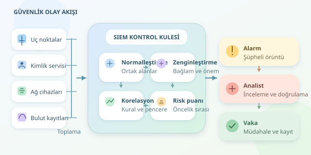

Kurumsal ağınızı dev bir havaalanı gibi düşünün: Kullanıcılar giriş yapıyor, sunucular konuşuyor, güvenlik duvarları geçişleri kontrol ediyor. Her hareket bir kayıt bırakıyor. Peki, binlerce kaydın içinden gerçekten tehlikeli olanı nasıl seçersiniz? SIEM, yani Güvenlik Bilgi ve Olay Yönetimi, bu kalabalığın merkezindeki dikkatli kontrol kulesidir.

``

## Önce kavramlar: Olay, alarm ve vaka

SIEM’in temel işi yalnızca log depolamak değildir. Farklı kaynaklardan gelen kayıtları ortak bir dilde birleştirir, aralarındaki ilişkileri araştırır ve analistin dikkatini önemli durumlara yönlendirir. Tek bir başarısız giriş genellikle sıradandır; aynı hesabın kısa sürede defalarca denenmesi ve ardından başarıyla açılması ise araştırılmaya değerdir.

| Kavram | Anlamı | Örnek |
|---|---|---|
| Olay | Kaydedilmiş tek hareket | Başarısız oturum açma |
| Alarm | Kuralın şüpheli bulduğu durum | Beş dakikada çok sayıda deneme |
| Vaka | Araştırma kapsamında birleştirilen bulgular | Şüpheli giriş ve sonraki veri aktarımı |




Bu ayrım önemlidir: Her olay alarm, her alarm da doğrulanmış saldırı değildir.

## Merkezi platformun veri yolculuğu

**Toplama:** Uç noktalar, kimlik servisleri, bulut uygulamaları ve ağ cihazları; ajanlar, Syslog veya API bağlantıları üzerinden kayıt gönderir. Aktarımda şifreleme, kaynak doğrulaması ve bağlantı kesintilerine karşı tamponlama gerekir.

**Normalleştirme:** Bir sistemin `source_address`, diğerinin `client_ip` dediği alan ortak bir `src_ip` alanına dönüştürülür. Zamanlar UTC’ye çevrilir; kullanıcı, eylem ve sonuç alanları standartlaştırılır.

**Zenginleştirme:** Kayda varlık kritiklik seviyesi, kullanıcı rolü veya tehdit istihbaratı eklenir. Böylece “bir giriş oldu” bilgisi, “kritik sunucuya alışılmadık bir giriş oldu” bağlamına kavuşur.

**Korelasyon:** Kurallar, zaman pencereleri ve davranış modelleri ilişkili kayıtları birleştirir. Kuyruklar ve dağıtık işlemciler, yoğun saatlerde veri akışının tıkanmasını önler.

Kapasite hesabı da işin teorik temelidir. Günlük ham veri yaklaşık $V=N \cdot r \cdot 86400 \cdot b$ ile hesaplanabilir. Burada $N$ kaynak sayısı, $r$ saniyelik olay sayısı, $b$ ortalama kayıt boyutudur. Bin kaynak, saniyede beş olay ve 500 baytlık kayıtlarla yaklaşık **216 GB/gün** üretir. İndeksler, kopyalar ve saklama süresi ayrıca değerlendirilmelidir.

## Önceliklendirme: En gürültülü değil, en riskli

Alarm sayısı başarı ölçütü değildir. Analiste sürekli önemsiz bildirim göndermek, güvenlik dünyasının “kurt var!” problemidir. Öncelik; davranışın şüpheliliği, hedef varlığın önemi ve bulgunun güvenilirliği birlikte değerlendirilerek belirlenir.

Öğretici bir model kullanalım: $R=\min(100,10F+10K)$. Burada $F$, beşle sınırlandırılmış başarısız giriş sayısı; $K$, 1–5 arasındaki varlık kritikliğidir. Bu puan bir saldırı olasılığı değil, inceleme sırasını belirleyen basit bir göstergedir.

## Python ile küçük bir korelasyon motoru

Aşağıdaki kod, aynı IP ve kullanıcı için beş dakika içinde en az beş başarısız girişten sonraki başarılı girişi işaretler. Girdi kayıtlarının doğrulanmış, zamanlarının aynı UTC ISO biçiminde ve kritikliklerinin 1–5 aralığında olduğu varsayılır.

```python
from collections import defaultdict, deque
from datetime import datetime, timedelta


def correlate(events):
    windows = defaultdict(deque)
    ordered = sorted(events, key=lambda e: e['timestamp'])

    for event in ordered:
        now = datetime.fromisoformat(event['timestamp'])
        key = (event['src_ip'], event['user'])
        failures = windows[key]

        while failures and now - failures[0] > timedelta(minutes=5):
            failures.popleft()

        if event['action'] == 'login_failed':
            failures.append(now)
        elif event['action'] == 'login_success' and len(failures) >= 5:
            count = min(len(failures), 5)
            risk = min(100, 10 * count + 10 * event['asset_criticality'])
            yield {'user': event['user'], 'source': event['src_ip'],
                   'risk': risk}
            failures.clear()
```

`deque`, pencere dışındaki kayıtların verimli temizlenmesini sağlar; `yield`, sonuçları tek tek üretir. Başarıdan sonra pencerenin temizlenmesi tekrarlayan bildirimleri azaltır. Ancak parola hatırlama çabası da aynı örüntüyü oluşturabilir: Alarm, suçun kanıtı değildir!

## Üretimde işler biraz daha ciddileşir

| Prototip yaklaşımı | Üretim gereksinimi |
|---|---|
| Bellekte tutulan kayıtlar | Kalıcı durum ve yatay ölçekleme |
| Basit zaman sıralaması | Geciken olaylar için tolerans |
| Tek eşik | Kullanıcı ve varlık bazlı davranış çizgisi |
| Tekrarsız veri varsayımı | Olay kimliğiyle mükerrer kayıt ayıklama |

Kuralların sürümlenmesi, test edilmesi ve gerçek vakalarla ölçülmesi gerekir. Yanlış pozitif oranı, algılama gecikmesi ve analistin inceleme süresi birlikte izlenmelidir. Eksik log kaynakları da görünür olmalıdır; sessizlik her zaman güvenlik anlamına gelmez.

Son olarak, erişimleri sınırlandırın; hassas verileri maskeleyin ve saklama sürelerini belirleyin. SIEM, SOAR aracılığıyla müdahaleyi başlatabilir; fakat hesap kapatma gibi etkili işlemlerde onay mekanizması önemlidir. İyi SIEM, en çok bağıran değil, doğru anda doğru soruyu soran sistemdir.
