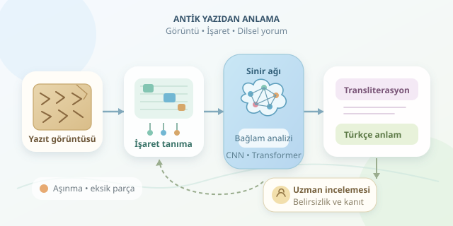

Bir müzedeki kil tableti düşünün: çatlaklar, silinmiş köşeler ve birbirine benzeyen onlarca işaret… Yanında da bir Mısır yazıtı: kuşlar, gözler, kıvrımlı çizgiler. İnsan gözü için büyüleyici, bilgisayar için oldukça çetin bir bulmaca! Derin öğrenme, bu görüntüleri işaret dizilerine, ardından dilsel yorumlara dönüştürmeye yardımcı oluyor. Ancak antik metinleri okumak, telefondaki fotoğrafı otomatik çevirmek kadar kolay değil.




``

## Önce üç farklı işi ayıralım

“Çözümleme” sözcüğü, aslında farklı görevleri aynı torbaya dolduruyor. **Tanıma**, görüntüdeki işareti belirler; **transliterasyon**, işaretleri bilimsel bir gösterime aktarır; **çeviri** ise anlamı başka bir dilde ifade eder. Bunları birbirine karıştırırsak, bir kuş çizimini tanıyan modeli firavunun özel tercümanı sanabiliriz.

| Aşama | Girdi | Beklenen çıktı |
|---|---|---|
| İşaret tanıma | Tablet veya yazıt görüntüsü | İşaret kimlikleri |
| Transliterasyon | İşaret dizisi | Latin harfli bilimsel gösterim |
| Çeviri | Dilsel olarak yorumlanan metin | Türkçe gibi hedef dilde anlam |

Üstelik çivi yazısı bir dil değildir; Sümerce ve Akadca gibi farklı dillerin yazımında kullanılmıştır. Mısır hiyeroglifleri de yalnızca resimlerden oluşmaz: sesleri, sözcükleri ve anlam kategorilerini belirten işaretler birlikte çalışır.

## Görüntüden işarete: Dijital kazı başlıyor

İlk adım, kaliteli görüntü ve uzman etiketleri toplamaktır. Fotoğraflar, üç boyutlu yüzey taramaları veya farklı ışıklandırmalar, aşınmış izleri görünür kılabilir. Ardından yazı alanları ve işaret grupları belirlenir.

CNN modelleri yerel kenar ve biçimleri öğrenirken, Vision Transformer modelleri görüntünün daha geniş bağlamını değerlendirebilir. Komşu işaretler, tek başına belirsiz görünen bir şeklin tanınmasına yardımcı olur.

Ancak sayfa düzeni önemlidir: hiyeroglifler yatay bir metin satırı gibi davranmayabilir; okuma yönü ve işaret grupları ayrıca çözülmelidir. Veri artırmada rastgele yansıtma yapmak da yön bilgisini veya etiketlerin geçerliliğini bozabilir. Antik yazıt, gelişigüzel çevrilecek bir kedi fotoğrafı değildir!

## İşaretleri anlamla buluşturmak

Görsel tanımadan sonra sıra dil modeline gelir. Aynı çivi yazısı işareti farklı bağlamlarda farklı ses veya sözcük değerleri taşıyabilir. Hiyerogliflerdeki belirleyiciler ise okunacak bir ses eklemeden anlam sınıfını daraltabilir.

Transformer tabanlı modeller, transliterasyon ile çeviri arasında eşleştirilmiş örneklerden öğrenebilir. Temel hedef, kaynak dizi $s$ verildiğinde hedef çeviri $t$ için $P(t\mid s)$ olasılığını modellemektir. Fakat eğitim verileri çoğunlukla sınırlı, dönemlere göre değişken ve uzman yorumlarına bağımlıdır.

Bu nedenle eksik bir bölümün tamamlanması, doğrudan okunmuş metinle aynı şey değildir. Modelin tahmini, yayında açıkça tahmin olarak işaretlenmelidir.

## Küçük bir PyTorch deneyi

Aşağıdaki örnek, önceden satırlara ayrılmış görüntüler için basitleştirilmiş bir tanıyıcıdır. Veri yükleyicisinin `images`, birleştirilmiş işaret etiketleri `targets`, etiket uzunlukları `target_lengths` ve sınıf sayısı `vocab_size` sağladığını varsayar. Sıfır numaralı sınıf, CTC için ayrılmıştır.

```python
import torch
from torch import nn

cnn = nn.Sequential(
    nn.Conv2d(1, 64, 3, padding=1),
    nn.ReLU(),
    nn.MaxPool2d(2)
)
rnn = nn.LSTM(64, 64, bidirectional=True)
head = nn.Linear(128, vocab_size)

# images boyutu: [parti, kanal, yükseklik, genişlik]
features = cnn(images).mean(dim=2).permute(2, 0, 1)
sequence, _ = rnn(features)
log_probs = head(sequence).log_softmax(dim=-1)
input_lengths = torch.full(
    (images.size(0),), log_probs.size(0), dtype=torch.long
)
loss = nn.CTCLoss(blank=0)(
    log_probs, targets, input_lengths, target_lengths
)
loss.backward()
```

CNN görsel özellikleri çıkarır; çift yönlü LSTM komşuluk ilişkilerini işler. CTC, her işaretin görüntüdeki kesin konumu etiketlenmeden dizi öğrenmeyi sağlar. Buradaki boş sembol, sözcükler arasındaki boşluk değildir. Kod kaybı ve gradyanları hesaplar; tam eğitim için optimizasyon döngüsü gerekir.

## Başarıyı nasıl ölçeriz?

İşaret tanımada $SER=\frac{S+D+I}{N}$ kullanılabilir. Burada $S$ değiştirme, $D$ silme, $I$ ekleme hatalarıdır; $N$ referanstaki işaret sayısıdır. Çeviride otomatik puanlar yararlıdır, fakat tarihsel anlam doğruluğunu tek başına ölçmez.

| Risk | Daha güvenilir yaklaşım |
|---|---|
| Aynı tabletin parçalarının iki kümeye dağılması | Eser bazında eğitim/test ayrımı |
| Nadir işaretlerde başarısızlık | İşaret bazında hata analizi |
| Akıcı ama yanlış çeviri | Filolojik uzman incelemesi |

Farklı dönem ve koleksiyonlarda test yapmak da modelin gerçekten genelleme yapıp yapmadığını gösterir. Belirsiz okumalar, alternatifler ve kaynak görüntüler birlikte sunulmalıdır.

Sonuçta yapay zeka, henüz çözülememiş her dili kendiliğinden açan sihirli bir anahtar değildir. En güçlü rolü, uzmanların işaretleri daha hızlı karşılaştırmasını ve olası okumaları araştırmasını sağlamaktır. Sinir ağı önerir; tarihsel bağlam ve filolojik kanıt son sözü söyler.
