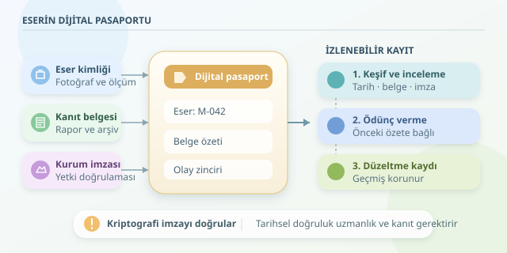

Bir Osmanlı çinisinin müzeye ulaşmadan önce hangi koleksiyonlardan geçtiğini düşünün. Belgeler farklı arşivlerde, tarihler bazen çelişkili, imzalar ise doğrulanmayı bekliyor. Blok zincir, bu yolculuğa ortak bir kayıt defteri sunabilir. Ancak önemli bir ayrıntı var: Teknoloji geçmişi kendiliğinden doğrulamaz; geçmiş hakkında kimlerin, ne zaman, hangi kanıtlarla beyanda bulunduğunu izlenebilir hale getirir.
``

## Eserin geçmişi ile sahipliği aynı şey değildir

**Köken bilgisi**, eserin üretimi, keşfi, restorasyonu ve el değiştirmesiyle ilgili tarihçedir. **Sahiplik** ise hukuki haklarla ilgilidir. Bir galerinin eseri sergilemesi, onun sahibi olduğu anlamına gelmez. Benzer şekilde, blok zincirdeki bir tokenın devredilmesi de fiziksel eserin mülkiyetini otomatik olarak devretmez.

Bu yüzden kayıt modeli, “sahibi” şeklinde tek bir alan yerine olaylardan oluşmalıdır: keşif, uzman incelemesi, satın alma, ödünç verme ve iade. Her olayın belge referansı, tarihi ve sorumlu kurumun dijital imzası bulunur. Böylece dijital pasaport, yalnızca son durumu değil, o duruma nasıl ulaşıldığını da anlatır.

## Kayıt sistemi nasıl çalışır?

İş akışını dört adımda kurabiliriz:

1. **Eseri tanımla:** Envanter numarası, ayrıntılı fotoğraflar, ölçümler ve uzman raporlarıyla başlangıç kaydı oluştur. Fiziksel etiketi, bu kayıtla ilişkilendir.
2. **Belgeleri parmak izine dönüştür:** Rapor dosyasının kriptografik özetini hesapla. Dosyanın kendisini güvenli bir arşivde tut; zincire özetini ve erişim referansını yaz.
3. **Beyanı imzala:** Yetkili kurum, olay verisini kendi özel anahtarıyla imzalasın. Doğrulayan taraf, kurumun açık anahtarını ve yetkisini kontrol etsin.
4. **Ağa kaydet:** İşlem, ağın mutabakat kurallarına göre kabul edilsin. Sonraki incelemeler önceki kayıtları değiştirmek yerine yeni olaylar eklesin.

Dijital imza, beyanın belirli bir anahtarla üretildiğini gösterir. Beyanın tarihsel olarak doğru olduğunu ise uzmanlık, belge incelemesi ve gerektiğinde hukuki değerlendirme belirler. Yani kriptografi imzayı kontrol eder; çininin gerçekten on altıncı yüzyıldan kaldığını söylemez.

## “Değiştirilemez” ifadesinin arkasındaki matematik

Bir olayın özeti, önceki kayıtla birlikte hesaplanabilir:

$$h_i = H(h_{i-1} \parallel E_i \parallel d_i)$$

Burada $H$ kriptografik özet fonksiyonu, $E_i$ olay verisi, $d_i$ belge özeti, $\parallel$ ise birleştirme işlemidir. Önceki verideki küçük bir değişiklik bile sonraki özetleri etkiler. Bu formül öğretici bir sadeleştirmedir; gerçek blok zincirler işlemleri bloklar ve farklı veri yapıları içinde düzenler.

Ancak özet zinciri tek başına yeterli değildir. Geçmişin yeniden yazılmasını zorlaştıran unsur, bağımsız kopyalar ve mutabakat mekanizmasıdır. Güvence; ağın yapısına, doğrulayıcıların bağımsızlığına ve yönetim kurallarına bağlıdır. “Asla değişmez” yerine “belirli güvenlik varsayımları altında değiştirilmesi zor ve fark edilebilir” demek daha doğrudur.

| Yaklaşım | Güven dayanağı | Düzeltme yöntemi |
|---|---|---|
| Merkezi veritabanı | Kurum ve erişim denetimleri | Güncelleme ve denetim günlüğü |
| İzinli blok zincir | Yetkili kurumlar ve mutabakat | Yeni düzeltme işlemi |
| Açık blok zincir | Protokol ve ekonomik güvenlik | Yeni işlem; geçmiş korunur |

## Python ile küçük bir kayıt zinciri

Aşağıdaki örnek, belge özetini bir kayıtla ilişkilendirir ve sonraki olayı öncekinin parmak izine bağlar:

```python
import hashlib
import json
from pathlib import Path


def create_record(event, previous):
    payload = {"event": event, "previous": previous}
    raw = json.dumps(
        payload, sort_keys=True, ensure_ascii=False,
        separators=(",", ":")
    ).encode("utf-8")
    return {"payload": payload,
            "digest": hashlib.sha256(raw).hexdigest()}


document_hash = hashlib.sha256(
    Path("rapor.pdf").read_bytes()
).hexdigest()

first = create_record({
    "artifact": "M-042", "action": "register",
    "document_hash": document_hash
}, "0" * 64)

second = create_record({
    "artifact": "M-042", "action": "loan",
    "institution": "Museum-B"
}, first["digest"])

print(second["digest"])
```

Kodu çalıştırmak için `rapor.pdf` dosyası gerekir. Sıralanmış anahtarlar ve sabit ayırıcılar, aynı girdinin aynı biçimde özetlenmesini sağlar. Üretimde ayrıca ortak veri şeması ve normalleştirme kuralları gerekir. Bu kod gerçek bir blok zincir değildir: İmza, ağ iletişimi ve mutabakat içermez. Kayıtlar, güvenilir biçimde sabitlenmiş bir özet olmadan birlikte yeniden üretilebilir.

## En zor bölüm: Fiziksel dünyaya güvenmek

QR kodu kopyalanabilir, sensör etiketi başka esere takılabilir, sahte rapor kusursuz biçimde özetlenebilir. Bu nedenle fiziksel eşleştirme; uzman incelemesi, ayrıntılı görüntüler ve düzenli envanter kontrolleriyle desteklenmelidir.

Pilot projede birkaç müze, ortak yetkilendirme kuralları ve sınırlı bir eser grubu yeterlidir. Hassas sahiplik bilgilerini açık zincire koymayın; belge erişimini yetkilendirin, yedekleme ve anahtar kurtarma süreçlerini tasarlayın. Hatalı kaydı silmek yerine gerekçeli düzeltme ekleyin. Böylece blok zincir, sihirli bir doğruluk makinesi değil, kültürel mirasın hesap verebilir dijital hafızası olur.
