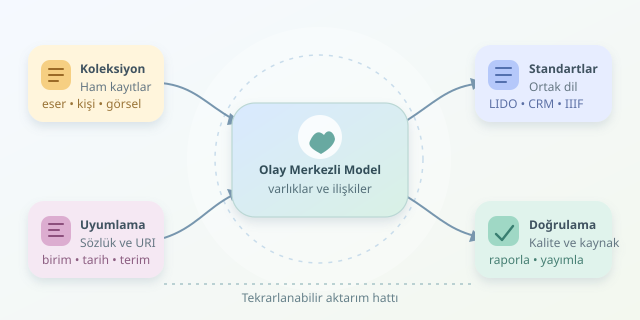

Bir müzenin dijital koleksiyonunda gezinirken gördüğünüz tablo, aslında buzdağının görünen kısmıdır. Arkasında sanatçı adları, üretim tarihleri, malzemeler, ölçüler, sergileme geçmişi ve kullanım hakları dolaşır. Binlerce eser söz konusu olduğunda mesele dosyaları klasörlere atmak değil, bu bilgilerin aynı dili konuşmasını sağlamaktır. Yoksa bir sistemin “tuval üzerine yağlıboya” dediğini diğeri “oil painting” diye ayrı bir gezegene gönderir.
``

## Önce mantık: Eser bir satırdan fazlasıdır

Meta veri, bir nesneyi tanımlayan ve bağlama yerleştiren veridir. Ancak müze nesneleri yalnızca özelliklerden oluşmaz; olaylarla da ilişkilidir. Bir heykel üretilir, satın alınır, restore edilir ve farklı sergilerde gösterilir. Dolayısıyla “eser–sanatçı–tarih” üçlüsü başlangıçtır, bütün hikâye değildir.

Buradaki temel ayrım, **varlık** ile **ilişki** arasındadır. Eser, kişi, kurum ve yer birer varlıktır. “Üreten”, “edinilen” ve “sergilenen” ise bunları bağlayan ilişkilerdir. Olay merkezli modelleme, tarihin hangi olaya ait olduğunu açıkça gösterir. Böylece üretim tarihiyle müzeye giriş tarihi yanlışlıkla aynı çekmeceye konmaz.

## Standartlar aynı işi yapmaz

Standart seçmek, tek bir sihirli format bulmak değildir. Bazıları alanları tanımlar, bazıları kavramsal ilişkileri kurar, bazılarıysa görüntüleri sunar. İyi mimari, bunları görevlerine göre birleştirir.

| Standart | Temel rol | Güçlü olduğu alan |
|---|---|---|
| Dublin Core | Genel tanımlama terimleri | Basit kataloglar, keşif |
| LIDO | XML tabanlı veri aktarımı | Müze kayıtlarının paylaşılması |
| CIDOC CRM | Kavramsal model ve ontoloji | Olaylar, kişiler, tarihsel ilişkiler |
| IIIF | Görüntü erişimi ve sunumu | Yakınlaştırma, manifestler, görüntüleyiciler |

Örneğin LIDO, kurumlar arasında kayıt alışverişini düzenlerken CIDOC CRM bu kayıtlardaki kavramların ilişkilerini ifade eder. IIIF ise eserin yüksek çözünürlüklü görselini ortak araçlarla sunabilir; kapsamlı katalog modelinin yerine geçmez.

## Veritabanında rafları nasıl kurarız?

Başlangıçta ilişkisel bir yapı yeterli olabilir: `eser`, `kisi`, `uretim_olayi`, `malzeme` ve `dijital_varlik` tabloları. Bir eser birden fazla malzemeye sahip olabileceğinden ara tablolar gerekir. Sanatçının adını her esere yeniden yazmak yerine kişi kaydına referans vermek, tekrarları azaltır.

Ölçülerde değer, birim ve ölçü türü ayrı tutulmalıdır. “30 × 40” ifadesi tek başına eksiktir: Santimetre mi, milimetre mi? Yükseklik mi önce geliyor? Tarihler de benzer şekilde modellenmelidir. “Yaklaşık 1850” bilgisini kesin bir güne dönüştürmek, bilgisayarı mutlu ederken tarihçiyi üzer.

Her varlığa kalıcı bir URI vermek, farklı sistemlerin aynı kaynağa referans vermesini kolaylaştırır. Envanter numarası da saklanır; ancak kurum içi numara ile küresel tanımlayıcı aynı şey değildir.

## JSON-LD ile ilişkileri görünür kılmak

Aşağıdaki sadeleştirilmiş örnek, bir eseri üretim olayı üzerinden sanatçısına bağlar. JSON-LD bağlamı, kısa alan adlarını açık ontoloji terimleriyle eşleştirir:

```json
{
  "@context": {
    "crm": "http://www.cidoc-crm.org/cidoc-crm/",
    "rdfs": "http://www.w3.org/2000/01/rdf-schema#",
    "ad": "rdfs:label",
    "uretim": "crm:P108i_was_produced_by",
    "sanatci": "crm:P14_carried_out_by"
  },
  "@id": "https://muze.example/eser/142",
  "@type": "crm:E22_Human-Made_Object",
  "ad": "Kıyıda Akşam",
  "uretim": {
    "@id": "https://muze.example/olay/871",
    "@type": "crm:E12_Production",
    "sanatci": {
      "@id": "https://muze.example/kisi/37",
      "@type": "crm:E21_Person",
      "ad": "Deniz Kaya"
    }
  }
}
```

Burada sanatçı doğrudan metin alanına sıkıştırılmaz; ayrı bir varlık olarak tanımlanır. Üretim olayı da kendi kimliğine sahiptir. Sonradan üretim yeri veya zaman aralığı eklemek bu yüzden kolaylaşır. Gerçek uygulamada kullanılan CIDOC CRM sürümü sabitlenmeli, eşlemeler belgelenmeli ve çıktılar doğrulanmalıdır.

## Kalite kontrolü: Dolu alan, doğru bilgi demek değildir

Zorunlu alanların geçerlilik oranını basitçe ölçebiliriz:

$$Q = 100 \times \frac{D}{R}$$

Burada $D$, doğrulamadan geçen zorunlu alan örneklerinin; $R$ ise bütün kayıtlarda beklenen zorunlu alan örneklerinin sayısıdır. Bu gösterge kullanışlıdır, fakat tarihsel doğruluğu tek başına ölçmez.

Kontrollü sözlükler, “bronz” ile “bronze” gibi terimlerin ortak kavrama bağlanmasını sağlar. Kaynak, atıf ve belirsizlik de saklanmalıdır. Özellikle tartışmalı sanatçı atıflarında iddiayı kesin gerçek gibi sunmamak önemlidir. Görselin kullanım hakkı ile fiziksel eserin hak durumu ayrıca değerlendirilmelidir.

## Küçük başlayıp binlerce esere ulaşmak

Önce temsil gücü yüksek yüz kayıt seçin. Alan sözlüğünü hazırlayın, tekrar eden kişileri ayıklayın ve tarihleri normalize ederken özgün ifadeleri koruyun. Ardından aktarım hattını kurun: kaynağı oku, dönüştür, doğrula, hataları raporla ve yayımla.

Dönüşüm kurallarını sürümleyin; başarısız kayıtları sessizce atmayın. Son olarak örnek kayıtları küratörlerle kontrol edin. Sağlam dijital koleksiyon, yalnızca çalışan kodun değil, yazılımcı ile alan uzmanının ortak eseridir.
