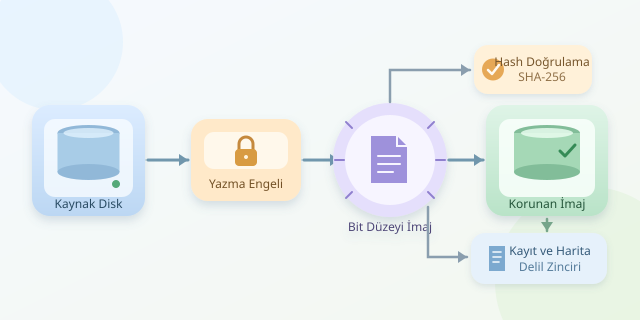

Bir sabit diski incelemek, olay yerindeki ayak izlerini araştırmaya benzer: Merakla yaklaşırken kendi izlerinizi bırakmamalısınız. Disk imajlama, verileri başka bir ortama taşırken orijinal üzerinde değişiklik yapmamayı hedefler. Adli kopyalama ise bu işlemi doğrulama, kayıt tutma ve delil güvenilirliğiyle birleştirir. Peki bu dijital fotokopi makinesi nasıl çalışır?
``

## Dosya kopyalamak neden yeterli değil?

Dosya yöneticisiyle yapılan kopyalama, genellikle yalnızca mevcut dosyaları ve seçili dizinleri taşır. Oysa bir diskte bölüm tablosu, dosya sistemi metaverileri, ayrılmamış alanlar ve dosyaların son sektörlerinde kullanılmayan boşluklar da bulunur. Silinmiş içeriklerin izleri bu bölgelerde kalabilir.

Bit düzeyinde imajlama, cihazın erişilebilir mantıksal sektörlerini sırayla okuyarak bunların içeriğini hedefe aktarır. Buradaki “bit bit”, disk plakasındaki tüm fiziksel işaretlerin kopyalandığı anlamına gelmez; denetleyicinin sunduğu adreslenebilir veri alanı kastedilir.

| Yöntem | Kapsam | Silinmiş veri izleri |
|---|---|---|
| Dosya kopyalama | Seçilen dosyalar | Genellikle alınmaz |
| Bölüm imajı | Seçilen bölüm | Bölüm sınırları içinde alınabilir |
| Tam disk imajı | Erişilebilir disk alanı | Üzerine yazılmamışsa alınabilir |

## Orijinali korumak: Yazma engelleyici

İşletim sistemleri, bağlanan disklerde günlük güncellemesi veya otomatik onarım gibi işlemler yapabilir. Bu nedenle kaynak disk, sıradan bir bilgisayara takılıp gelişigüzel açılmamalıdır.

Tercih edilen yaklaşım, bağlantı türüyle uyumlu ve doğrulanmış bir **donanımsal yazma engelleyici** kullanmaktır. Bu cihaz, bilgisayardan kaynağa gönderilen yazma komutlarını engeller. Yazılımsal salt okunur ayarlar ek koruma sağlayabilir; ancak tek başlarına aynı güvenceyi vermez.

Hazırlanmış adli çalışma ortamında otomatik bağlama kapatılır. Kaynak diskin marka, model, seri numarası ve kapasitesi kaydedilir. Hedef depolama ise mutlaka ayrı bir cihaz olmalıdır. Küçük bir cihaz adı hatası, büyük bir felakete dönüşebilir!

## Kapasite ve süre hesabı

Ham imaj için hedefte en az kaynak diskin erişilebilir kapasitesi kadar alan gerekir; yalnızca kullanılan dosyaların toplam boyutu yeterli değildir. İşlem günlükleri için de pay bırakılmalıdır.

İdeal koşullarda yaklaşık süre:

$$t_{\min} \approx \frac{S}{v}$$

Burada $S$ veri boyutu, $v$ sürdürülebilir okuma hızıdır. Örneğin 2 TB diski 150 MB/s hızla okumak yaklaşık 3,7 saat sürer. Bağlantı sınırları, bozuk sektörler ve yeniden denemeler bu süreyi uzatır. Diskinizin kahve molası sizinkinden uzun olabilir.

## GNU ddrescue ile ham imaj alma

GNU ddrescue, okunamayan bölgeleri harita dosyasına kaydederek işlemin kontrollü biçimde sürdürülmesini sağlar. Aşağıdaki örnek, doğru kaynak belirlenmiş ve yazma engelleyici üzerinden bağlanmış bir ortam içindir:

```bash
lsblk -o NAME,SIZE,MODEL,SERIAL,MOUNTPOINTS
sudo ddrescue -n /dev/sdX /mnt/kanit/disk.raw /mnt/kanit/disk.map
```

İlk komut cihaz kimliklerini karşılaştırmaya yardımcı olur. `/dev/sdX` örnek kaynak adıdır; doğrulamadan kullanılmamalıdır. İkinci komut ham imajı oluşturur. `-n`, yoğun sektör kazıma aşamasını atlar; `disk.map` ise hangi bölgelerin okunabildiğini saklar.

Harita dosyası, doğru kaynak ve aynı imajla işlemi devam ettirmek için değerlidir. Hatalı sektörler varsa çıktı eksiksiz kabul edilmez. Özellikle mekanik arıza belirtilerinde tekrar tekrar okumak yerine uzman değerlendirmesi gerekir.

## Hash: Dijital parmak izi

SHA-256, içeriği 256 bitlik bir özetle temsil eder:

$$h = \operatorname{SHA256}(I)$$

İmaj tamamlandıktan sonra özet alınabilir:

```bash
sha256sum /mnt/kanit/disk.raw > /mnt/kanit/disk.raw.sha256
sha256sum --check /mnt/kanit/disk.raw.sha256
```

İlk komut özeti kaydeder; ikinci komut imajın kayıtlı özetle eşleştiğini kontrol eder. Bu kontrol, imajın sonradan değişmediğini doğrulamaya yardımcı olur; tek başına kaynakla birebir eşleştiğini kanıtlamaz. Sağlıklı ve kararlı kaynakta ayrıca alınan özetle karşılaştırma yapılabilir. Ancak bu, diski yeniden okumayı gerektirir; arızalı medyada gereksiz yükten kaçınılmalıdır.

## Format ve delil zinciri

| Format | Avantaj | Dikkat noktası |
|---|---|---|
| RAW | Basit, yaygın uyumluluk | Metaveriler ayrıca tutulur |
| E01 | Sıkıştırma ve vaka metaverileri | Uyumlu araç gerekir |

Kayıtlara operatör, tarih, saat dilimi, araç sürümü, yazma engelleyici bilgileri ve okuma hataları eklenir. Esas imaj korunur; analiz çalışma kopyasında yapılır. Böylece yalnızca veri değil, verinin izlediği yol da açıklanabilir olur.

Son olarak, SSD’lerde TRIM ve dahili çöp toplama nedeniyle silinmiş veriler geri gelmeyebilir. Yazma engelleyici, cihazın kendi iç işlemlerini durdurmaz. Denetleyicinin gizlediği alanlar da standart imaja otomatik girmez. Adli kopyalamanın başarısı, doğru araç kadar bu sınırları dürüstçe belgelemeye bağlıdır.



