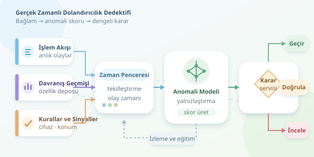

Kredi kartınızla kahve aldınız; birkaç dakika sonra başka bir ülkeden yüksek tutarlı bir işlem geldi. Bankanın dijital dedektifi hemen şüphelenir. Ancak mesele yalnızca büyük harcamaları yakalamak değildir: Gerçek zamanlı anomali analizi, alışılmış davranıştan sapmaları bağlamıyla değerlendirerek dolandırıcılık ihtimalini araştırır. Üstelik bunu ödeme deneyimini gereksiz yere bozmadan yapmalıdır.

``

## Anomali neden dolandırıcılık demek değildir?

Anomali, beklenen örüntüden belirgin biçimde uzaklaşan gözlemdir. Dolandırıcılık ise işlemin yetkisiz veya aldatıcı olmasıyla ilgilidir. İlk kez uçak bileti almak sıra dışı olabilir; bu, kart sahibinin suç mahalline dönüştüğü anlamına gelmez!

Bu yüzden sistem, işlem tutarından fazlasını inceler: Son dakikalardaki işlem sayısı, önceki işlemden geçen süre, cihaz değişimi ve müşterinin harcama geçmişi birlikte değerlendirilir. Aynı tutar, farklı müşteriler için farklı anlamlar taşır.

| Sinyal | Normal olabilecek durum | Şüpheyi artıran birleşim |
|---|---|---|
| Yüksek tutar | Planlı elektronik alışverişi | Yeni cihaz ve alışılmadık ülke |
| İşlem yoğunluğu | Kampanyalı alışveriş | Kısa sürede çok sayıda başarısız deneme |
| Konum değişimi | Seyahat | Zaman aralığıyla açıklanamayan uzaklık |




## Teorik temel: Noktaları yalnızlaştırmak

Isolation Forest, veriyi rastgele bölerek gözlemleri birbirinden ayırır. Sıra dışı noktalar genellikle daha az bölmeyle yalnızlaşır. Modelin temel skor mantığı şöyle özetlenebilir:

$$s(x)=2^{-E[h(x)]/c(n)}$$

Burada $E[h(x)]$, işlemin ağaçlardaki ortalama yol uzunluğudur; $c(n)$ ise örneklem büyüklüğüne bağlı normalleştirme terimidir. Kısa yollar daha yüksek anomali skorları üretir. Önemli ayrıntı: Bu skor, doğrudan dolandırıcılık olasılığı değildir.

Etiketli dolandırıcılık örnekleri az olduğunda bu yaklaşım kullanışlıdır. Yeterli etiket varsa denetimli modeller ve uzman kurallarıyla birlikte çalıştırılabilir. Böylece dedektifimiz yalnızca “garip” olanı değil, geçmişte gerçekten zararlı olduğu öğrenilmiş örüntüleri de tanır.

## Gerçek zamanlı akış nasıl kurulur?

İşlemler bir mesaj kuyruğuna gelir. Akış işleyicisi, kart bazında kısa zaman pencerelerini günceller ve özellik deposundan geçmiş davranış özetlerini getirir. Ardından model skor üretir; karar servisi skoru kurallar ve ek sinyallerle yorumlar.

Pencereler mümkün olduğunca olay zamanına göre hesaplanmalıdır. Geciken mesajlar, aynı işlemin tekrar gelmesi ve saat farklılıkları hesaba katılmazsa masum müşteriler bir anda hız rekortmeni görünebilir. Tekilleştirme anahtarları ve gecikme toleransı burada kritik araçlardır.

Eğitim özellikleri de yalnızca işlem anında bilinebilen bilgilerle hazırlanmalıdır. Gelecekteki işlemleri geçmişe sızdırmak, test sonuçlarını parlatır ama üretimde dedektifi şaşırtır.

## Python ile küçük bir skor servisi

Aşağıdaki örnekte `egitim` geçmiş işlemleri, `kalibrasyon` ise daha sonraki bir dönemdeki güvenilir normal işlemleri içeren tablolardır. Bilinen dolandırıcılıklar eğitimden çıkarılmıştır. Her satır, işlem anındaki özellikleri taşır; sayısal alanların eksiksiz ve negatif olmayan değerler içerdiği varsayılır.

```python
import numpy as np
from sklearn.ensemble import IsolationForest

kolonlar = ['tutar', 'gecen_dk', 'islem_5dk', 'ulke_farki']

def ozellikler(df):
    x = df[kolonlar].astype(float).copy()
    x[kolonlar[:3]] = np.log1p(x[kolonlar[:3]])
    return x

model = IsolationForest(
    n_estimators=150, max_samples=256, random_state=42
)
model.fit(ozellikler(egitim))
normal_skorlar = -model.score_samples(ozellikler(kalibrasyon))
esik = np.quantile(normal_skorlar, 0.995)

def degerlendir(islemler):
    skorlar = -model.score_samples(ozellikler(islemler))
    return skorlar, skorlar >= esik
```

`log1p`, uzun kuyruklu sayısal değerleri sıkıştırır; ülke farkı ise sıfır veya bir olarak kalır. `score_samples` çıktısının işareti çevrilerek yüksek değerlerin daha şüpheli olması sağlanır. Eşik, kalibrasyondaki normal işlemlerin yaklaşık yüzde 0,5’ini işaretler. Bu oran, gelecekte aynı alarm oranının korunacağını veya dolandırıcılıkların yakalanacağını garanti etmez. Kod ayrıca mesaj tüketimi ve pencere yönetimini değil, skorlama çekirdeğini gösterir.

## Alarmı karara dönüştürmek

Tek bir eşikle her işlemi reddetmek pahalıdır. Düşük riskli işlemler geçebilir; orta riskte ek kimlik doğrulama, yüksek riskte inceleme veya kurum politikasına uygun engelleme uygulanabilir. Müşteri deneyimi de optimizasyon hedefinin parçasıdır.

Dolandırıcılık nadir olduğundan doğruluk yanıltıcı olabilir. Bunun yerine $precision=TP/(TP+FP)$ ve $recall=TP/(TP+FN)$ birlikte izlenmelidir. PR-AUC, yanlış alarm maliyeti, kaçırılan kayıp ve karar gecikmesi de değerlendirilir. Testler zaman sırasını korumalı; eşikler gerçek operasyon kapasitesine göre seçilmelidir.

## Dedektifin de bakıma ihtiyacı var

Tatil dönemleri, yeni ödeme alışkanlıkları ve saldırganların değişen yöntemleri veri dağılımını kaydırır. Bu nedenle özellik dağılımları, alarm oranları ve gecikmeli doğrulanan sonuçlar düzenli izlenmelidir. Yeniden eğitim kontrollü yapılmalı, eski modelle karşılaştırılmalıdır.

Kart verilerini tokenlaştırmak, erişimi sınırlandırmak ve gereksiz kişisel verileri toplamamak da tasarımın parçasıdır. İyi sistem yalnızca şüpheli işlemi yakalamaz; bunu hızlı, ölçülebilir ve müşteriye mümkün olduğunca az sürtünme yaratarak yapar.
