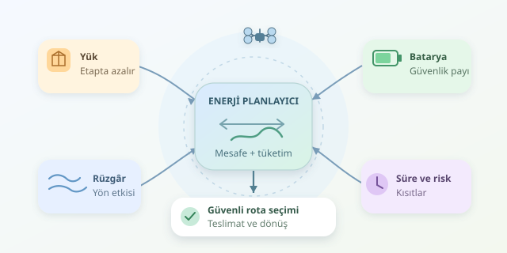

Bir dronun pizza teslim etmesi kulağa kolay gelir: Kalk, adrese uç, paketi bırak! Ancak batarya göstergesi yüzde ona düştüğünde işler değişir. Teslimat sistemleri yalnızca müşteriye ulaşmayı değil, güvenli dönüşü de planlamalıdır. İşin sırrı, mesafeyi enerjiyle birlikte değerlendiren algoritmalardadır; çünkü gökyüzünde şarj prizi bulmak biraz zordur.
``

## Rota neden yalnızca mesafe değildir?

Klasik rota planlaması noktalar arasındaki mesafeyi küçültmeye çalışır. Dronlarda ise taşınan yük, rüzgâr, uçuş hızı ve yükselme hareketleri enerji tüketimini değiştirir. Aynı uzunluktaki iki uçuşun batarya maliyeti farklı olabilir.

Bu problem, **enerji kısıtlı araç rotalama** ailesine girer. Kararlar birbirine bağlıdır: Ağır paketi erken bırakmak sonraki uçuşları ucuzlatabilir; fakat o müşteriye ulaşmak ciddi bir sapma gerektirebilir. Dolayısıyla teslimat sırası, yalnızca haritadaki yakınlıklara bakılarak belirlenemez.

Basitleştirilmiş bir enerji modeli şöyledir:

$$E_{rota}=\sum_i c(m_i,w_i)d_i+nE_{servis}$$

Burada $d_i$ etap mesafesi, $m_i$ o etapta taşınan yük, $w_i$ rüzgâr koşulu, $c$ kilometre başına tüketimdir. $nE_{servis}$ ise teslimatlar sırasında havada bekleme gibi işlemleri temsil eder. Gerçek uygulamada kalkış ve iniş maliyetleri de ayrıca eklenir.

| Yaklaşım | Temel ölçüt | Gözden kaçırabileceği durum |
|---|---|---|
| En kısa rota | Toplam mesafe | Yük ve rüzgâr etkisi |
| Enerji odaklı rota | Tahmini tüketim | Teslimat süresi sınırları |
| Çok amaçlı planlama | Enerji, süre, risk | Daha yüksek hesaplama maliyeti |

## Bataryanın tamamı harcanamaz

Planlayıcı bir güvenlik rezervi bırakmalıdır. Başlangıç doluluk oranı $s_0$, korunacak alt sınır $s_{min}$ ve nominal kapasite $E_{nom}$ ise:

$$E_{butce}=E_{nom}(s_0-s_{min})$$

Oranlar sıfır ile bir arasında kullanılır. Örneğin tam dolu, 0,60 kWh bataryada yüzde 20 rezerv bırakıldığında görev bütçesi 0,48 kWh olur. Bu bütçe hem teslimatları hem dönüşü kapsar. Yaşlanmış bataryalarda kapasiteyi katalogdan değil, ölçülen kullanılabilir kapasiteden almak gerekir.

## Python ile dönüşü unutmayan planlayıcı

Aşağıdaki örnek, koordinatları kilometre cinsinden kabul eder. Tüketim katsayıları yalnızca gösterim içindir; gerçek bir dronun menzil garantisi değildir. Algoritma, her aday teslimattan sonra kalan yükle depoya dönülebileceğini kontrol eder.

```python
from math import hypot

depo = (0, 0)
kalan = {
    "A": ((3, 1), 0.8),
    "B": ((5, 2), 0.4),
    "C": ((1, 4), 1.0),
}

def enerji(a, b, yuk):
    mesafe = hypot(a[0] - b[0], a[1] - b[1])
    return mesafe * (0.022 + 0.004 * yuk)

butce = 0.60 * (1 - 0.20)
harcanan = 0.0
yuk = sum(kutle for _, kutle in kalan.values())
konum = depo
rota = ["Depo"]

while kalan:
    adaylar = []
    for ad, (hedef, kutle) in kalan.items():
        gidis = enerji(konum, hedef, yuk) + 0.006
        donus = enerji(hedef, depo, yuk - kutle)
        if harcanan + gidis + donus <= butce:
            adaylar.append((gidis + donus, ad, gidis))
    if not adaylar:
        break
    _, ad, gidis = min(adaylar)
    konum, kutle = kalan.pop(ad)
    harcanan += gidis
    yuk -= kutle
    rota.append(ad)

harcanan += enerji(konum, depo, yuk)
rota.append("Depo")
print(rota, round(harcanan, 3), "kWh")
print("Teslim edilemeyenler:", list(kalan))
```

`enerji` fonksiyonu mesafeyi yükle birlikte tüketim tahminine dönüştürür. Her teslimatta yük azalır; böylece sonraki etaplar yeniden hesaplanır. Adaylar arasında gidiş ve doğrudan dönüş enerjisi toplamı en küçük olan seçilir. Hiçbir aday güvenli değilse dron depoya döner; teslim edilemeyen paketler hâlâ üzerindedir. Bunlar başka bir sortieye, yani yeni bir uçuş görevine aktarılmalıdır.

## Bu algoritma ne kadar akıllı?

Bu yöntem **açgözlü bir sezgiseldir**: Hızlı ve anlaşılırdır, ancak küresel optimumu garanti etmez. Mevcut kararda iyi görünen müşteri, sonraki teslimatları zorlaştırabilir. Ayrıca tüm paketleri başlangıçta yüklemek yerine paket seçimini de optimize etmek gerekir. Büyük filolarda karma tamsayılı optimizasyon, yerel arama ve metasezgisel yöntemler daha güçlü seçeneklerdir.

Üretim ortamında şu geliştirmeler önemlidir:

- **Yönlü rüzgâr modeli:** Gidiş ve dönüş aynı enerjiye mal olmayabilir; tüketim tahmini yön ve hava durumuyla güncellenmelidir.
- **Gerçek uçuş koridorları:** Öklid mesafesi yerine yasak bölgeleri, engelleri ve izin verilen irtifaları hesaba katan yollar kullanılmalıdır.
- **Zaman pencereleri:** Müşterinin teslimat saati, enerji açısından uygun bir rotayı operasyonel olarak geçersiz kılabilir.
- **Yeniden planlama:** Telemetri beklenenden yüksek tüketim gösterirse plan güncellenmeli; güvenli iniş noktaları ve dönüş seçenekleri sürekli korunmalıdır.

Sonuç olarak başarılı teslimat, yalnızca paketin kapıya ulaşması değildir. Dronun güvenle dönmesi de hedefin parçasıdır. En iyi rota, haritada en kısa görünen değil; enerji, zaman ve güvenlik kısıtlarını birlikte karşılayan rotadır.



