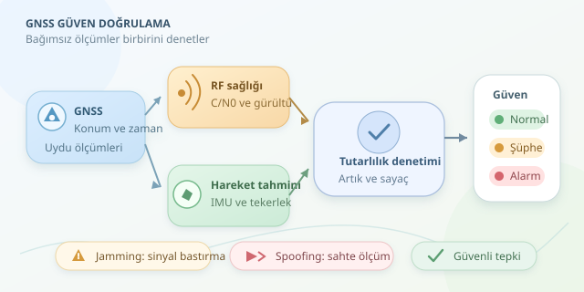

Navigasyon ekranında aracınız bir anda denizin ortasına ışınlandıysa, sorun yalnızca haritanın hayal gücü olmayabilir. Uydu sinyalleri kasıtlı biçimde bastırılabilir veya taklit edilebilir. Peki araç, gerçekten hareket ettiğini mi, yoksa kandırıldığını mı nasıl anlar? Cevap, tek bir sihirli eşikten ziyade birbirini denetleyen ölçümlerde saklıdır.

``

## Önce iki farklı problemi ayıralım

GPS, daha geniş GNSS ailesinin bir üyesidir. Alıcı, uydulardan gelen zaman bilgileriyle yaklaşık mesafeleri hesaplar; konumunu ve saat hatasını bu ölçümlerden çıkarır. Sinyaller yeryüzüne oldukça zayıf ulaştığı için alıcının kulağı hassastır, ama çevredeki bağırışlara karşı savunmasızdır.

**Jamming**, istenmeyen radyo enerjisiyle gerçek sinyallerin alınmasını zorlaştırır. **Spoofing** ise alıcıya makul görünen sahte ölçümler sunarak yanlış konum veya zaman üretmesini hedefler. Birincisi konuşmayı bastırır; ikincisi konuşmacının yerine geçer. Ancak pratikte belirtileri karışabilir.

| Özellik | Jamming | Spoofing |
|---|---|---|
| Temel etki | Sinyale erişimi bozar | Ölçümlerin güvenilirliğini bozar |
| Olası belirti | Uydu kilitlerinin kaybı | Tutarlı görünen yanlış konum |
| Konum çıktısı | Kesilebilir veya bozulabilir | Normal görünebilir |
| Denetim | RF sağlığı | Fiziksel ve ölçümsel tutarlılık |




## Ölçümlerin birbirini sorgulaması

Jamming izleyicisi, taşıyıcı-gürültü yoğunluğu oranı olan $C/N_0$, takip edilen uydu sayısı ve alıcının gürültü göstergelerini birlikte değerlendirir. Birçok uyduda eşzamanlı düşüş şüphelidir; fakat tünel, bina gölgelemesi ve anten arızası da benzer sonuçlar doğurabilir. Otomatik kazanç kontrolünün davranışı ayrıca alıcı modeline göre yorumlanmalıdır.

Spoofing için güçlü bir yaklaşım, GNSS konumunu IMU ve tekerlek hızından bağımsız ilerletilen hareket tahminiyle karşılaştırmaktır. Bütün değerler aynı yerel koordinat sistemine dönüştürülür. Ölçüm $z$, tahmin $Hx$ ise artık $r=z-Hx$ olur. Kovaryans $S$, normal koşullarda beklenen belirsizliği temsil eder:

$$D^2=r^T S^{-1}r$$

Bu normalize edilmiş uzaklık, yalnızca metre farkını değil, farkın belirsizliğe göre büyüklüğünü ölçer. Üç boyutlu, yaklaşık Gauss dağılımlı artıklar için $D^2>16.27$, yüzde 99,9 ki-kare sınırına karşılık gelir. Bu sınır bir saldırı kanıtı değildir.

## Python ile küçük bir şüphe izleyicisi

Aşağıdaki örnek, geçerli konum ölçümlerinde RF belirtilerini ve konum tutarsızlığını ayrı ayrı sayar. Ardışık anomaliler alarm üretirken sağlıklı örnekler sayaçları azaltır:

```python
import numpy as np

def detect(gnss_enu, predicted_enu, S, metrics, counters):
    residual = np.asarray(gnss_enu) - np.asarray(predicted_enu)
    nis = float(residual @ np.linalg.solve(S, residual))

    jam_hint = (
        metrics['cn0_drop_db'] > 8
        and (metrics['noise_rise_db'] > 4
             or metrics['lost_fraction'] > 0.5)
    )
    position_hint = nis > 16.27

    for name, active in [('rf', jam_hint),
                         ('position', position_hint)]:
        counters[name] = min(5, counters[name] + 1) if active else max(
            0, counters[name] - 1
        )

    return {
        'jamming_suspected': counters['rf'] >= 3,
        'position_inconsistent': counters['position'] >= 3,
        'nis': nis,
    }
```

`counters` başlangıçta `{'rf': 0, 'position': 0}` olabilir. RF değişimleri kalibre edilmiş referansa göre hesaplanır; eşikler yalnızca örnektir. `solve`, matrisin tersini açıkça hesaplamadan uzaklığı bulur. $S$ pozitif tanımlı olmalıdır. Bir hertz örneklemede üç ardışık anomali yaklaşık üç saniyelik doğrulama sağlar; farklı örnekleme hızlarında süre temelli pencereler kullanılmalıdır. Konum üretilemediğinde ise ayrı bir ölçüm-geçerlilik denetimi gerekir.

## Neden tek kontrol yeterli değil?

Yavaşça sürüklenen sahte konum, ani sıçrama kontrolünden kaçabilir. Üstelik GNSS ile sürekli düzeltilen hareket tahmini de aynı yanlışlığı öğrenebilir. Bu nedenle bağımsız izleyiciye GNSS bilgisinin nasıl girdiği dikkatle sınırlandırılmalıdır.

Ek katmanlar arasında Doppler-hız tutarlılığı, uydu başına sözde mesafe artıkları, güvenilir saatle zaman karşılaştırması ve çok antenli geliş açısı denetimi bulunur. Kamera veya radar odometrisi de bağımsız hareket kanıtı sağlayabilir. Navigasyon mesajı doğrulaması yararlıdır; fakat tek başına bütün geciktirme ve yeniden yayın saldırılarını dışlamaz.

## Test ve güvenli tepki

Algoritmayı yalnızca saldırı kayıtlarıyla değil; tüneller, şehir kanyonları, keskin dönüşler ve anten sorunlarıyla da sınayın. Yanlış alarm oranını, tespit gecikmesini ve kaçırılan olayları birlikte ölçün. Eşikleri farklı araçlarda ve güzergâhlarda doğrulamadan üretime taşımayın.

Şüphe oluştuğunda araç GNSS ağırlığını azaltabilir, bağımsız sensörlere geçebilir ve konum belirsizliğini büyütebilir. Güvenli tepki, kullanım senaryosunun gerektirdiği kontrollü yavaşlama veya durmayı da içerebilir. Amaç, GPS'i yalancılıkla suçlamak değil; konumu hangi güven düzeyiyle kullanabileceğini dürüstçe hesaplamaktır.
