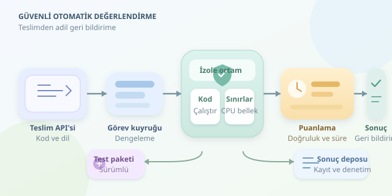

Bir sınıfta yüz öğrencinin aynı programlama ödevini teslim ettiğini düşünün. Her çözümü elle çalıştırmak, öğretmeni insan biçiminde bir test sunucusuna dönüştürür! Otomatik değerlendirme, yani auto-grading, bu yükü azaltır. Ancak öğrencinin kodunu çalıştırmak yalnızca doğru çıktıyı aramak değildir: güvenlik, adalet ve öğretici geri bildirim de aynı sistemin sorumluluğundadır.




``

## Notlandırmanın teorik temeli

Bir programı, girdileri çıktılara dönüştüren bir fonksiyon olarak modelleyebiliriz: $f(x)=y$. Değerlendirici, öğrencinin programının seçilmiş girdilerde beklenen davranışı gösterip göstermediğini ölçer. Buradaki kritik ayrım şudur: testleri geçmek, programın bütün olası girdilerde doğru olduğunu kanıtlamaz.

Bu nedenle test kümesi, problemin davranış alanını temsil etmelidir. Normal örneklerin yanında boş girdiler, sınır değerler, tekrar eden elemanlar ve büyük veri kümeleri bulunmalıdır. Rastgele testlerde sabit tohum kullanmak, sonuçların tekrar üretilebilmesini sağlar.

| Değerlendirme boyutu | Ne ölçer? | Örnek |
|---|---|---|
| İşlevsel doğruluk | Beklenen davranış | Listenin doğru sıralanması |
| Verimlilik | Kaynak kullanımı | Büyük girdide süre sınırı |
| Kod kalitesi | Bakım kolaylığı | Anlamlı isimler, tekrarın azaltılması |

Ağırlıklı puanlama için basit bir model kullanılabilir:

$$P = 100 \times \frac{\sum_{i=1}^{n} w_i s_i}{\sum_{i=1}^{n} w_i}$$

Burada $w_i$ testin ağırlığı, $s_i$ ise başarı durumudur. Kısmi başarı ölçülebiliyorsa $s_i$, sıfır ile bir arasında olabilir. Ağırlıklar, test sayısını değil öğrenme hedeflerinin önemini yansıtmalıdır.

## Güvenli çalıştırma: Kod misafir değil, şüphelidir

Öğrenci kodu yanlışlıkla sonsuz döngüye girebilir; kasıtlı olarak dosyalara erişmeye veya ağ bağlantısı açmaya da çalışabilir. Bu yüzden teslimleri web uygulamasının çalıştığı süreçte yürütmek ciddi bir tasarım hatasıdır.

Her değerlendirme geçici ve izole bir ortamda yapılmalıdır. CPU süresi, gerçek geçen süre, bellek, süreç sayısı, disk ve çıktı boyutu sınırlandırılmalıdır. Süre dolduğunda yalnızca ana süreç değil, oluşturduğu alt süreçler de sonlandırılmalıdır. Ağ erişimi varsayılan olarak kapalı tutulmalı; sunucunun dosyaları, kimlik bilgileri ve Docker soketi ortama bağlanmamalıdır.

| Yaklaşım | Avantaj | Dikkat edilmesi gereken |
|---|---|---|
| Ayrı süreç | Basit kurulum | Tek başına güvenlik izolasyonu sağlamaz |
| Container | Hızlı başlangıç, kaynak kontrolü | Ana sistemin çekirdeğini paylaşır |
| Sanal makine veya microVM | Daha güçlü izolasyon | Yönetim ve kaynak maliyeti artar |

Container kullanılıyorsa ayrıcalıksız kullanıcı, salt okunur dosya sistemi, capability kısıtlamaları ve seccomp gibi önlemler gerekir. Özellikle herkese açık hizmetlerde daha güçlü izolasyon tercih edilmelidir. Tek bir sihirli güvenlik düğmesi yoktur; savunma katmanlarla kurulur.

## Örnek: Puanlama ile çalıştırmayı ayırmak

Aşağıdaki Python kodu, güvenli çalıştırmayı ayrı bir servis olarak ele alır. `runner`, izolasyonu ve sınırları gerçekten uygulayan istemcidir; sıradan bir `subprocess` sarmalayıcısı değildir.

```python
def grade(source, tests, runner):
    total = sum(test["weight"] for test in tests)
    if total <= 0:
        raise ValueError("Toplam ağırlık pozitif olmalı")
    earned = 0
    for test in tests:
        result = runner.run(
            source=source,
            stdin=test["input"],
            language="python",
            timeout_ms=1500,
            memory_mb=128,
            network=False,
        )
        if result["status"] == "infra_error":
            raise RuntimeError("Değerlendirme yeniden denenmeli")
        if (result["status"] == "ok"
                and result["stdout"] == test["expected"]):
            earned += test["weight"]
    return round(100 * earned / total, 2)
```

Bu örnek tam çıktı eşitliği kullanır. Boşlukların önemsiz olduğu veya kayan noktalı sonuçlar içeren sorularda karşılaştırıcı değiştirilmelidir. Sayısal karşılaştırmada $\vert a-b\vert  \leq \varepsilon$ gibi toleranslar, gerektiğinde bağıl hata ile birlikte uygulanabilir. Karşılaştırma kuralları öğrenciye önceden açıklanmalıdır.

## Geri bildirim ve adalet

“Yanlış cevap” tek başına pek öğretici değildir. Sistem; derleme hatası, çalışma zamanı hatası, süre aşımı ve çıktı uyuşmazlığını ayırmalıdır. Açık testlerde beklenen ve üretilen çıktı gösterilebilir; gizli testlerde ise test verisini açığa çıkarmadan hata sınıfı açıklanabilir.

Altyapı arızası öğrencinin başarısızlığı sayılmamalıdır. Ayrıca aynı dil sürümü, bağımlılıklar ve kaynak politikası bütün teslimlerde korunmalıdır. Öğrenci çıktıları güvenilmeyen veri kabul edilmeli; arayüzde HTML olarak yorumlanmamalı ve günlüklerde boyut sınırıyla saklanmalıdır.

## Üretime giderken

Pratik mimari; teslim API’si, görev kuyruğu, izole çalıştırıcılar ve sonuç deposundan oluşur. Kuyruk yoğunluğu dengeler; sürümlenmiş test paketleri ise yeniden değerlendirmeyi tutarlı kılar. Teslimlerin saklanma süresi ve erişim yetkileri açıkça belirlenmelidir.

Sonuçta iyi bir auto-grading sistemi, yalnızca hızlı not veren bir robot değildir. Güvenli bir laboratuvar ve sabırlı bir yardımcı öğretmendir: hatayı yakalar, nedenini anlaşılır kılar ve öğrenciyi bir sonraki denemeye hazırlar.
