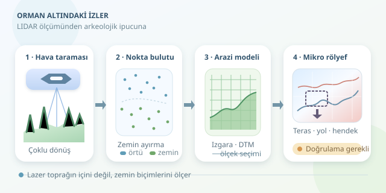

Bir ormana baktığınızda ağaçları görürsünüz; bir arkeolog ise aynı yerde kayıp yolları, terasları ve antik yerleşimleri arayabilir. LIDAR, bu arayışı üç boyutlu ölçümlerle destekler. Ancak küçük bir sürpriz var: Lazer toprağın içini göstermez! Asıl numara, bitki örtüsünün arasından ölçülen zemin üzerindeki ince şekilleri okumaktır.

``

## Lazerin gördüğü şey nedir?

LIDAR, gönderdiği lazer darbesinin geri dönüş süresinden mesafe hesaplar. Basitleştirilmiş ilişki şöyledir:

$$R = \frac{c\Delta t}{2}$$

Burada $R$ uzaklık, $c$ ışık hızı, $\Delta t$ ise gidiş-dönüş süresidir. İkiye bölme işlemi, ışığın yolu iki kez katetmesinden kaynaklanır.

Havadan taramada sensörün konumu ve yönelimi, GNSS ve ataletsel ölçümlerle belirlenir. Böylece mesafeler koordinatlı noktalara dönüşür. Bir darbe yapraklardan, dallardan ve zeminden birden fazla dönüş üretebilir. Zemine ulaşan ışık, çoğunlukla örtüdeki açıklıklardan geçer; yaprakları sihirli biçimde delmez.

| Yöntem | Temel olarak gösterdiği | Önemli sınırlama |
|---|---|---|
| Hava fotoğrafı | Görünür yüzey ve renk | Yoğun örtü zemini gizler |
| Havadan LIDAR | Üç boyutlu yüzey geometrisi | Yeterli zemin dönüşü gerekir |
| Yer radarı | Yeraltındaki elektromanyetik karşıtlıklar | Toprak koşullarından etkilenir |

Tamamen gömülü ve yüzeyde hiçbir iz bırakmamış bir duvar, LIDAR ile doğrudan görüntülenmez. Buna karşılık duvarın oluşturduğu hafif yükselti veya eski bir hendeğin çöküntüsü, arazi modelinde fark edilebilir.

## Nokta bulutundan arkeolojik ipucuna

İşlem zincirini dört basamakta düşünün:

1. **Veriyi hazırlayın:** Uçuş şeritlerinin uyumunu, koordinat sistemini ve yükseklik referansını kontrol edin. Yaprak dökümü dönemindeki uçuşlar, bazı ormanlarda zemin örneklemesini iyileştirir.
2. **Zemini sınıflandırın:** Ağaç ve yapı noktalarını ayırın. Son dönüş her zaman zemin değildir; sınıflandırıcılar komşuluk, eğim ve yükseklik ilişkilerini değerlendirir.
3. **Arazi modeli oluşturun:** Zemin noktalarını düzenli bir ızgaraya aktararak sayısal arazi modeli, yani DTM üretin. Bitki tepelerini içeren yüzey modeliyle karıştırmayın.
4. **Mikroreliefi inceleyin:** Çok yönlü gölgelendirme, yerel rölyef ve gökyüzü görünürlük faktörü gibi görselleştirmeleri birlikte değerlendirin.

Izgara boyutu, veri yoğunluğuna uygun olmalıdır. Seyrek ölçümlerden santimetrelik hücreler üretmek yeni bilgi yaratmaz; yalnızca belirsizliğe daha şık bir ambalaj giydirir. Küçük ayrıntıların güvenilirliği, hücre boyutundan çok gerçek zemin örneklemesine bağlıdır.

## Python ile yerel rölyef çıkaralım

Yerel rölyef modeli, geniş ölçekli topoğrafik eğilimi çıkararak küçük yükselti ve çukurları belirginleştirir:

$$LRM(x,y)=DTM(x,y)-G_\sigma(DTM)(x,y)$$

$G_\sigma$, Gaussian yumuşatmayı temsil eder. Seçilen ölçek önemlidir: Çok küçük değerler kalıntının kendisini silebilir, çok büyük değerler doğal yamaç biçimlerini öne çıkarabilir. Tek bir ölçek yerine birkaç ölçeği karşılaştırmak daha güvenlidir.

Aşağıdaki örnek, önceden sınıflandırılmış küçük bir LAZ parçasını işler. Koordinatların metre birimli olması gerekir. `laspy`, LAZ okumak için `lazrs` gibi uygun bir arka uca ihtiyaç duyabilir.

```python
import laspy
import numpy as np
import matplotlib.pyplot as plt
from scipy.stats import binned_statistic_2d
from scipy.ndimage import gaussian_filter

las = laspy.read("orman_parcasi.laz")
ground = las.classification == 2
x, y, z = [np.asarray(v)[ground]
           for v in (las.x, las.y, las.z)]
if len(z) < 3:
    raise ValueError("Yeterli zemin noktası yok.")

cell = 1.0
xe = np.arange(x.min(), x.max() + 2 * cell, cell)
ye = np.arange(y.min(), y.max() + 2 * cell, cell)
dtm = binned_statistic_2d(
    x, y, z, statistic="mean", bins=[xe, ye]
).statistic.T

valid = np.isfinite(dtm)
sigma = 10.0 / cell
weights = gaussian_filter(valid.astype(float), sigma)
smoothed = gaussian_filter(np.where(valid, dtm, 0), sigma)
trend = smoothed / np.maximum(weights, 1e-9)
relief = np.where(valid, dtm - trend, np.nan)

plt.imshow(relief, origin="lower", cmap="RdBu_r")
plt.colorbar(label="Yerel rölyef (m)")
plt.show()
```

Kod, zemin sınıfındaki noktaları hücrelerde ortalar. Boş hücrelerin yumuşatma hesabında sıfır yüksekliğe dönüşmesini ağırlıklandırmayla engeller; çıktıdaki boşlukları ise korur. Bu, otomatik kalıntı tespiti değil, incelemeye yardımcı bir görselleştirmedir. Büyük dosyalar parçalara ayrılmalıdır.

## Her dikdörtgen bir tapınak değildir

Düzenli teraslar, kapalı çevre çizgileri ve yol bağlantıları aday işaretlerdir. Fakat ormancılık yolları, drenaj kanalları ve sınıflandırma hataları benzer desenler oluşturabilir. Gölgelendirme yönünü değiştirin, ham noktaları inceleyin ve tarihî haritalarla karşılaştırın.

Son karar; izinli saha araştırması, yüzey buluntuları ve gerektiğinde jeofizik ölçümlerle desteklenmelidir. Hassas konumları gelişigüzel paylaşmamak da kültürel mirası korumanın parçasıdır. LIDAR’ın başarısı, toprağı görünmez yapmakta değil; ormanın sakladığı topoğrafik ipuçlarını ölçülebilir hâle getirmektedir.
