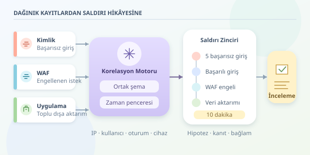

Bir güvenlik duvarı engellenen isteği, kimlik sunucusu başarısız girişleri, uygulama ise büyük veri indirmesini kaydeder. Ayrı ayrı bakıldığında bunlar sıradan olaylar olabilir. Birleştirildiğinde ise hesap ele geçirme girişiminin izleri belirir. Log korelasyonu, dijital dedektifliğin tam da bu noktada devreye giren büyütecidir: Kayıtları toplamakla kalmaz, aralarındaki anlamlı ilişkileri araştırır.

``

## Korelasyonun teorik temeli

Korelasyon, farklı kaynaklardaki olayları ortak özellikler ve zaman ilişkileri üzerinden eşleştirmektir. Temel soru şudur: **Bu kayıtlar aynı güvenlik olayının parçaları olabilir mi?** Aynı IP adresi başlangıç noktasıdır; ancak kullanıcı, oturum kimliği ve cihaz bilgisi daha güçlü bağlantılar kurabilir.

Buradaki kritik ayrım, korelasyonun nedensellik anlamına gelmemesidir. Aynı dakikada gerçekleşen iki olay birbirinden bağımsız olabilir. Bu nedenle yalnızca yakınlık değil, saldırı davranışına uygun sıralama da aranmalıdır.

| Kaynak | Görünen olay | Tek başına belirsizlik |
|---|---|---|
| Kimlik sistemi | Başarısız girişler | Kullanıcı parolasını unutmuş olabilir |
| WAF | Engellenen istek | Otomatik tarama olabilir |
| Uygulama denetimi | Toplu veri dışa aktarımı | Yetkili iş akışı olabilir |

Birleşen kayıtlar, bu belirsizlikleri azaltır; fakat otomatik olarak saldırıyı kanıtlamaz.

## Önce kayıtları aynı dile çevirin

Kaynaklar farklı alan adları ve tarih biçimleri kullanabilir. Bir sistem `username`, diğeri `account` yazar. Korelasyon öncesinde kayıtlar ortak bir şemaya dönüştürülmelidir: `ts`, `source`, `ip`, `user` ve `action`.

Zamanları UTC'ye dönüştürmek gereklidir; ancak saatleri yanlış çalışan makineleri tek başına düzeltmez. Saat senkronizasyonunu da izleyin. Ayrıca olayın gerçekleşme zamanı ile toplayıcıya ulaşma zamanını ayırın: Ağ gecikmesi, saldırının sırasını kâğıt üzerinde değiştirebilir.

WAF çoğu zaman kullanıcı adını bilmez. Böyle durumlarda oturum veya istek kimliğiyle zenginleştirme gerekir. Aşağıdaki örnek, bu hazırlığın tamamlandığını varsayar.

## Bir saldırı hipotezi kurmak

Senaryomuzda aynı kullanıcı ve IP için on dakikalık pencerede şu zinciri arıyoruz: En az beş başarısız giriş, ardından başarılı giriş, aynı pencerede WAF engellemesi ve başarılı girişten sonra toplu dışa aktarım.

Kuralı mantıksal olarak şöyle yazabiliriz:

$$C = F \land S \land W \land D$$

Burada $F$ başarısız giriş eşiğini, $S$ başarılı girişi, $W$ WAF olayını, $D$ ise sonraki dışa aktarımı temsil eder. Zaman koşulu $0 \le t_{son}-t_{olay} \le 600$ saniyedir. WAF olayı destekleyici bağlamdır; girişle arasında zorunlu bir sıra aramıyoruz.

## Python ile küçük bir korelasyon motoru

Aşağıdaki kod örnek kayıtları üretir ve her olay geldiğinde kayan pencereyi değerlendirir. Kullanılan IP, dokümantasyon için ayrılmış örnek bir adrestir.

```python
from collections import defaultdict, deque
from datetime import datetime, timedelta

base = datetime.fromisoformat("2026-10-10T09:00:00+00:00")

def event(minute, source, action):
    return {
        "ts": base + timedelta(minutes=minute),
        "source": source, "action": action,
        "ip": "203.0.113.8", "user": "deniz"
    }

logs = [event(i, "auth", "login_fail") for i in range(5)]
logs += [event(5, "auth", "login_ok"),
         event(6, "waf", "blocked"),
         event(7, "audit", "bulk_export")]

windows = defaultdict(deque)
alerted = set()

for row in sorted(logs, key=lambda r: r["ts"]):
    key = (row["ip"], row["user"])
    window = windows[key]
    window.append(row)
    while row["ts"] - window[0]["ts"] > timedelta(minutes=10):
        window.popleft()

    successes = [r for r in window if r["action"] == "login_ok"]
    for success in successes:
        failures = sum(r["action"] == "login_fail"
                       and r["ts"] < success["ts"] for r in window)
        exported = any(r["action"] == "bulk_export"
                       and r["ts"] > success["ts"] for r in window)
        blocked = any(r["source"] == "waf"
                      and r["action"] == "blocked" for r in window)
        if failures >= 5 and exported and blocked and key not in alerted:
            print("İncelenmeli:", key, "olay sayısı:", len(window))
            alerted.add(key)
```

`deque`, eski kayıtların pencereden çıkarılmasını kolaylaştırır. Kod giriş ve dışa aktarım sırasını denetler; yalnızca olay sayılarını toplamaz. `alerted` tekrarları bastırır, ancak üretimde kalıcı susturma yerine süreli tekrar bastırma kullanılmalıdır. Gerçek akışlarda geç gelen kayıtlar için ayrıca sınırlı gecikme toleransı gerekir.

## Alarmı karar sanmayın

Paylaşılan IP adresleri, VPN çıkışları ve servis hesapları yanlış pozitif üretebilir. Bu yüzden kullanıcı-cihaz ilişkisini, MFA sonuçlarını ve dışa aktarılan veri miktarını kontrol edin. Beş deneme eşiği evrensel değildir; normal davranışa göre ayarlanmalıdır.

| Yaklaşım | Avantaj | Risk |
|---|---|---|
| Sabit eşik | Açıklanabilir, kolay uygulanır | Ortama uyumsuz kalabilir |
| Davranışsal eşik | Kullanıcı alışkanlıklarını dikkate alır | Sağlıklı geçmiş veri ister |

Tekrarlanan kayıtları olay kimliğiyle ayıklayın ve merkezi log erişimini sınırlandırın. Alarm üzerinde ilgili kayıtları birlikte göstererek analistin doğrulamasını kolaylaştırın. İlk aksiyon doğrudan hesap kapatmak değil, bağlamı incelemek olabilir.

Sonuçta korelasyon, tek bir gürültülü alarmı büyütmek değil, dağınık kanıtlardan tutarlı bir hipotez kurmaktır. İyi dedektif büyüteci kullanır; ama gördüğü her gölgeye saldırgan demez.



