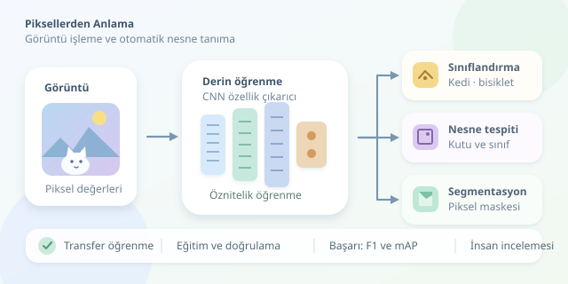

Bir bilgisayarın fotoğraftaki kediyi tanıması, bizim için sıradan görünen ama makineler açısından oldukça karmaşık bir iştir. Bilgisayar önce yalnızca sayılar görür; bıyık, kulak ve patiler henüz ortada yoktur! Derin öğrenme, bu sayılardan anlamlı örüntüler çıkararak nesneleri sınıflandırmamızı sağlar. Peki bu dijital dedektif nasıl çalışır?

``

## Önce problemi doğru tanımlayalım

Otomatik hedef tanıma ifadesini burada görüntülerdeki ilgili nesnelerin tanınması anlamında kullanıyoruz. Ancak **sınıflandırma**, **nesne tespiti** ve **segmentasyon** aynı görev değildir. Sınıflandırma, görüntünün hangi sınıfa ait olduğunu söyler. Nesne tespiti, nesnelerin konumlarını sınırlayıcı kutularla gösterir. Segmentasyon ise nesnelere ait pikselleri ayırır.

Örneğin bir fotoğrafa “bisiklet” etiketi vermek sınıflandırmadır. Fotoğraftaki üç bisikleti ayrı ayrı işaretlemek tespittir. Bisikletlerin her pikselini boyamak ise segmentasyondur. Birden fazla nesne türü içeren görüntülerde tek etiketli sınıflandırma yetersiz kalabilir; çok etiketli sınıflandırma veya tespit yaklaşımı gerekir.

## Derin öğrenmenin teorik mutfağı

Evrişimli sinir ağları, yani **CNN** modelleri, küçük filtrelerle görüntü üzerinde dolaşır. İlk katmanlar kenar ve renk geçişlerini, sonraki katmanlar daha karmaşık yapıları öğrenebilir. Evrişim, doğrusal olmayan aktivasyonlarla birleşince modelin temsil gücü artar. Kabaca bir katmanın çıktısı şöyle düşünülebilir:

$$H = \operatorname{ReLU}(X * W + b)$$

Burada $X$ girdi, $W$ öğrenilen filtreler, $b$ sapma terimi, $*$ ise evrişim işlemini temsil eder. Eğitim sırasında modelin tahmini ile gerçek etiket arasındaki fark hesaplanır; geri yayılım bu farkı azaltacak parametre güncellemelerini sağlar.

Tek etiketli sınıflandırmada yaygın kayıp fonksiyonu çapraz entropidir:

$$L = -\sum_{k=1}^{K} y_k \log(p_k)$$

$y_k$ gerçek sınıfı, $p_k$ modelin ilgili sınıfa atadığı olasılığı gösterir. Yanlış sınıfa yüksek güven vermek, modele pahalıya patlar!

| Yaklaşım | Temel fikir | Uygun kullanım |
|---|---|---|
| ResNet | Artık bağlantılı CNN | Güçlü sınıflandırma başlangıcı |
| EfficientNet | Dengeli mimari ölçekleme | Kaynak sınırlı sınıflandırma |
| Vision Transformer | Görüntü parçaları arasında dikkat | Ön eğitimle güçlü temsil öğrenme |
| YOLO | Nesnelerin kutu ve sınıflarını tahmin etme | Hızlı nesne tespiti |

## Transfer öğrenmeyle işe başlayalım

Sıfırdan eğitim, bol veri ve hesaplama gerektirir. **Transfer öğrenme**, büyük veri kümelerinde öğrenilmiş özellikleri yeni problemimize taşır. Aşağıdaki PyTorch örneği, ImageNet üzerinde eğitilmiş ResNet18'in özellik çıkarıcısını dondurur ve yalnızca yeni sınıflandırma katmanını eğitir. Görüntüleri `veri/train/sinif_adi/` klasörlerine yerleştirmek yeterlidir; sınıf etiketlerini `ImageFolder` oluşturur.

```python
import torch
from torch import nn
from torch.utils.data import DataLoader
from torchvision import datasets, models

weights = models.ResNet18_Weights.DEFAULT
data = datasets.ImageFolder(
    'veri/train', transform=weights.transforms()
)
loader = DataLoader(data, batch_size=16, shuffle=True)
device = torch.device('cuda' if torch.cuda.is_available() else 'cpu')

model = models.resnet18(weights=weights)
for parameter in model.parameters():
    parameter.requires_grad = False
model.fc = nn.Linear(model.fc.in_features, len(data.classes))
model = model.to(device)
optimizer = torch.optim.AdamW(model.fc.parameters(), lr=1e-3)
criterion = nn.CrossEntropyLoss()

# Dondurulmuş omurganın BatchNorm istatistiklerini koru.
model.eval()
for epoch in range(2):
    for images, labels in loader:
        images, labels = images.to(device), labels.to(device)
        optimizer.zero_grad(set_to_none=True)
        loss = criterion(model(images), labels)
        loss.backward()
        optimizer.step()
```

Ön işleme, girişleri ön eğitimdeki ölçeğe ve normalizasyona uyarlar. Yeni doğrusal katmanın parametreleri varsayılan olarak öğrenilebilir durumdadır. Buradaki `eval()`, gradyanları kapatmaz; dondurulmuş omurganın BatchNorm davranışını sabitler. İki eğitim turu yalnızca gösterim amaçlıdır, başarılı bir model garantisi değildir.

## Başarıyı doğru ölçmek

Veriyi eğitim, doğrulama ve test kümelerine ayırın. Aynı nesnenin neredeyse aynı fotoğrafları farklı kümelere dağılırsa veri sızıntısı oluşabilir. Model gerçekten öğrenmek yerine tanıdık görüntüleri hatırlar; sınavda soruları önceden görmek gibi!

| Metrik | Ne anlatır? | Dikkat noktası |
|---|---|---|
| Accuracy | Toplam doğru tahmin oranı | Dengesiz sınıflarda yanıltabilir |
| Macro F1 | Sınıfların eşit ağırlıklı F1 ortalaması | Azınlık sınıflarını görünür kılar |
| mAP | Tespit performansını özetler | Kutu eşleşme eşiklerine bağlıdır |

F1, kesinlik ile duyarlılığı dengeler: $F1 = 2PR/(P+R)$. Karışıklık matrisi de modelin hangi sınıfları birbirine karıştırdığını gösterir. Veri artırmada kırpma, parlaklık değişimi ve çevirme kullanılabilir; ancak dönüşümler gerçek sınıfı değiştirmemelidir.

## Laboratuvardan gerçek dünyaya

Gerçek kullanımda ışık, kamera açısı ve arka plan değişir. Bu yüzden yalnızca test puanına değil, gecikmeye, bellek tüketimine ve farklı koşullardaki hatalara da bakın. Softmax skorlarını kesin güven ölçüsü sanmayın; gerektiğinde kalibrasyon ve insan incelemesi ekleyin. İyi nesne tanıma, yalnızca iyi model değil, temiz veri ve dürüst değerlendirme işidir.



