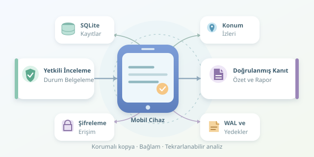

Telefonunuzdan bir mesajı sildiğinizde gerçekten yok mu olur, yoksa dijital koltuğun minderleri arasına mı düşer? Mobil cihaz adli analizi, bu soruyu teknik yöntemlerle araştırır. Ancak modern telefonlarda şifreleme, uygulama mimarisi ve depolama davranışı oyunun kurallarını değiştirir. Gelin, silinen mesajlarla konum izlerinin hangi koşullarda bulunabildiğini ve neden bazen kurtarılamadığını dijital dedektif gözüyle inceleyelim.

``

## Önce Yetki, Sonra Büyüteç

Bu işlemler yalnızca sahibi olduğunuz veya inceleme yetkisine sahip olduğunuz cihazlarda yapılmalıdır. Telefon, sadece sahibinin değil, onunla iletişim kuran insanların da özel bilgilerini barındırır. Adli çalışmada amaç mümkün olan her şeyi toplamak değil, hukuki kapsam içinde gerekli kanıtları güvenilir biçimde değerlendirmektir.

İlk adım cihazın durumunu belgelemektir: açık mı, kilitli mi, ağa bağlı mı? Gelişigüzel yeniden başlatma, uygulama yükleme veya mesajlaşma, mevcut izleri değiştirebilir. Ağ izolasyonu ve güç yönetimi, cihazın durumuna göre uzman tarafından planlanmalıdır.

## Silmek Neden Her Zaman Yok Etmek Değildir?

Birçok mesajlaşma uygulaması verilerini SQLite veritabanlarında tutar. Silme işlemi bazen kaydı kullanıcı arayüzünden kaldırırken eski içeriğin veritabanının kullanılmayan alanlarında kalmasına izin verir. Bazen de içerik hemen temizlenir. Yani “silinen her mesaj kurtarılır” iddiası, dijital dünyanın şehir efsanelerindendir.

SQLite’ın WAL dosyası, henüz ana veritabanına aktarılmamış değişiklikleri içerebilir. Önceki sayfa sürümleri, uygun koşullarda eski kayıtların izlerini taşıyabilir. Ancak WAL bir geri dönüşüm kutusu değildir; kontrol noktaları, yeniden kullanım ve temizlik işlemleri bu izleri ortadan kaldırabilir.

Modern telefonlarda dosya tabanlı şifreleme ve uygulamaya özgü korumalar da devrededir. Ham depolama verisini elde etmek, okunabilir mesaj elde etmekle aynı şey değildir. Üzerine yazılmış içerik veya erişilemeyen şifreleme anahtarları karşısında güçlü yazılımlar bile sihir yapamaz.

## Hangi Kaynak Ne Sunar?

| Kaynak | Bulunabilecek izler | Başlıca sınırlama |
|---|---|---|
| Mantıksal çıkarım | Erişilebilir kayıtlar ve bazı yedek içerikleri | Silinmiş alanları genellikle kapsamaz |
| Dosya sistemi çıkarımı | Uygulama veritabanları, günlükler, önbellekler | Cihaz desteği ve erişim yetkileri gerekir |
| WAL ve kullanılmayan sayfalar | Eski kayıt parçaları veya sayfa sürümleri | Temizlik ve üzerine yazma izleri silebilir |
| Yedekler | Yedekleme anındaki mesaj ve konum kayıtları | Tarih, kapsam ve şifreleme belirleyicidir |

Bulut yedeği, bildirim geçmişi veya eşleştirilmiş cihaz da ek kaynak olabilir. Bununla birlikte bir bildirimin metni, eksiksiz konuşma kaydı değildir; her kaynak kendi bağlamıyla değerlendirilmelidir.

## Kanıtı Korumak: Orijinale Dokunma

Çıkarımın yöntemi, kullanılan araç sürümü, zaman bilgisi ve dosya özetleri kaydedilir. SHA-256 gibi kriptografik özetler, aynı dosyanın sonradan değişip değişmediğini kontrol etmeye yardımcı olur; içeriğin doğru veya gerçek olduğunu tek başına kanıtlamaz.

Analiz, çalışma kopyasında yapılır. SQLite veritabanının yanında bulunan `-wal` ve `-shm` dosyaları da korunmalıdır. Bunları ayırmak, bazı kayıtların incelemede görünmemesine yol açabilir. Ayrıca cihazdan veri alma işlemi tamamen değişikliksiz olmayabilir; oluşan değişiklikler raporlanmalıdır.

## Python ile Küçük Bir İnceleme

Aşağıdaki Python 3.11+ örneği, çalışma kopyasının özetini hesaplar ve örnek bir mesaj tablosunu salt okunur bağlantıyla inceler. `messages(id, timestamp_ms, body)` şeması eğitim amaçlıdır; gerçek uygulamalarda tablo ve sütunlar değişir.

```python
import hashlib
import sqlite3
from pathlib import Path
from datetime import datetime, timezone

path = Path("calisma/mesajlar.db").resolve()
with path.open("rb") as file:
    print("SHA-256:", hashlib.file_digest(file, "sha256").hexdigest())

connection = sqlite3.connect(path.as_uri() + "?mode=ro", uri=True)
try:
    columns = {row[1] for row in connection.execute(
        "PRAGMA table_info(messages)"
    )}
    if not {"id", "timestamp_ms", "body"}.issubset(columns):
        raise ValueError("Beklenen örnek şema bulunamadı")

    rows = connection.execute(
        "SELECT id, timestamp_ms, body FROM messages ORDER BY timestamp_ms"
    )
    for identifier, milliseconds, body in rows:
        moment = datetime.fromtimestamp(milliseconds / 1000, timezone.utc)
        print(identifier, moment.isoformat(), body)
finally:
    connection.close()
```

Bu kod silinmiş kayıtları diriltmez; SQLite’ın mevcut görünümündeki kayıtları listeler. Silinmiş sayfaların incelenmesi, dosya yapısını bilen araçlar ve sonuçların bağımsız doğrulanmasını gerektirir.

## Konum İzleri ve Zamanın Küçük Tuzakları

Konum verileri harita uygulamalarında, fotoğraf metaverilerinde, etkinlik günlüklerinde veya izinli bulut geçmişinde bulunabilir. GPS ölçümüyle baz istasyonu tahmini aynı kesinlikte değildir. Bir koordinatın yanında zaman, doğruluk değeri ve kaynağı da değerlendirilmelidir.

Milisaniye tabanlı Unix zamanı için $t_{saniye} = t_{milisaniye}/1000$ dönüşümü kullanılır. Fakat her uygulama aynı başlangıç tarihini veya birimi kullanmaz. Saat dilimi hatası, doğru koordinatı yanlış olayla eşleştirebilir.

Sonuçta iyi adli analiz, yalnızca veri bulmak değildir: parçaları bağlamıyla doğrulamak, belirsizliği belirtmek ve tekrarlanabilir bir rapor üretmektir. Dijital dedektifliğin yıldızı gösterişli kurtarma düğmesi değil, titiz yöntemdir.
