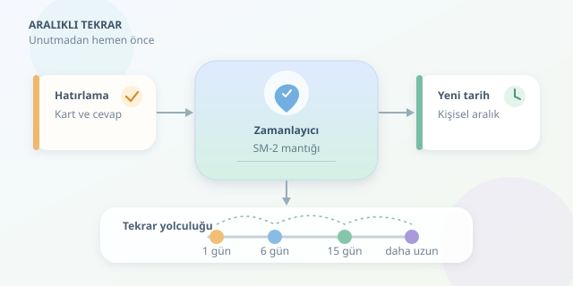

Yeni öğrendiğiniz bir İngilizce kelimeyi bugün hatırlıyor, üç gün sonra ise sanki hiç görmemiş gibi bakıyor musunuz? Sorun her zaman dikkatsizlik değildir; hafıza, kullanılmayan bilgiyi zamanla erişilmesi zor bir çekmeceye kaldırır. Aralıklı tekrar algoritmaları, o çekmeceyi doğru zamanda açtırmaya çalışır. Üstelik bunu her kelime için ayrı hesaplayabilirler.

``

## Unutmanın matematiği

Aralıklı tekrarın temel fikri, bilgiyi sürekli göstermek değil, hatırlama zorlaşmaya başlamışken yeniden çağırmaktır. Çok erken tekrar gereksiz iş yükü oluşturabilir; çok geç tekrar ise yeniden öğrenme maliyetini artırabilir. Amaç, bu iki uç arasında verimli bir denge kurmaktır.

Basitleştirilmiş bir unutma modeli şöyle yazılabilir:

$$R(t)=e^{-t/S}$$

Burada $R(t)$, son tekrardan $t$ gün sonra hatırlama olasılığını; $S$ ise belleğin dayanıklılığını temsil eder. Büyük $S$, daha yavaş unutma demektir. Bu denklem öğretici bir yaklaşımdır; bütün insanların bütün kelimeleri böyle unuttuğu anlamına gelmez.

Hedefimiz hatırlama olasılığını $r=0.90$ civarında tutmaksa tekrar zamanı:

$$t=-S\ln(r)$$

olarak hesaplanabilir. Örneğin $S=10$ gün için yaklaşık $1.05$ gün, $S=40$ gün için yaklaşık $4.21$ gün çıkar. Kelime sağlamlaştıkça takvim rahatlar: hafızanın abonelik ücreti azalır!

## Aynı hedef, farklı yöntemler

Algoritmaların farkı, kelimenin ne kadar sağlam öğrenildiğini nasıl temsil ettiklerinde ortaya çıkar.

| Yaklaşım | Temel mekanizma | Güçlü yanı | Sınırlaması |
|---|---|---|---|
| Leitner | Doğru cevaplanan kartı ileri kutuya taşır | Basit ve anlaşılır | Kişiselleştirme kabadır |
| SM-2 | Tekrar sayısı ve kolaylık katsayısıyla aralık büyütür | Uygulaması kolaydır | Açık bir olasılık modeli değildir |
| FSRS | Zorluk, dayanıklılık ve hatırlanabilirliği modeller | Geçmişten parametre öğrenebilir | Daha karmaşıktır |

Önemli ayrım şu: SM-2, yukarıdaki üstel denklemi kullanarak tarih hesaplamaz. Denklem olasılıksal düşünceyi açıklarken SM-2, pratik kurallarla aralıkları düzenler.

## SM-2 mantığını kodlayalım

SM-2 ailesinde kullanıcı, cevabını genellikle $0$ ile $5$ arasında değerlendirir. Başarılı tekrarlar aralığı büyütür; başarısızlık öğrenme dizisini yeniden başlatır. Kolaylık katsayısı $EF$, büyümenin hızını kontrol eder.

Yaygın katsayı güncellemesi şöyledir:

$$EF'=\max(1.3, EF+0.1-(5-q)(0.08+0.02(5-q)))$$

Burada $q$ cevap kalitesidir. Yüksek puan katsayıyı artırabilir; zorlanma azaltabilir. Alt sınır, tekrar aralıklarının aşırı daralmasını önlemeye yardımcı olur.

Aşağıdaki Python 3.10+ örneği, SM-2 esintili bir zamanlayıcıdır. İlk iki başarılı tekrar için bir ve altı gün kullanır; sonraki aralıkları önceki kolaylık katsayısıyla çarpar. Eğitim amaçlıdır, belirli bir uygulamanın birebir kopyası değildir.

```python
from dataclasses import dataclass
from datetime import date, timedelta

@dataclass
class Kart:
    basari: int = 0
    aralik: int = 0
    kolaylik: float = 2.5
    sonraki: date | None = None

def tekrar(kart: Kart, puan: int, bugun: date) -> Kart:
    if not isinstance(puan, int) or not 0 <= puan <= 5:
        raise ValueError("Puan 0 ile 5 arasında olmalı")

    eski_kolaylik = kart.kolaylik
    if puan < 3:
        kart.basari = 0
        kart.aralik = 1
    else:
        if kart.basari == 0:
            kart.aralik = 1
        elif kart.basari == 1:
            kart.aralik = 6
        else:
            kart.aralik = max(1, round(kart.aralik * eski_kolaylik))
        kart.basari += 1

    fark = 5 - puan
    kart.kolaylik = max(
        1.3, eski_kolaylik + 0.1 - fark * (0.08 + fark * 0.02)
    )
    kart.sonraki = bugun + timedelta(days=kart.aralik)
    return kart
```

`Kart`, kelimenin öğrenme durumunu saklar. `tekrar` ise cevap puanına göre bu durumu değiştirir ve yeni tarihi hesaplar. Tarihi dışarıdan almak, testlerde sistem saatine bağımlılığı ortadan kaldırır.

## Bir kelimenin takvim yolculuğu

Başlangıç katsayısı $2.5$ olan bir karta her seferinde dört puan verildiğini düşünelim:

| Başarılı tekrar | Sonraki bekleme | Kolaylık katsayısı |
|---|---:|---:|
| Birinci | 1 gün | 2.5 |
| İkinci | 6 gün | 2.5 |
| Üçüncü | 15 gün | 2.5 |

Bu süreler başlangıçtan itibaren toplam gün değil, son tekrardan sonraki bekleme süreleridir. Unutursanız örnekte aralık bir güne döner. Gerçek ürünlerde yeniden öğrenme için dakika ölçeğinde ek adımlar da kullanılabilir.

## Algoritmayı gerçekten verimli yapan şey

Sadece tarihi hesaplamak yetmez. Cevabı göstermeden önce kullanıcıdan hatırlamasını istemek gerekir; tanıdık gelmesi, gerçekten hatırlamak değildir. Her kartta tek ve net bilgi bulunması da puanların anlamlı olmasını sağlar.

Ayrıca planlanan ve gerçekleşen tekrar tarihlerini kaydedin. Gecikmiş tekrarlar, modelin tahminini değiştirebilir. Başarı oranını ve günlük tekrar yükünü birlikte izleyin: daha yüksek hedef hatırlama oranı, genellikle daha çok tekrar gerektirir. Hiçbir algoritma unutmayı garantiyle engellemez; iyi bir zamanlayıcı, öğrenme bütçesini daha akıllıca kullanır.
