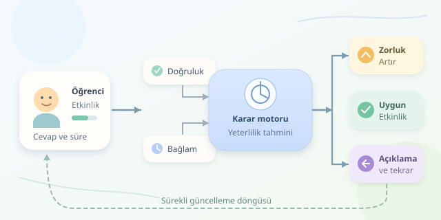

Bir öğrenme platformunun herkese aynı soruları göstermesi, spor salonunda herkese aynı ağırlığı vermeye benzer: Birileri sıkılır, birileri daha ilk sette pes eder. Uyarlanabilir öğrenme, öğrencinin performansını izleyerek sıradaki etkinliğin zorluğunu, açıklama biçimini ve tekrar zamanını kişiselleştirir. Ama mesele yalnızca “doğru yaptıysa zorlaştır” düğmesine basmak değildir; arka planda küçük bir karar motoru çalışır.

``

## Önce öğrenciyi değil, bilgisini modelleyelim

Sistem öğrencinin zihnini okuyamaz; cevaplardan hareketle bir tahmin üretir. Bu yüzden “öğrenci seviyesi” kesin bir etiket değil, sürekli güncellenen bir modeldir. Üstelik kesirlerde güçlü olan biri, denklemlerde zorlanabilir. Tek bir genel puan yerine beceri bazlı durum tutmak daha anlamlıdır.

Basit bir başlangıç, tek parametreli lojistik modeldir:

$$p=\frac{1}{1+e^{-(\theta-b)}}$$

Burada $\theta$ öğrencinin ilgili becerideki yeterlilik tahmini, $b$ sorunun zorluğu, $p$ ise doğru cevap olasılığıdır. Yeterlilik ile zorluk eşitse olasılık yaklaşık yüzde ellidir. Yeterlilik arttıkça başarı olasılığı yükselir. İki parametrenin aynı ölçekte olması gerektiğinden, soru zorlukları geçmiş cevaplarla kalibre edilmelidir.

| Yaklaşım | Karar mantığı | Temel sınırlılık |
|---|---|---|
| Sabit içerik | Herkese aynı sıra | Bireysel farkları kaçırır |
| Basit kural | Doğruysa zorlaştır | Şansı ve belirsizliği görmez |
| Olasılıksal model | Tahmine göre içerik seç | Kaliteli veri ve kalibrasyon ister |




## Gerçek zamanlı karar döngüsü

Her cevapta üç işlem gerçekleşir: performans sinyali alınır, öğrenci modeli güncellenir ve uygun sonraki etkinlik seçilir. “Gerçek zamanlı” çoğunlukla cevap gönderildikten hemen sonra karar vermektir; öğrenci soruyu çözerken soruyu gizlice değiştirmek değildir.

Doğruluğu $y\in\{0,1\}$ ile gösterirsek, basit bir çevrimiçi güncelleme şöyle yazılabilir:

$$\theta_{t+1}=\theta_t+\eta(y_t-p_t)$$

$\eta$, güncelleme adımının büyüklüğüdür. Beklenmedik bir doğru cevap tahmini daha fazla yükseltir; beklenen bir doğru cevap daha küçük etki yaratır. Böylece tek cevaba aşırı tepki vermek yerine kanıt biriktirilir. Bu, sabit soru zorlukları için lojistik olabilirliğin gradyanına dayanan basit bir güncellemedir.

Platform örneğin yüzde yetmiş başarı olasılığı hedefleyebilir. Amaç öğrenciyi ne sürekli başarısızlığa sürüklemek ne de sıkılacağı kadar kolay içerikte tutmaktır. Bu oran evrensel bir pedagojik optimum değil, test edilmesi gereken tasarım tercihidir.

## Python ile küçük bir karar motoru

Aşağıdaki örnek, yeterlilik tahminini günceller; ardından aynı becerideki görülmemiş sorular arasından hedefe uygun olanı seçer:

```python
from dataclasses import dataclass
from math import exp, log

@dataclass(frozen=True)
class Soru:
    kimlik: str
    beceri: str
    zorluk: float

def olasilik(theta, b):
    return 1 / (1 + exp(-(theta - b)))

def guncelle(theta, soru, dogru, hiz=0.25):
    p = olasilik(theta, soru.zorluk)
    yeni = theta + hiz * (int(dogru) - p)
    return max(-3.0, min(3.0, yeni))

def sec(theta, havuz, beceri, gorulen, hedef=0.70):
    if not 0 < hedef < 1:
        raise ValueError('Hedef 0 ile 1 arasında olmalı')
    adaylar = [s for s in havuz
               if s.beceri == beceri and s.kimlik not in gorulen]
    ideal_b = theta - log(hedef / (1 - hedef))
    return min(adaylar, key=lambda s: abs(s.zorluk - ideal_b),
               default=None)
```

`guncelle`, ani sıçramaları sınırlandırır; bu sınırlar örnek amaçlıdır. `sec`, lojistik denklemi tersine çevirerek ideal zorluğu bulur. Aday kalmazsa `None` döner; platform bunu açıklama, tekrar veya başka bir uygun etkinliğe yönlendirebilir. Uygulama, cevap sonrasında ilgili becerinin tahminini ve görülmüş soru kimliklerini saklamalıdır. Örnek, kalibre edilmiş ve sonlu zorluk değerleri varsayar.

## Akıllı görünen sistemin kör noktaları

Yanlış cevap her zaman bilgisizlik değildir: dikkatsizlik, dil bariyeri veya arayüz sorunu olabilir. Benzer şekilde uzun çözüm süresi tek başına düşük yeterlilik göstergesi değildir. İpucu kullanımı ve süre gibi sinyaller, doğruluğun yerine geçmeden bağlam sağlamalıdır.

Gerçek sistemlerde ön koşullar, erişilebilirlik ihtiyaçları ve içerik çeşitliliği seçim filtresine eklenir. Art arda başarısızlıkta yalnızca kolay soru vermek yerine çözümlü örnek sunmak daha yararlı olabilir. Ayrıca yeni öğrenciler için kısa tanılama, tahmin belirsizliğinin izlenmesi ve öğretmenin müdahale edebilmesi önemlidir.

Başarıyı yalnızca tıklama sayısıyla ölçmeyin. Gecikmeli hatırlama, bağımsız değerlendirmedeki kazanım ve farklı öğrenci gruplarındaki sonuçlar daha anlamlıdır. Toplanan veriyi gerekli olanla sınırlayın; kişiselleştirme, gereksiz gözetim anlamına gelmemelidir.

Kısacası iyi bir uyarlanabilir platform, görünmez bir sınav görevlisi değil, sabırlı bir antrenördür: kanıt toplar, küçük adımlarla ayarlar ve gerektiğinde farklı bir açıklama dener. Zorluk ayarı ancak öğretim tasarımıyla birleştiğinde gerçek öğrenmeye dönüşür.
