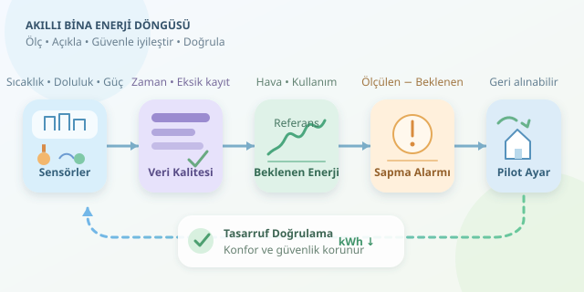

Bir bina konuşabilseydi, muhtemelen ilk şikâyeti şu olurdu: “Gece kimse yokken neden hâlâ bütün katları soğutuyorsunuz?” Bina otomasyonu, bu sessiz şikâyeti sıcaklık, doluluk ve elektrik ölçümlerine dönüştürür. Asıl değer ise veriyi toplamakta değil, tüketimin neden yükseldiğini anlayıp konforu bozmadan gereksiz harcamayı azaltmaktadır. Gelin sensörlerden tasarrufa uzanan yolu birlikte kuralım.
``

## Önce fiziği, sonra grafikleri anlayalım

Enerji tüketimi ile güç aynı şey değildir. Güç, cihazın o anda ne kadar enerji kullandığının hızıdır; enerji ise belirli bir süre boyunca biriken tüketimdir. Sabit güç için ilişki şöyledir:

$$E=P\Delta t$$

Örneğin, 10 kW gücündeki bir sistem iki saat çalışırsa 20 kWh tüketir. Değişken güçte, kısa aralıkların tüketimleri toplanır. Bu yüzden sensörün anlık güç mü, aralık enerjisi mi, yoksa birikimli sayaç değeri mi verdiğini bilmek şarttır. Birikimli sayaç okumaları doğrudan toplanmaz; ardışık okumaların farkı alınır. Sayaç sıfırlanmaları ayrıca kontrol edilir.

| Veri | Açıklayabildiği durum | Kontrol noktası |
|---|---|---|
| Elektrik tüketimi | Toplam enerji yükü | Birim ve ölçüm aralığı |
| Dış sıcaklık | Isıtma ve soğutma ihtiyacı | Sensör konumu |
| İç sıcaklık | Konforun korunması | Kalibrasyon |
| Doluluk | Kullanıma bağlı ihtiyaç | Algılama hataları |
| Ekipman durumu | Gereksiz çalışma | Zaman damgası uyumu |

Saat dilimlerini eşitlemek, tekrarlanan kayıtları temizlemek ve eksik ölçümleri işaretlemek analizin temelidir. Eksik tüketimi sıfır kabul etmek, binayı yanlışlıkla tasarruf şampiyonu ilan edebilir!

## “Normal tüketim” için bir referans oluşturun

Yüksek tüketim her zaman israf değildir. Çok sıcak bir günde çalışan soğutma sistemi, ılıman bir gündekinden doğal olarak fazla enerji kullanır. Bu nedenle tüketimi hava koşulları, kullanım saatleri ve dolulukla açıklayan bir referans model gerekir.

Basit bir yaklaşım, sıcaklığı ısıtma ve soğutma ihtiyacına dönüştürmektir:

$$H_t=\max(18-T_t,0),\qquad C_t=\max(T_t-22,0)$$

Buradaki eşikler örnektir; binanın kullanımına göre ayarlanmalıdır. Model bu değişkenlerden beklenen tüketimi öğrenir. Ölçülen tüketimle tahmin arasındaki pozitif fark, araştırılacak bir sapmadır; tek başına arıza kanıtı değildir.

Aşağıdaki Python örneği, her satırı bir saatlik tüketimi temsil eden veride referans model kurar ve boş saatlerdeki yüksek sapmaları işaretler. `occupied`, binanın kullanılıp kullanılmadığını gösteren 0/1 değeridir.

```python
import numpy as np
import pandas as pd
from sklearn.linear_model import Ridge
from sklearn.metrics import mean_absolute_error

# energy_kwh: bir saatlik aralık tüketimi
# outdoor_c: dış sıcaklık, occupied: doluluk göstergesi
df = pd.read_csv('bina.csv', parse_dates=['timestamp'])
df = df.sort_values('timestamp').dropna(
    subset=['energy_kwh', 'outdoor_c', 'occupied']
)

hour = df['timestamp'].dt.hour
X = pd.DataFrame({
    'heating': (18 - df['outdoor_c']).clip(lower=0),
    'cooling': (df['outdoor_c'] - 22).clip(lower=0),
    'occupied': df['occupied'],
    'hour_sin': np.sin(2 * np.pi * hour / 24),
    'hour_cos': np.cos(2 * np.pi * hour / 24)
})

cut = int(len(df) * 0.8)
model = Ridge(alpha=1.0)
model.fit(X.iloc[:cut], df['energy_kwh'].iloc[:cut])

test = df.iloc[cut:].copy()
test['expected'] = model.predict(X.iloc[cut:]).clip(min=0)
test['excess'] = test['energy_kwh'] - test['expected']
alerts = test[
    (test['occupied'] == 0)
    & (test['excess'] > 0.20 * test['expected'] + 0.5)
]
print('MAE:', mean_absolute_error(test['energy_kwh'], test['expected']))
print(alerts[['timestamp', 'energy_kwh', 'excess']])
```

Kronolojik ayrım, geleceğin eğitim verisine karışmasını önler. İlk yüzde 80’in verimli işletildiği doğrulanmış bir dönemi temsil etmesi önemlidir; aksi hâlde model israfı normal öğrenebilir. MAE, ortalama mutlak tahmin hatasını kWh cinsinden gösterir. Alarm eşiği ise örnektir; gerçek hata dağılımıyla kalibre edilmelidir.

## Alarmı güvenli bir iyileştirmeye dönüştürün

Grafikteki kırmızı nokta, otomatik olarak “klimayı kapat” komutu değildir. Önce bakım ekibiyle sebebi doğrulayın. Ardından küçük değişiklikleri, geri alınabilir pilot uygulamalarla deneyin.

| Örüntü | Olası neden | Denenecek iyileştirme |
|---|---|---|
| Gece yüksek tüketim | Uzun çalışma takvimi | Saat programını daraltmak |
| Boş alanda iklimlendirme | Hatalı doluluk kontrolü | Sensörü ve gecikmeyi ayarlamak |
| Eşzamanlı ısıtma-soğutma | Çakışan kontrol ayarları | Kontrol bantlarını düzenlemek |

Yangın güvenliği, havalandırma gereksinimleri ve kritik alanlar tasarruf hedefinden önce gelir. İç sıcaklık ve hava kalitesi izlenmeli; konfor bozulursa değişiklik geri alınmalıdır. Doluluk analizinde kişileri takip etmek yerine toplulaştırılmış veriler tercih edilmelidir.

## Tasarrufu doğru ölçün

Önceki ayın faturasıyla karşılaştırma yeterli değildir: hava ve kullanım değişmiş olabilir. İyileştirme sonrası koşulları referans modele vererek beklenen tüketimi hesaplayın:

$$S=100\times\frac{E_{\text{referans}}-E_{\text{gerçek}}}{E_{\text{referans}}}$$

Referans model uygulama boyunca sabit tutulmalı; sonuçlar tahmin belirsizliği, veri kapsamı ve konfor göstergeleriyle birlikte değerlendirilmelidir. Böylece rastlantısal düşüşü gerçek kazanımdan ayırabilirsiniz. En başarılı akıllı bina, en çok sensörü bulunan değil; ölçen, açıklayan, güvenle müdahale eden ve sonucunu doğrulayan binadır.
