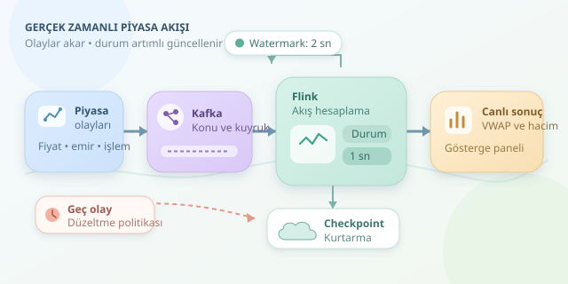

Bir borsada fiyatlar değişirken veri mühendisinin kahvesinin soğumasını bekleyen kimse yoktur. İşlemler, emir güncellemeleri ve fiyat teklifleri saniyede binlerce olay üretir. Akış işleme, bu hareketli nehri depoya doldurmadan analiz etmenin yoludur: Veri gelir, hesaplama ilerler, sonuçlar güncellenir.

``

## Temel fikir: Bitmeyen bir veri kümesi

Toplu işlemede veri kümesinin sınırları bellidir; örneğin dünün işlemleri analiz edilir. Akış işlemede ise kaynak teorik olarak hiç bitmez. Bu yüzden bütün veriyi beklemek yerine her olayla güncellenen **durum** tutulur. Bir sembolün toplam işlem miktarı, son fiyatı veya pencere içindeki toplam işlem değeri bu duruma örnektir.

| Özellik | Toplu işleme | Akış işleme |
|---|---|---|
| Veri kapsamı | Sonlu veri kümesi | Sürekli gelen olaylar |
| Sonuç zamanı | İş tamamlanınca | Artımlı veya pencere kapanınca |
| Temel zorluk | Büyük veri taraması | Gecikme ve durum yönetimi |
| Finansal örnek | Gün sonu raporu | Canlı hacim takibi |




Kapasiteyi sezmek için Little yasası yararlıdır: $L=\lambda W$. Kararlı bir sistemde saniyede $20.000$ olay geliyor ve ortalama sistemde kalış süresi $0{,}05$ saniyeyse, sistemde ortalama $1.000$ olay bulunur. Burada $L$ ortalama olay sayısıdır; işlemci kapasitesi veya bellek ihtiyacı doğrudan bu sayıdan çıkarılamaz.

## Saatler aynı zamanı söylemez

**Olay zamanı**, işlemin piyasada gerçekleştiği andır. **İşleme zamanı**, uygulamanın olayı gördüğü andır. Ağ gecikmesi yüzünden önce gerçekleşen işlem daha sonra ulaşabilir. Finansal hesaplamalarda bu fark önemlidir: Yanlış zaman penceresine eklenen işlem, hacmi ve ortalama fiyatı değiştirir.

Watermark, sistemin olay zamanındaki ilerlemesine ilişkin bir tahmindir. Örneğin iki saniyelik gecikme toleransı, bu eşiğe göre pencerelerin ne zaman tamamlanacağını belirlemeye yardımcı olur. Ancak “artık eski olay gelmez” garantisi değildir. Daha geç gelen kayıtlar için ayrı çıktı, düzeltme veya reddetme politikası gerekir. Anlık ara sonuçlarla kesinleşmiş pencere sonuçları da aynı şey değildir.

## Kafka taşır, Flink hesaplar

Tipik mimaride piyasa adaptörü olayları Kafka'ya yazar; Flink bunları okuyup hesaplar ve sonuçları bir veritabanına veya gösterge paneline gönderir. Kafka dayanıklı taşıma ve yeniden oynatma sağlar. Flink ise anahtarlı durum, zamanlayıcılar ve pencere hesaplamalarını yönetir.

Sembol üzerinden bölümlendirme, aynı enstrümanın olaylarını birlikte işlemeyi kolaylaştırır. Fakat çok hareketli tek bir sembol, **sıcak anahtar** oluşturabilir. Daha fazla çalışan eklemek bu darboğazı kendiliğinden çözmez; gerekiyorsa hesaplama parçalanıp ikinci aşamada birleştirilir.

## Bir saniyelik VWAP hesaplayalım

Hacim ağırlıklı ortalama fiyat, büyük işlemlere daha fazla ağırlık verir:

$$\operatorname{VWAP}=\frac{\sum_i p_i q_i}{\sum_i q_i}$$

Burada $p_i$ işlem fiyatı, $q_i$ işlem miktarıdır. Aşağıdaki Flink SQL örneği, Kafka'daki JSON kayıtlarından sembol başına bir saniyelik VWAP üretir. Uyumlu Kafka connector'ünün kurulu olduğu varsayılır; `event_ms`, UTC epoch milisaniyesidir.

```sql
CREATE TABLE trades (
  symbol STRING,
  price DECIMAL(18, 6),
  quantity BIGINT,
  event_ms BIGINT,
  event_time AS TO_TIMESTAMP_LTZ(event_ms, 3),
  WATERMARK FOR event_time AS
    event_time - INTERVAL '2' SECOND
) WITH (
  'connector' = 'kafka',
  'topic' = 'market-trades',
  'properties.bootstrap.servers' = 'broker:9092',
  'properties.group.id' = 'vwap-demo',
  'scan.startup.mode' = 'latest-offset',
  'format' = 'json'
);

SELECT
  symbol,
  window_start,
  SUM(price * quantity)
    / NULLIF(SUM(quantity), 0) AS vwap,
  SUM(quantity) AS total_volume
FROM TABLE(
  TUMBLE(TABLE trades, DESCRIPTOR(event_time),
         INTERVAL '1' SECOND)
)
WHERE quantity > 0 AND price > 0
GROUP BY symbol, window_start, window_end;
```

`TUMBLE`, çakışmayan zaman pencereleri oluşturur. `DECIMAL`, ikili kayan nokta kaynaklı fiyat hatalarını azaltır; üretimde hassasiyet ve taşma sınırları ayrıca değerlendirilmelidir. Sorgu, watermark ilerleyip pencereyi kapattığında sonuç verir. Dolayısıyla bir saniyelik pencere, bir saniyelik uçtan uca gecikme garantisi değildir. `latest-offset` yeni olaylarla başlar; geçmişi yeniden işlemek için başlangıç politikası değiştirilmelidir.

## Üretimde asıl sınav

- **Tekrarlı kayıtlar:** Benzersiz işlem kimliğiyle deduplikasyon uygulayın; durum saklama süresini beklenen tekrar ufkuna göre seçin.
- **Arıza kurtarma:** Checkpoint, durumu ve kaynak ilerlemesini birlikte kurtarır. Uçtan uca exactly-once için hedef sistem de işlemsel veya idempotent yazmayı desteklemelidir.
- **Geri basınç:** Yavaş hedef, bütün hattı yavaşlatabilir. Kafka gecikmesini, kuyrukları ve checkpoint sürelerini izleyin.
- **Sessiz bölümler:** Veri üretmeyen kaynak bölümleri watermark ilerlemesini durdurabilir; uygun idleness ayarı kullanın.

Özetle mesele yalnızca hızlı kod değildir. Doğru zaman modeli, kontrollü durum ve güvenilir kurtarma birlikte çalışmalıdır. Piyasa koşar; iyi tasarlanmış akış sistemi ise hem yetişir hem de hangi sonucu neden ürettiğini açıklayabilir.
