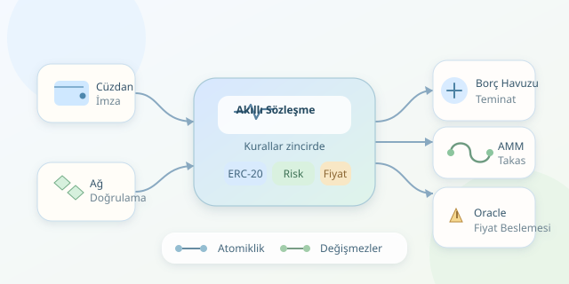

Bir bankanın kredi masasını ve bir borsanın işlem motorunu kodla yeniden tasarladığınızı düşünün. Merkeziyetsiz Finans, yani DeFi, tam olarak bu fikrin peşindedir: Varlıkların saklanması, borçların hesaplanması ve takasların gerçekleştirilmesi akıllı sözleşmeler tarafından yürütülür. Ancak gişedeki görevliyi kaldırmak, güven problemini ortadan kaldırmaz; onu yazılımın kurallarına, veri kaynaklarına ve ekonomik teşviklere taşır.

``

## Mimari: Gişe yok, katmanlar var

Tipik bir DeFi uygulaması; cüzdan bağlantılı arayüz, blokzincir erişimi sağlayan RPC katmanı ve birbirini çağıran akıllı sözleşmelerden oluşur. Arayüz işlemi hazırlar, kullanıcı imzalar, ağ işlemi doğrular. Varlıkların hareketini belirleyen otorite web sitesi değil, zincirdeki sözleşmedir.

Sözleşmeler genellikle havuz, muhasebe, risk yönetimi ve fiyat beslemesi modüllerine ayrılır. ERC-20 standardı token etkileşimlerini ortaklaştırır; oracle ise dış dünyadaki fiyatları zincire taşır. İndeksleyiciler geçmiş olayları okuyarak ekranları hızlandırır, fakat finansal kuralların kaynağı olmaz.

| İşlev | Geleneksel yaklaşım | DeFi yaklaşımı |
|---|---|---|
| Saklama | Kurum hesabı | Sözleşme adresi |
| Borç değerlendirmesi | Gelir ve kredi skoru | Teminat ve risk parametreleri |
| Takas | Emir defteri veya aracı | AMM likidite havuzu |
| Kayıt | Kurum veritabanı | Zincir durumu ve olaylar |

Bu mimaride yükseltme yetkileri de önemlidir: Kod değiştirilebiliyorsa yönetişim, çoklu imza ve zaman kilidi sistemin güven modeline dahildir.

## Borç verme: Teminatın matematiği

Borç verenler varlıklarını bir havuza yatırır. Protokol, yatırılan tutarın havuzdaki payını temsil eden tokenlar veya muhasebe kayıtları üretir. Borç alanlar ise teminat yatırarak başka bir varlığı ödünç alır. Yaygın model aşırı teminatlandırmadır; klasik kredi skorunun yerini teminat tamponu alır.

Tek teminat için borç sınırı kabaca $B_{max}=C \cdot P \cdot LTV$ olur. Burada $C$ teminat miktarı, $P$ birim fiyatı, $LTV$ izin verilen borç oranıdır. Örneğin 2.000 dolarlık teminat ve yüzde 70 LTV, en fazla 1.400 dolarlık borç sağlar.

Tasfiye kontrolünde ayrı bir eşik kullanılır:

$$HF = \frac{C \cdot P \cdot LT}{D}$$

$LT$ tasfiye eşiği, $D$ güncel borç değeridir. $HF<1$ olduğunda tasfiyeciler borcun bir bölümünü kapatıp indirimli teminat alabilir. Faiz, havuzun kullanım oranına göre değişebilir; borç muhasebesi zamanla büyüyen bir endeks üzerinden güncellenir. Böylece her kullanıcı için her blokta ayrı kayıt yazmak gerekmez.

## Takas: Emir defteri yerine eğri

Otomatik piyasa yapıcılar, yani AMM’ler, iki varlığın rezervlerini kullanarak fiyat üretir. Sabit çarpımlı modelin ücret hariç ideal ilişkisi $x \cdot y = k$ şeklindedir. Kullanıcı havuza bir token eklediğinde diğerinden alır; rezerv oranı değiştiği için fiyat da değişir.

Ücret sonrası giriş miktarı $\Delta x_{net}$ ise:

$$\Delta y = \frac{y \cdot \Delta x_{net}}{x + \Delta x_{net}}$$

İşlem rezervlere kıyasla büyüdükçe fiyat etkisi artar. Bu nedenle ekrandaki yaklaşık fiyat, gerçekleşecek ortalama fiyat değildir. Ücret havuzda tutulduğunda gerçek rezerv çarpımı büyüyebilir.

## Kodun kalbi: Çıkış miktarını hesaplamak

Aşağıdaki Solidity kütüphanesi, yüzde 0,3 ücretli bir havuz için takas çıktısını hesaplar. Token taşımaz; yalnızca fiyatlama mantığını gösterir.

```solidity
pragma solidity ^0.8.24;

library AMMMath {
    function quote(
        uint256 amountIn,
        uint256 reserveIn,
        uint256 reserveOut
    ) internal pure returns (uint256) {
        require(amountIn > 0, "ZERO_INPUT");
        require(reserveIn > 0 && reserveOut > 0, "NO_LIQUIDITY");

        uint256 inputWithFee = amountIn * 997;
        uint256 numerator = inputWithFee * reserveOut;
        uint256 denominator = reserveIn * 1000 + inputWithFee;
        return numerator / denominator;
    }
}
```

`997/1000` ücret etkisini temsil eder. Tamsayı bölmesi çıktıyı aşağı yuvarlar; rezervler ilgili tokenların en küçük birimleriyle verilmelidir. Gerçek takas fonksiyonu girdiyi tahsil eder, kullanıcının `minAmountOut` sınırını denetler, rezervleri günceller ve çıktıyı aktarır. İşlem başarısız olursa zincirdeki değişiklikler geri alınır: Buna atomiklik denir.

## Güvenlik: Matematik doğruysa iş bitmiyor

Bu örnek üretime hazır değildir. Gerçek protokoller güvenli token transferleri, yeniden giriş koruması, taşma sınırları ve standart dışı token davranışlarını ele almalıdır. Özellikle transfer sırasında ücret kesen tokenlarda istenen miktarla alınan miktar aynı olmayabilir.

Oracle fiyatları güncellik ve sapma kontrollerinden geçirilmelidir. Tek bir AMM’nin anlık fiyatını teminat değerlemesinde kullanmak, manipülasyona kapı açabilir. Flash loan’lar teminatsızdır ama aynı işlem içinde geri ödenmelidir; atomiklik burada hem özellik hem saldırı büyütücüsüdür.

Son olarak testler yalnızca başarılı senaryoları değil, ekonomik değişmezleri de sınamalıdır: Yetkisiz çekim yapılamamalı, borç muhasebesi tutarlı kalmalı ve takas havuzun değer kuralını korumalıdır. DeFi’nin büyüsü aracıyı kaldırmasında; mühendisliği ise onun yerine sağlam kurallar koymasındadır.



