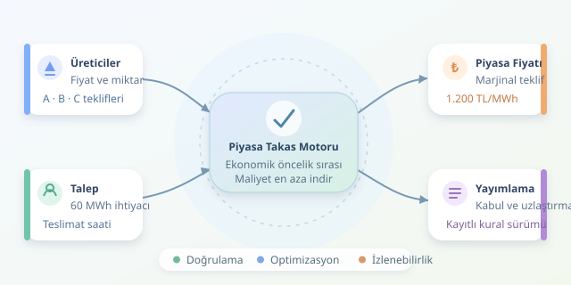

Elektrik piyasasını, her saat yeniden kurulan dev bir açık artırma salonu gibi düşünün. Üreticiler enerji sunar, alıcılar ihtiyaçlarını bildirir, algoritmalar ise hangi tekliflerin kabul edileceğini ve enerjinin hangi fiyattan işlem göreceğini hesaplar. Ancak önemli bir ayrıntı var: Toptan enerji fiyatı ile faturanızdaki dağıtım bedeli aynı mekanizmayla belirlenmez.

``

## Açık artırmanın matematiksel motoru

Şebekede üretim ve tüketim sürekli dengelenmelidir. Gün öncesi piyasalarında katılımcılar, ertesi günün teslimat dönemleri için fiyat ve miktar teklifleri gönderir. Basitleştirilmiş bir modelde talep sabittir; üretim teklifleri ucuzdan pahalıya sıralanarak ihtiyaç karşılanır. Bu sıralamaya **merit order**, yani ekonomik öncelik sırası denir.

Algoritmanın hedefi, tekliflerle temsil edilen toplam maliyeti en aza indirmektir:

$$\min_q \sum_i b_i q_i \quad \text{koşuluyla} \quad \sum_i q_i=D,\; 0\le q_i\le Q_i$$

Burada $b_i$ teklif fiyatını, $q_i$ kabul edilen enerjiyi, $Q_i$ teklif miktarını, $D$ ise talebi gösterir. Enerji MWh, fiyat TL/MWh cinsindedir. Teklif fiyatının gerçek üretim maliyetine eşit olması zorunlu değildir; fırsat maliyeti ve piyasa beklentileri de teklifleri etkiler.

## Son kabul edilen teklif neden önemlidir?

Bir saatlik dönemde talebin 60 MWh olduğunu varsayalım. İletim kısıtı, kayıp ve karmaşık teklif bulunmasın:

| Üretici | Teklif miktarı | Teklif fiyatı | Kabul edilen |
|---|---:|---:|---:|
| A | 30 MWh | 800 TL/MWh | 30 MWh |
| B | 40 MWh | 1200 TL/MWh | 30 MWh |
| C | 20 MWh | 2000 TL/MWh | 0 MWh |

**Tek fiyatlı açık artırmada**, bu varsayımlar altında son kabul edilen teklif fiyatı belirler: $p=1200$. Kabul edilen bütün enerji bu fiyatla ödenir. A'nın geliri 36.000 TL, B'nin geliri 36.000 TL olur. Gelir, kâr değildir; yakıt, işletme ve diğer maliyetler ayrıca düşülür.

Ucuz üreticinin daha yüksek fiyat alması şaşırtıcı görünebilir. Mekanizma, farklı teklifleri ortak bir piyasa fiyatında buluşturur; fakat her piyasanın ödeme ve teklif kuralları aynı değildir.

## Python ile küçük bir piyasa kuralım

Aşağıdaki kod, bölünebilir teklifleri sıralar, talebi doldurur ve marjinal fiyatı döndürür. Eğitim amaçlıdır; gerçek bir piyasa işletim motoru değildir.

```python
from dataclasses import dataclass

@dataclass(frozen=True)
class Offer:
    producer: str
    energy: float
    price: float

def clear_market(offers, demand):
    if demand <= 0 or any(o.energy < 0 for o in offers):
        raise ValueError("Talep pozitif, miktarlar negatif olmayan olmalı.")

    remaining = demand
    accepted = []
    for offer in sorted(offers, key=lambda o: o.price):
        quantity = min(offer.energy, remaining)
        if quantity <= 0:
            continue
        accepted.append((offer.producer, quantity))
        remaining -= quantity
        if remaining <= 1e-9:
            return offer.price, accepted

    raise ValueError("Arz yetersiz; ayrı bir kıtlık kuralı gerekiyor.")

offers = [Offer("A", 30, 800), Offer("B", 40, 1200),
          Offer("C", 20, 2000)]
print(clear_market(offers, 60))
# (1200, [('A', 30), ('B', 30)])
```

Sıralama yaklaşık $O(n\log n)$ zaman alır. B teklifinin yalnızca bir kısmı kabul edilir. Eşit fiyatlı teklifler bu örnekte giriş sırasını korur; gerçek uygulamada bağlayıcı eşitlik kuralları gerekir. Yetersiz arzda hata vermek, gerçek piyasaların kıtlık fiyatlandırmasını temsil etmez.

## Gerçek piyasada işler neden zorlaşır?

Santrallerin minimum üretimi, devreye girme maliyeti ve güç değiştirme sınırları bulunabilir. Blok teklifler birden fazla dönemi birbirine bağlayabilir. Bu yüzden yalnızca sıralama yapmak yetmez; doğrusal veya karma tamsayılı optimizasyon gerekebilir. İletim kısıtları da piyasa tasarımına göre bölgesel ya da düğümsel fiyat farklılıkları yaratabilir.

| Mekanizma | Temel yaklaşım | Önemli ayrım |
|---|---|---|
| Tek fiyatlı ihale | Kabul edilenlere ortak fiyat | Basit örneğimizin modeli |
| Teklif fiyatından ödeme | Her teklife kendi fiyatı | Teklif stratejileri değişir |
| Düzenlenen dağıtım tarifesi | Onaylanan maliyet ve gelir hesabı | Spot enerji ihalesi değildir |

Türkiye'de EPİAŞ'ın gün öncesi piyasasında Piyasa Takas Fiyatı oluşur. Dağıtım bedelleri ise EPDK'nın düzenlediği tarifeler kapsamındadır. Dağıtım şirketlerinin enerji veya hizmet alım ihaleleri yapabilmesi, tüketici dağıtım tarifesinin doğrudan açık artırmayla belirlendiği anlamına gelmez.

## Yazılım mimarisinin görünmeyen kahramanları

Sağlam bir sistem; teklif doğrulama, optimizasyon, sonuç yayımlama ve uzlaştırmayı ayrı katmanlarda ele almalıdır. Tekliflerin zaman damgaları, değişiklik geçmişi ve kullanılan kural sürümü kaydedilmelidir. Böylece aynı girdilerle sonuç yeniden üretilebilir ve itirazlar incelenebilir.

Talep tahminleri veya yenilenebilir üretim gerçekleşmeleri değiştiğinde gün içi işlemler ve dengeleme mekanizmaları devreye girer. Ayrıca fiyat sınırları, teminat kontrolleri ve piyasa gözetimi gerekir: En hızlı algoritma, hatalı veriyi yalnızca daha hızlı işler!

Sonuçta elektrik fiyatı tek bir sihirli formülün değil; ekonomik teklifler, fiziksel sınırlar, piyasa kuralları ve güvenilir yazılımın birlikte çalışmasının ürünüdür.



