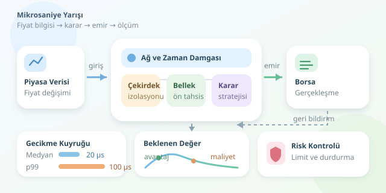

Bir fiyat değişikliğini rakibinizden önce görmek, doğru emri zamanında göndermek ve gerçekleşme haberini gecikmeden işlemek… Yüksek frekanslı ticarette bunların arasındaki birkaç mikrosaniye, fırsat ile maliyet arasındaki sınırı değiştirebilir. Ancak mesele yalnızca işlemciyi hızlandırmak değildir: ağ, yazılım, piyasa mikro yapısı ve risk kontrolleri aynı yarış pistindedir. Üstelik pistte trafik hiç bitmez!




``

## Hız neden ekonomik değer taşır?

HFT sistemleri, kısa ömürlü fiyat farklılıklarını değerlendirebilir veya sürekli alış ve satış kotasyonları sunabilir. Yeni bilgi geldiğinde mevcut emirler hızla güncellenmelidir. Aksi hâlde eski fiyatınız, sizden hızlı bir katılımcı için cazip bir hedef olur. Buna **ters seçim** denir: emriniz, fiyatın sizin aleyhinize hareket edeceği koşullarda gerçekleşir.

Gecikmenin etkisini basitleştirilmiş bir modelle düşünelim:

$$E[P\vert L] = p_{fill}(L) [A_0 e^{-L/\tau} - c - a(L)]$$

Burada $L$ gecikme, $A_0$ başlangıçtaki brüt avantaj, $\tau$ fırsatın sönümlenme süresi, $c$ işlem maliyeti, $a(L)$ ise gerçekleşme başına beklenen ek ters seçim kaybıdır. $p_{fill}(L)$ emrin gerçekleşme olasılığını temsil eder. Avantaj ile ters seçim terimlerini ayrı tanımlamak, aynı kaybı iki kez saymamak açısından önemlidir.

Örneğin $A_0=1{,}2$ baz puan ve $\tau=80$ mikrosaniye olsun. Avantaj, 20 mikrosaniyede yaklaşık 0,935; 100 mikrosaniyede 0,344 baz puana düşer. Maliyet 0,4 baz puansa ikinci senaryo, ters seçim eklenmeden bile negatiftir. Bir baz puan, yüzde 0,01’dir.

Bu model öğreticidir; gerçek piyasada gerçekleşme olasılığı, kuyruk konumu ve rakiplerin davranışı birlikte değişir. Daha hızlı olmak, otomatik olarak daha kârlı olmak değildir.

## Gecikme bütçesini parçalayın

Önce “hangi gecikme?” sorusunu cevaplayın. Piyasa verisinin sisteme ulaşmasından emrin ağ kartından çıkmasına kadar geçen süre, borsanın emri kabul etmesine kadar geçen süreden farklıdır. Strateji açısından anlamlı başlangıç ve bitiş noktalarını açıkça tanımlayın.

| Katman | Tipik sorun | Optimizasyon yaklaşımı |
|---|---|---|
| Ağ | Paket kuyrukları, fiziksel mesafe | Kolokasyon, uygun ağ donanımı |
| İşletim sistemi | Zamanlama, kesmeler | CPU sabitleme, çekirdek izolasyonu |
| Bellek | Tahsis, önbellek kaçırmaları | Ön tahsis, NUMA farkındalığı |
| Uygulama | Kilitler, gereksiz kopyalar | Basit veri akışı, sınırlı kuyruklar |

Kolokasyon fiziksel mesafeyi azaltır; mesafeyi yazılım optimizasyonuyla yenemezsiniz. DPDK gibi kernel-bypass yaklaşımları uygun mimarilerde işletim sistemi ağ yolunu kısaltabilir. Fakat yoğun sorgulama CPU tüketir; operasyonel karmaşıklık ve bakım maliyeti de artar.

## Ortalama değil, kuyruk gecikmesi kazanır

Ortalama 10 mikrosaniye güzel görünür. Ancak haber anında bazı emirlerin 300 mikrosaniyeye sıçraması stratejiyi bozabilir. Bu nedenle medyanın yanında **p99 ve p99.9** değerlerini izleyin. Yeterli örnek sayısı olmadan yüksek yüzdelikler güvenilir değildir.

Aşağıdaki Python deneyi, iki sentetik gecikme dağılımının basitleştirilmiş beklenen getiriyi nasıl etkilediğini gösterir. Bu kod emir gönderme yolunda çalıştırılacak bir bileşen değil, araştırma aracıdır.

```python
import numpy as np

rng = np.random.default_rng(42)
samples = 100_000
scenarios = {
    "once": rng.lognormal(np.log(40), 0.60, samples),
    "sonra": rng.lognormal(np.log(20), 0.35, samples),
}

for name, latency_us in scenarios.items():
    edge_bps = 1.2 * np.exp(-latency_us / 80)
    fill_probability = 0.4
    cost_bps = 0.4
    adverse_loss_bps = 0.1
    expected_bps = fill_probability * (
        edge_bps - cost_bps - adverse_loss_bps
    )
    p50, p99 = np.percentile(latency_us, [50, 99])
    print(name, round(p50, 2), round(p99, 2),
          round(expected_bps.mean(), 4))
```

Kod, gecikme örnekleri üretir; her fırsat için maliyet sonrası beklenen değeri hesaplar ve yüzdelikleri raporlar. Gerçekleşme olasılığı ile ters seçim kaybı burada sabittir. Dolayısıyla sonuçlar gerçek strateji kârlılığının tahmini değil, varsayımların etkisini gösteren bir laboratuvar deneyidir.

## Ölçüm ve güvenlik birlikte ilerlemeli

Donanımsal zaman damgaları ve uygun PTP senkronizasyonu, makineler arası ölçümleri iyileştirebilir. Aynı makinedeki süre ölçümlerinde monoton saat tercih edin. Saat alanlarını karıştırmayın; ölçüm kodunun kendi maliyetini de kontrol edin.

Optimizasyonları tek tek uygulayın ve aynı yük altında karşılaştırın. Paket kaybı, kuyruk derinliği, reddedilen emirler ve gerçekleşme kalitesi de izlenmelidir. Sınırsız kuyruk yerine taşma davranışı tanımlanmış yapılar kullanın; eski veriyi hızla işlemek yine yanlış karar üretebilir.

Son olarak pozisyon limitleri, emir hız sınırları ve acil durdurma mekanizması hız uğruna kaldırılmamalıdır. HFT’de başarı, en hızlı yanlış emri göndermek değil; doğru, ölçülebilir ve kontrollü kararı zamanında verebilmektir.
