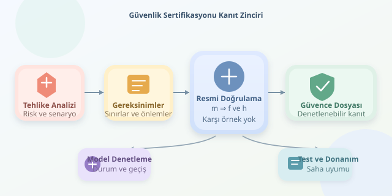

Bir insansız aracın yazılım hatası, ekranda beliren sevimli bir uyarıyla sınırlı kalmayabilir; yanlış frenleme veya beklenmedik yön değişimi doğurabilir. Bu yüzden kritik yazılımlarda “bende çalışıyor” yaklaşımı emekliye ayrılır. Güvenlik sertifikasyonu, yazılımın belirlenmiş koşullarda kabul edilebilir riskle çalıştığını sistematik kanıtlarla göstermeyi amaçlar.
``

## Sertifika, kusursuzluk belgesi değildir

Önce önemli ayrımı yapalım: Hiçbir sertifikasyon süreci, gerçek dünyada bütün hataların imkânsız olduğunu garanti etmez. Güvence; tanımlanmış gereksinimler, çevresel varsayımlar ve işletim sınırları kapsamında oluşturulur. Dolayısıyla doğru soru, “Yazılım hatasız mı?” yerine “Hangi tehlikelere karşı, hangi varsayımlarla, hangi kanıtlarımız var?” olmalıdır.

Araç türü ve kullanım bağlamı, uygulanacak çerçeveyi değiştirir:

| Çerçeve | Tipik kapsam | Temel vurgu |
|---|---|---|
| DO-178C | Havacılık yazılımı | Yazılım geliştirme ve doğrulama güvencesi |
| DO-333 | DO-178C için resmi yöntemler eki | Matematiksel doğrulama kanıtları |
| ISO 26262 | Kapsamındaki kara yolu araçları | Elektrik/elektronik sistemlerin fonksiyonel güvenliği |
| ISO 21448 | Kapsamındaki otomotiv işlevleri | Amaçlanan işlevin güvenliği, algılama yetersizlikleri |
| IEC 61508 | Genel elektrik/elektronik güvenlik sistemleri | Güvenlik yaşam döngüsü |




Bunlar birbirinin yerine kullanılan evrensel sertifikalar değildir. Özellikle havacılıkta sistem değerlendirmesi ve donanım güvencesi, yazılım sürecinden ayrı fakat bağlantılı çalışmalar gerektirir.

## Süreç: Tehlikeden doğrulama kanıtına

İlk adım, tehlike analiziyle başlar. Örneğin sensör verisinin eskimesi, aracın yanlış konum üzerinden hareket komutu üretmesine yol açabilir. Bu senaryo; güvenlik gereksinimlerine, ardından mimari önlemlere dönüştürülür: zaman damgası denetimi, bağımsız izleme, komut sınırlandırma ve güvenli duruş gibi.

Sonra gereksinimden tasarıma, koddan teste uzanan **çift yönlü izlenebilirlik** kurulur. Her kritik gereksinimin nasıl gerçekleştirildiği ve doğrulandığı görünür olmalıdır. Yapılandırma yönetimi, değişiklik kontrolü, incelemeler ve gerektiğinde bağımsız doğrulama bu zinciri korur. Sertifikasyon yalnızca son gün çalıştırılan testlerden oluşmaz; geliştirme boyunca biriken kanıtların değerlendirilmesidir.

## Resmi doğrulamanın matematiksel omurgası

Bir denetleyiciyi durumlar ve geçişlerle modelleyelim. $m$ hareket iznini, $f$ sensör verisinin tazeliğini, $h$ sistem sağlığını temsil etsin. İstenen güvenlik değişmezi şudur:

$$I(s) = m \Rightarrow (f \land h)$$

Yani hareket izni varsa veri güncel ve sistem sağlıklı olmalıdır. Tümevarımsal ispat için değişmezin başlangıçta geçerli olduğunu, ardından her izin verilen geçişte korunduğunu gösteririz:

$$Init(s) \Rightarrow I(s)$$
$$I(s) \land T(s,s') \Rightarrow I(s')$$

| Yöntem | Sorduğu soru | Önemli sınır |
|---|---|---|
| Test | Seçilen girdide sonuç doğru mu? | Denenmeyen durumlar kalır |
| Model denetleme | Modelde ihlal yolu var mı? | Durum uzayı büyüyebilir |
| Teorem ispatlama | Özellik varsayımlardan çıkar mı? | İspat uzmanlığı gerektirir |
| Soyut yorumlama | Program güvenli sınırlar içinde mi? | Soyutlama yanlış alarmlar üretebilir |

## Küçük bir Z3 örneği

Aşağıdaki Python kodu, hata görüldüğünde hareket iznini kilitleyen soyut bir gözeticiyi doğrular. Çalıştırmak için `z3-solver` paketi gerekir. Çözücüye ispatı değil, ispatı bozacak bir karşı örneği aratırız:

```python
from z3 import Bools, And, Or, Not, Implies, Solver

m, f, h, locked = Bools('m f h locked')
mn, fn, hn, locked_n = Bools('mn fn hn locked_n')

def invariant(move, fresh, healthy, latch):
    return And(
        Implies(move, And(fresh, healthy)),
        Implies(latch, Not(move))
    )

current = invariant(m, f, h, locked)
following = invariant(mn, fn, hn, locked_n)
initial = And(Not(m), Not(locked))
transition = And(
    locked_n == Or(locked, Not(fn), Not(hn)),
    mn == And(Not(locked_n), fn, hn)
)

checks = {
    'initial': And(initial, Not(current)),
    'step': And(current, transition, Not(following))
}
for name, counterexample in checks.items():
    solver = Solver()
    solver.add(counterexample)
    print(name, solver.check())
```

İki kontrolün de `unsat` vermesi, başlangıç ve geçiş koşulları altında karşı örnek bulunmadığını gösterir. Buradaki kilit, hata sonrasında izin verilmesini engeller; yeniden başlatma davranışı modellenmemiştir. Ayrıca hareket izni, fiziksel hız değildir: fren mesafesi, gecikmeler ve sensörün yanlışlıkla “sağlıklı” görünmesi bu ispatın dışında kalır.

## Kanıttan sahaya geçiş

Matematiksel model ile gerçek kod arasındaki uyum ayrıca doğrulanmalıdır. Donanım üzerinde testler, zamanlama ve kaynak analizleri, hata enjeksiyonu ve entegrasyon değerlendirmeleri bu nedenle önemlidir. İşletim varsayımları değiştiğinde kanıtların geçerliliği yeniden incelenir. Siber güvenlik de ayrı, ancak etkileşen bir güvence alanıdır.

En güçlü yaklaşım, resmi doğrulamayı testlerin rakibi değil tamamlayıcısı yapmaktır. Model bize mantıksal sınırları gösterir; testler uygulamanın gerçek dünyayla ilişkisini sorgular. Sertifikasyon ise bu kanıtları izlenebilir, denetlenebilir ve bağlama uygun bir güvence bütününe dönüştürür.
