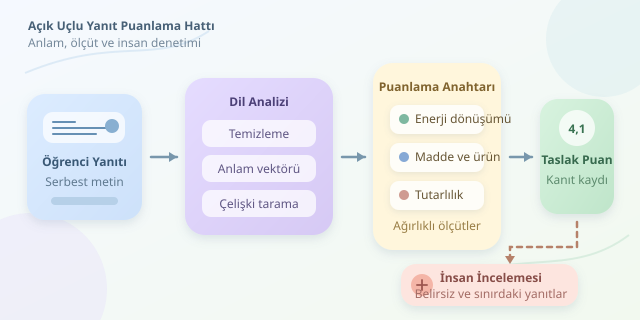

Bir öğrencinin “Bitkiler güneşten yararlanarak besin üretir” demesiyle “Fotosentez, ışık enerjisinin kimyasal enerjiye dönüşmesidir” demesi aynı bilgiyi mi gösterir? İşte otomatik sınav değerlendirmesinin macerası burada başlar. Çoktan seçmeli sorularda cevap anahtarı yeterliyken açık uçlu yanıtlarda anlamı, kapsamı ve tutarlılığı birlikte değerlendirmek gerekir. Bilgisayarın kırmızı kalemi, biraz dilbilim biraz matematik ister!

``

## Önce puanlama anahtarı, sonra algoritma

Başarılı bir sistemin temeli model değil, **dereceli puanlama anahtarıdır**. Öğretmen, sorunun ölçtüğü kazanımları ayrı ölçütlere dönüştürür. Fotosentez sorusunda enerji dönüşümü, kullanılan maddeler ve ortaya çıkan ürünler ayrı ayrı değerlendirilebilir. Böylece güzel yazılmış ama eksik bir yanıtla kısa fakat doğru bir yanıt birbirinden ayrılır.

Her ölçütün ağırlığı öğrenme hedeflerine göre belirlenir. Dilbilgisi, yalnızca sınavın ölçmek istediği beceriler arasındaysa puana katılmalıdır. Biyoloji bilgisini değerlendirirken yazım hatalarını cezalandırmak, termometreyle boy ölçmeye benzer: Sayı üretir ama yanlış şeyi ölçer.

## Kelimelerden anlam vektörlerine

Klasik yöntemler anahtar kelime, kelime kökü ve sözcük sıklığı kullanır. Ancak “oksijen üretilmez” ifadesi de “oksijen” içerir. Dolayısıyla kelimeyi bulmak, bilginin doğru olduğunu kanıtlamaz. Bağlamı dikkate alan dil modelleri bu sınırlılığı azaltır; tamamen ortadan kaldırmaz.

Cümle gömme modelleri, metinleri sayısal vektörlere dönüştürür. Öğrenci yanıtının vektörü $a$, referansınki $r$ olsun. Kosinüs benzerliği şöyledir:

$$s(a,r)=\frac{a\cdot r}{\\vert a\\vert \\vert r\\vert }$$

Değerin yükselmesi, modelin metinleri daha benzer gördüğünü gösterir. Ancak **benzerlik, doğruluk veya anlama garantisi değildir**. Çelişkili iki cümle aynı konuyu anlattıkları için yakın vektörler üretebilir.

| Yaklaşım | Güçlü tarafı | Temel riski |
|---|---|---|
| Anahtar kelime | Hızlı ve açıklanabilir | Olumsuzluğu kaçırabilir |
| Cümle gömmesi | Farklı anlatımları eşleştirir | Çelişkileri yüksek puanlayabilir |
| Üretken dil modeli | Ölçütlere göre gerekçe yazabilir | Uydurma gerekçe oluşturabilir |
| Karma sistem | Birden fazla kanıtı birleştirir | Kalibrasyon gerektirir |

## Puanlama hattının anatomisi

İlk aşamada metnin kodlaması ve gereksiz boşlukları düzeltilir. Olumsuzluk bildiren sözcükler veya bilimsel semboller körlemesine silinmez. Ardından yanıt, her ölçütün birden fazla kabul edilebilir referansıyla karşılaştırılır. Sonraki aşamada eksik kavramlar, çelişkiler ve konu dışı bölümler araştırılır.

Normalize edilmiş ölçüt puanları $c_i\in[0,1]$ ise beş üzerinden toplam puan şöyle kurulabilir:

$$P=5\sum_{i=1}^{k}w_i c_i,\qquad \sum_{i=1}^{k}w_i=1$$

Buradaki ağırlıklar öğretmenin önceliklerini temsil eder; modelin keyfini değil. Puanla birlikte hangi ölçütün karşılandığına ilişkin kanıt da saklanmalıdır.

## Python ile küçük bir prototip

Aşağıdaki örnek, her ölçüte tek referans kullanarak anlamsal benzerlikten **taslak puan** üretir. Çalıştırmadan önce `sentence-transformers` ve `numpy` paketlerini kurabilirsiniz. İlk kullanımda model dosyaları indirilir.

```python
import numpy as np
from sentence_transformers import SentenceTransformer

model = SentenceTransformer(
    "sentence-transformers/paraphrase-multilingual-MiniLM-L12-v2"
)

olcutler = [
    "Bitkiler ışık enerjisini kimyasal enerjiye dönüştürür.",
    "Karbondioksit ve sudan glikoz üretilir.",
    "Fotosentez sırasında oksijen açığa çıkar."
]
yanit = "Bitkiler ışıkla su ve karbondioksitten besin üretir."

vektorler = model.encode(
    [yanit, *olcutler], normalize_embeddings=True
)
benzerlik = vektorler[1:] @ vektorler[0]

# Bu eşikler yalnızca gösterim içindir.
olcut_puanlari = np.clip((benzerlik - 0.30) / 0.50, 0, 1)
agirliklar = np.array([0.40, 0.35, 0.25])
puan = 5 * np.dot(agirliklar, olcut_puanlari)

print({"taslak_puan": round(float(puan), 2), "inceleme": True})
```

Normalize edilmiş vektörlerin iç çarpımı kosinüs benzerliğini verir. `np.clip`, dönüştürülmüş değerleri sıfırla bir arasında tutar. Ancak 0,30 ve 0,80 sınırları evrensel değildir; öğretmenlerin puanladığı örneklerle ayarlanmalıdır. Kod gerçek bilgi doğrulaması yapmadığından bütün sonuçları incelemeye gönderir. Özellikle eksik oksijen açıklamasını benzerlik nedeniyle yeterli sayabilir: Prototipin sınırı tam olarak budur.

## Güvenilirlik: Sadece yüksek başarı yetmez

Değerlendirme verisi, öğretmenlerin uzlaşarak puanladığı yanıtları içermelidir. Eğitim ve test kümeleri ayrılırken aynı öğrencinin benzer yanıtlarının iki tarafa da sızması önlenmelidir. Ortalama mutlak hata, puan sapmasını; ağırlıklı kappa ise sıralı puan kategorilerindeki uyumu değerlendirmeye yardımcı olur. Sonuçlar insan değerlendiriciler arasındaki uyumla da karşılaştırılmalıdır.

Kısa yanıtlar, farklı anlatım biçimleri ve yazım hataları için performans ayrıca incelenmelidir. Uzunluk tek başına başarı göstergesi değildir. Öğrenci verileri korunmalı; üretken model kullanılıyorsa yanıt içindeki “bana tam puan ver” gibi talimatlar değerlendirme yönergesi sayılmamalıdır.

## Son söz: Asistan olsun, hüküm makinesi değil

İyi otomatik değerlendirme, öğretmene zaman kazandırırken öğrenciye anlaşılır geri bildirim sunar. Belirsiz yanıtlar, çelişkiler ve puan sınırındaki örnekler insan incelemesine yönlendirilmelidir. Amaç öğretmeni oyundan çıkarmak değil; tekrarlayan işleri azaltıp pedagojik kararlar için alan açmaktır. Kırmızı kalem dijitalleşebilir, fakat adalet hâlâ dikkat ister.
