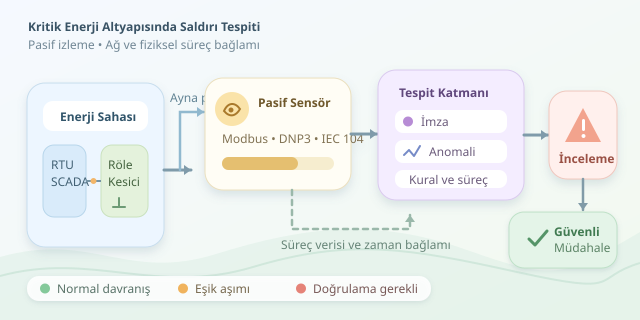

Elektrik şebekesinde bir siber saldırı, yalnızca ekranda beliren kırmızı bir uyarı değildir; yanlış açılan bir kesici, geciken bir kontrol komutu veya güvenilmez hâle gelen ölçümler anlamına gelebilir. Bu yüzden kritik enerji altyapısının dijital nöbetçileri, ağ paketleriyle fiziksel süreçleri birlikte izler. Kahve molası verebiliriz, ama şebekenin dikkatini dağıtma lüksü yoktur!

``

## IT güvenliğinden OT güvenliğine

Kurumsal bilgi teknolojileri, yani IT, veri ve uygulamaları korur. Operasyonel teknoloji, yani OT ise fiziksel ekipmanı izler ve yönetir. SCADA sistemleri, uzak terminal birimleri ve koruma röleleri bu dünyanın parçalarıdır. Burada güvenlik önleminin kendisi de risk yaratabilir: üretim ortamında agresif tarama yapmak, eski bir cihazı iletişimsiz bırakabilir.

Bu nedenle izleme çoğunlukla **pasif** yürütülür. Ağ anahtarlarının ayna portları veya uygun ağ TAP cihazları üzerinden trafik kopyalanır; sensör, kontrol iletişiminin yoluna girmez. Sensörlerin yerleşimi, görünürlük kadar güvenli veri aktarımını da gözetmelidir.

| Boyut | Kurumsal IT | Enerji OT ortamı |
|---|---|---|
| Öncelik | Veri ve hizmetlerin korunması | Emniyet, süreklilik ve bütünlük |
| Değişiklik | Görece sık güncelleme | Planlı bakım pencereleri |
| İzleme | Uç nokta ve ağ kayıtları | Ağ, cihaz ve süreç verileri |
| Müdahale | Cihaz izolasyonu uygulanabilir | Fiziksel etkiler önce değerlendirilir |




## Saldırı tespiti neyi arar?

Bir ağ saldırı tespit sistemi, bilinen kötü davranışlara ait imzaları arayabilir. Ancak enerji altyapısında saldırgan, geçerli bir hesabı ve protokole uygun komutları kullanabilir. Paket düzgün görünürken niyet yanlış olabilir. Bu yüzden tek yöntem yerine katmanlı tespit tercih edilir:

- **İmza tabanlı tespit:** Bilinen saldırı örüntülerini yakalar; yeni tekniklerde kör kalabilir.
- **Anomali tespiti:** Cihazın alışılmış iletişiminden sapmaları bulur; bakım faaliyetlerini saldırıyla karıştırabilir.
- **Kural ve süreç doğrulaması:** Komutun kaynağını, zamanını ve fiziksel koşullarla tutarlılığını değerlendirir.

Modbus TCP, DNP3 ve IEC 60870-5-104 gibi protokollerin farkında olan sensörler, yalnızca bağlantıları değil işlem türlerini de inceler. Örneğin normalde ölçüm okuyan bir istasyonun aniden kontrol komutları göndermesi araştırılmalıdır. Yine de bu değişiklik, tek başına saldırı kanıtı değildir.

## Normal davranışı matematikle tarif etmek

Her cihazın dakikadaki kontrol komutu sayısını $x_t$ ile gösterelim. Sağlıklı geçmişten hesaplanan ortalama $m$, standart sapma $s$ olsun. Basit bir anomali puanı şöyle tanımlanabilir:

$$z_t = \frac{x_t - m}{s + e}$$

Buradaki küçük pozitif $e$, sıfıra bölünmeyi önleyen sayısal bir destektir. $\vert z_t\vert  > 3$ koşulu, inceleme için başlangıç eşiği olabilir; saldırının kesin olasılığını vermez. Özellikle seyrek komutlar, normal dağılıma uymayan veriler ve değişen çalışma koşulları bu yaklaşımın sınırlarını gösterir.

Sağlıklı referans davranışı, cihazın rolüne ve işletme durumuna göre oluşturulmalıdır. Gece yüküyle bakım saatlerini aynı sepete koyarsak, dedektörümüz her farklılığı görünce düdük çalan aşırı heyecanlı bir hakeme dönüşür.

## Python ile küçük bir savunma deneyi

Aşağıdaki örnek, tamamen sentetik dakikalık komut sayılarından cihaz bazlı referans üretir. Gerçek şebekeye bağlanmaz ve hiçbir kontrol komutu göndermez.

```python
import pandas as pd

history = pd.DataFrame({
    "asset": ["rtu-1"] * 8 + ["rtu-2"] * 8,
    "rate": [2, 3, 2, 4, 3, 2, 3, 4,
             1, 2, 1, 1, 2, 1, 2, 1]
})
current = pd.DataFrame({
    "asset": ["rtu-1", "rtu-2"],
    "rate": [14, 2]
})

baseline = history.groupby("asset")["rate"].agg(
    mean="mean", std="std"
)
scored = current.join(baseline, on="asset")
scored["z"] = (
    (scored["rate"] - scored["mean"])
    / (scored["std"] + 0.1)
)
alerts = scored.loc[
    scored["z"].abs() > 3, ["asset", "rate", "z"]
]
print(alerts.to_string(index=False))
```

`groupby` her cihazı kendi geçmişiyle karşılaştırır; `join` güncel gözlemleri bu istatistiklerle eşleştirir. Son filtre, eşik aşımını raporlar. Sekiz örnek yalnızca gösterim içindir: üretimde daha uzun, doğrulanmış geçmiş; eksik veri yönetimi ve yeni cihazlar için ayrı kurallar gerekir.

## Alarmdan güvenli müdahaleye

Alarmlar, merkezi güvenlik izleme platformunda bakım kayıtları, operatör oturumları ve süreç ölçümleriyle ilişkilendirilmelidir. Saat senkronizasyonu önemlidir; aksi hâlde komut ile fiziksel değişimin sırası yanlış yorumlanabilir. Analist, yetkili bir bakım işlemiyle beklenmeyen davranışı bu bağlam sayesinde ayırır.

Şifreli trafik, paket kaybı ve eksik envanter görünürlüğü sınırlar. Referans davranışının kontrolsüz güncellenmesi de saldırgan etkinliğini zamanla normalleştirebilir. Bu yüzden modeller ve kurallar düzenli olarak gözden geçirilmelidir.

Son olarak, alarm almak otomatik olarak kesici açmak anlamına gelmez. Müdahale; işletme ekibiyle koordineli, önceden test edilmiş ve emniyet odaklı olmalıdır. Başarı, en çok alarmı üretmek değil, doğru şüpheyi zamanında gösterirken elektriğin güvenle akmasını sağlamaktır.
