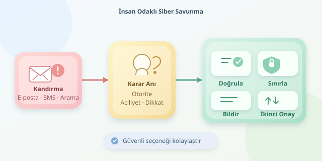

Bir saldırganın içeri girmek için her zaman yazılım açığı bulması gerekmez. Bazen “Merhaba, bilgi işlemden arıyorum” demesi yeterlidir. Sosyal mühendislik, teknik savunmaları insanların kararları üzerinden aşmaya çalışır. Ancak insanı otomatik olarak “en zayıf halka” ilan etmek eksik bir teşhistir: Zaman baskısı, kötü tasarlanmış süreçler ve belirsiz sorumluluklar da saldırganın takımında oynar.




``

## Beynimizin Kullanışlı Kısayolları

İnsan beyni her mesajı adli incelemeye tabi tutmaz. Günlük yaşamda hızlı karar vermek için güven, alışkanlık ve bağlam gibi işaretlerden yararlanırız. Bu kısayollar genellikle faydalıdır; saldırganlar ise onları yanlış bağlamda tetiklemeye çalışır.

Örneğin yönetici gibi görünen birinden gelen acil ödeme talebi, otoriteye uyma eğilimini zaman baskısıyla birleştirir. Yoğun bir çalışanın dikkati bölündüğünde, mesajdaki küçük tutarsızlıkları fark etmesi zorlaşır. Burada mesele zekâ eksikliği değil, sınırlı dikkat kaynaklarıdır. Aynı çalışan sakin bir ortamda şüpheli bulacağı isteği, toplantılar arasında sıradan bir görev gibi değerlendirebilir.

Basitleştirilmiş risk modeli şöyledir:

$$R = P \times E$$

Burada $P$, saldırının başarı olasılığı; $E$ ise gerçekleşirse oluşturacağı etkidir. Bu bir ölçüm standardı değil, düşünme aracıdır. Eğitim olasılığı azaltmaya yardımcı olurken, sınırlı yetkiler ve ödeme onayları etkiyi küçültebilir.

| Psikolojik tetikleyici | Tipik görünüm | Savunma refleksi |
|---|---|---|
| Otorite | “Genel müdür istedi” | Bağımsız kanaldan doğrula |
| Aciliyet | “Hesabınız bugün kapanacak” | İşlemi durdur, süreyi sorgula |
| Sosyal kanıt | “Herkes bu uygulamayı kurdu” | Kurum politikasını kontrol et |
| Karşılıklılık | “Yardım ettim, kodu paylaşır mısın?” | Doğrulama kodlarını paylaşma |

## Psikoloji Teknik Zincire Nasıl Bağlanır?

Kimlik avı e-postası, SMS dolandırıcılığı veya telefonla kandırma farklı kanallardır; ortak amaçları güven oluşturup bir davranış başlatmaktır. Bu davranış bağlantıya tıklamak, dosya açmak, ödeme yapmak veya erişim izni vermek olabilir.

Teknik tarafta taklit alan adları, yanıltıcı görünen adlar ve ele geçirilmiş gerçek hesaplar devreye girer. Dolayısıyla düzgün Türkçe, kurumsal logo veya tanıdık gönderen tek başına güven kanıtı değildir. HTTPS de yalnızca bağlantının şifrelendiğini gösterir; sitenin dürüst olduğunu değil. Kilit simgesi, dijital dünyanın ahlak sertifikası değildir!

Çok faktörlü doğrulama önemlidir; fakat bütün yöntemler eşit değildir. SMS ve tek kullanımlık kodlar kandırılarak paylaşılabilir. FIDO2/WebAuthn tabanlı güvenlik anahtarları ve uygun yapılandırılmış geçiş anahtarları, doğrulamayı gerçek hizmetin alan adına bağlayarak kimlik avına karşı daha güçlü koruma sağlar.

## Küçük Bir Savunma Otomasyonu

Aşağıdaki Python örneği, gönderen adresini, aciliyet ifadelerini ve bağlantı alanlarını inceleyerek uyarılar üretir. Yalnızca ön kontroldür; mesajları güvenli veya zararlı diye kesin sınıflandırmaz.

```python
from email.utils import parseaddr
from urllib.parse import urlparse

GUVENILEN = {'kurum.example'}


def on_kontrol(gonderen, metin, baglantilar):
    uyarilar = []
    adres = parseaddr(gonderen)[1]
    alan = adres.rpartition('@')[2].casefold()

    if alan not in GUVENILEN:
        uyarilar.append('Gönderen alanını doğrulayın.')

    if any(k in metin.casefold() for k in ('acil', 'hemen')):
        uyarilar.append('Zaman baskısı içeren ifade bulundu.')

    for baglanti in baglantilar:
        url = urlparse(baglanti)
        hedef = (url.hostname or '').casefold()
        tanidik = any(
            hedef == alan or hedef.endswith('.' + alan)
            for alan in GUVENILEN
        )
        if url.scheme not in {'http', 'https'} or not tanidik:
            uyarilar.append('Bağlantıyı bağımsız kanaldan doğrulayın.')

    return uyarilar
```

`parseaddr`, görünen isimden e-posta adresini ayırır; `urlparse`, bağlantının gerçek sunucu adını çıkarır. Noktalı alt alan kontrolü, kurum adını yalnızca içinde barındıran sahte alanları kabul etmez. Bununla birlikte görünen gönderen adresi taklit edilebilir. Üretimde ayrıştırma hataları ele alınmalı; SPF, DKIM ve DMARC sonuçları değerlendirilmelidir. Bu kontroller de içeriğin iyi niyetli olduğunu garanti etmez.

## İnsanları Değil, Sistemi Güçlendirin

- **Doğrulamayı kolaylaştırın:** Şüpheli aramayı kapatıp kurum rehberindeki numarayı aramak normal prosedür olsun.
- **Kritik işlemleri ayırın:** Banka hesabı değişiklikleri ve yüksek tutarlı ödemeler ikinci onay gerektirsin.
- **Yetkileri sınırlandırın:** Tek hesabın ele geçirilmesi bütün kurumu etkilemesin.
- **Bildirimi ödüllendirin:** Hata yapanı utandırmak, sonraki olayın gizlenmesine yol açabilir.
- **Müdahaleyi hazırlayın:** Şüpheli tıklamada güvenlik ekibine hızla bildirim yapılsın; oturumların iptali ve hesap incelemesi planlansın.

Başarı ölçütü yalnızca eğitim sınavındaki puan değildir. Şüpheli mesajların bildirilme hızı, doğrulama süreçlerinin uygulanması ve olayların etkisi de izlenmelidir. Amaç herkesi paranoyak yapmak değil; kritik anlarda durmayı, kontrol etmeyi ve yardım istemeyi kolaylaştırmaktır.

İnsan faktörü yalnızca bir açık değildir; iyi desteklendiğinde güçlü bir algılama katmanıdır. En sağlam savunma, çalışanlara “Dikkatli olun” demekle yetinmez: Dikkat dağıldığında bile güvenli seçeneği kolaylaştırır.
