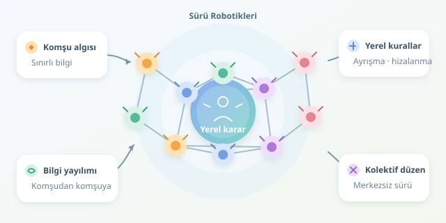

Yüzlerce drone’un gökyüzünde birbirine çarpmadan hareket ettiğini düşünün. Ortada herkese emir yağdıran bir kontrol kulesi yok; her araç yalnızca yakın çevresini gözlüyor ve küçük kararlar alıyor. Sürü robotiklerinin büyüsü burada: Basit yerel kurallar, birlikte uygulandığında şaşırtıcı derecede düzenli küresel davranışlar oluşturabiliyor. Ancak bu düzen kendiliğinden değil, doğru tasarlanmış etkileşimlerden doğuyor.

``

## Büyük düzen, küçük kararlar

Merkezsiz koordinasyonda her robot kendi konumunu, hızını ve erişebildiği komşularının durumunu kullanır. Komşuluk; belirli bir mesafeyle, sensör görüş alanıyla veya kablosuz bağlantıyla tanımlanabilir. Bütün robotların birbirini görmesi gerekmez: Bilgi, komşudan komşuya yayılabilir.

Bu yapıyı bir grafikle temsil ederiz: Robotlar düğüm, iletişim bağlantıları kenardır. Bir robotun komşu kümesi $N_i$ olsun. Kontrol girdisi genel olarak $u_i=f(x_i,\{x_j:j\in N_i\})$ biçimindedir. Burada $x_i$ robotun durumunu belirtir. Kritik fikir, kararın tüm sürünün durumuna değil, erişilebilir yerel bilgiye dayanmasıdır. Böylece tek bir merkezi bilgisayarın arızası bütün koordinasyonu doğrudan durdurmaz; fakat iletişim ağının parçalanması yine ciddi sorun yaratabilir.

## Hangi algoritma, hangi davranış?

Tek bir sihirli sürü algoritması yoktur. Hareket düzenlemek, ortak bir değerde uzlaşmak ve görev paylaşmak farklı problemlerdir. Bu nedenle gerçek sistemler çoğunlukla birkaç yöntemi birleştirir.

| Yaklaşım | Yerel mekanizma | Güçlü olduğu iş | Temel zorluk |
|---|---|---|---|
| Boids | Ayrışma, hizalanma, birleşme | Sürü hâlinde hareket | Ağırlıkların dengelenmesi |
| Konsensüs | Komşularla durum farkını azaltma | Ortak hız veya ölçüm | Bağlantı ve gecikme |
| Stigmerji | Çevrede bırakılan izlere tepki | Keşif ve alan tarama | İzlerin güncelliği |
| Dağıtık açık artırma | Yerel tekliflerin paylaşılması | Görev dağıtımı | Teklif tutarsızlıkları |

Boids yaklaşımında **ayrışma** yakın komşulardan uzaklaştırır, **hizalanma** hızları benzeştirir, **birleşme** grubu dağılmaktan korur. Stigmerjide ise robotlar doğrudan mesajlaşmak yerine çevredeki işaretlerden etkilenir; karıncaların feromon yolları bunun biyolojik ilhamıdır. Robotlarda bu izler, yerel olarak paylaşılan dijital haritalarla da temsil edilebilir.

## Konsensüsün matematiksel kalbi

Robotların ortak bir hız bileşeninde anlaşmasını istediğimizi varsayalım. Basit bir güncelleme şöyledir:

$$q_i(t+1)=q_i(t)+\epsilon\sum_{j\in N_i}a_{ij}(q_j(t)-q_i(t))$$

Burada $q_i$ uzlaşılacak değeri, $a_{ij}$ komşunun etkisini, $\epsilon$ ise güncelleme adımını gösterir. Robot, komşularından farklıysa değerini onların yönüne çeker; benzerse fazla değişmez.

Sabit, bağlı, çift yönlü bir grafikte; simetrik, negatif olmayan ağırlıklar ve uygun adım büyüklüğüyle değerler başlangıç ortalamasına yakınsar. Örneğin $0<\epsilon<1/d_{max}$ yeterli bir seçimdir; $d_{max}$ en büyük ağırlıklı düğüm derecesidir. Ancak hızda anlaşmak, güvenli mesafeyi otomatik olarak korumak değildir. Koordinasyon ile çarpışma önleme ayrı gereksinimlerdir.

## Python ile yerel sürü davranışı

Aşağıdaki fonksiyon yalnızca bir robotun durumunu ve yakın komşularını kullanarak yeni hız üretir. İki boyutlu vektörlerle çalışır; merkezi bir lider gerektirmez.

```python
import numpy as np

def local_velocity(p, v, neighbors, dt=0.05, vmax=2.0):
    if not neighbors:
        return v.copy()

    positions = np.array([q for q, _ in neighbors])
    velocities = np.array([w for _, w in neighbors])
    away = p - positions
    distance2 = np.sum(away * away, axis=1) + 1e-6

    separation = np.sum(away / distance2[:, None], axis=0)
    alignment = velocities.mean(axis=0) - v
    cohesion = positions.mean(axis=0) - p

    acceleration = (0.5 * separation
                    + 0.8 * alignment
                    + 0.15 * cohesion)
    candidate = v + dt * acceleration
    speed = np.linalg.norm(candidate)
    return candidate * min(1.0, vmax / max(speed, 1e-9))
```

Ayrışma terimi yakın robotları daha güçlü iter. Hizalanma, komşuların ortalama hızına yaklaşır; birleşme, yerel grubun merkezine yöneltir. Son satır hız sınırını uygular. Katsayılar evrensel sabitler değildir: Birimlere, robot dinamiğine ve algılama mesafesine göre ayarlanmalıdır.

Simülasyonda bütün robotlar aynı zaman adımının durum görüntüsünden hesaplanmalıdır; aksi hâlde güncelleme sırası sonucu etkiler. Gerçek robotlarda ise mesaj zaman damgaları ve gecikmeler hesaba katılır. Ayrıca hız komutu, aracın fiziksel kontrolcüsüne uygun biçimde aktarılmalıdır.

## Laboratuvardan gerçek dünyaya

Başarıyı yalnızca güzel animasyonlarla ölçmeyin. Robotlar arası minimum mesafeyi, hedefe ulaşma süresini, enerji tüketimini ve mesaj trafiğini izleyin. Paket kaybı, sensör gürültüsü ve robot arızaları ekleyerek dayanıklılığı sınayın.

Bu örnek çarpışmasızlık garantisi vermez; tam üst üste gelen robotları bile ayıramayabilir. Gerçek uygulamalarda engel algılama, ivme sınırları ve uygun varsayımlar altında güvenlik sağlayan kontrol bariyer fonksiyonları gibi yöntemler gerekir. Sürü zekâsı, herkesin her şeyi bilmesi değil; sınırlı bilginin iyi kurallarla kolektif davranışa dönüşmesidir.



