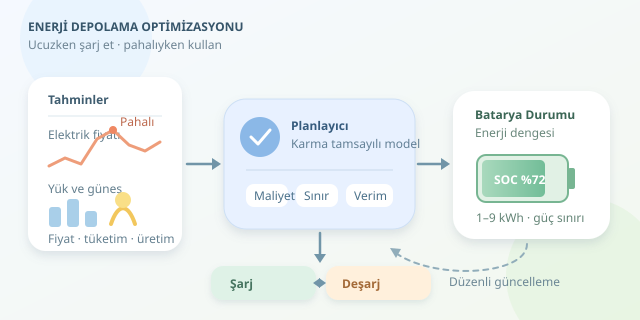

Elektrik ucuzken bataryayı doldur, pahalıyken kullan: Kulağa market indirimlerini takip etmek kadar kolay geliyor. Ancak bataryanın kapasitesi, enerji kayıpları, güç sınırları ve yıpranması bu alışverişi karmaşıklaştırıyor. Enerji depolama optimizasyonu, bütün bu koşulları birlikte değerlendirerek şarj ve deşarj kararlarını hesaplıyor. Gelin, elektrik faturasını azaltan bu görünmez planlayıcının mantığını inceleyelim.




``

## Önce fiziği modele çevirelim

Bir bataryanın enerji miktarı, banka hesabındaki bakiye gibi düşünülebilir. Şarj etmek para yatırmaya, deşarj etmek para çekmeye benzer; fakat burada her işlem sırasında bir miktar enerji kaybolur.

Zaman adımları arasındaki enerji dengesi şöyledir:

$$e_{t+1}=e_t+\eta_c p^c_t\Delta t-\frac{p^d_t\Delta t}{\eta_d}$$

Burada $e_t$ depolanan enerjiyi, $p^c_t$ şarj gücünü, $p^d_t$ deşarj gücünü gösterir. Verimler $\eta_c$ ve $\eta_d$, zaman adımının uzunluğu ise $\Delta t$ ile belirtilir. Güç kW, enerji kWh cinsindendir. Doluluk oranı, yani SOC, $e_t/E_{\max}$ olarak hesaplanabilir.

Enerji ve güç sınırları zorunludur. Örneğin 10 kWh kapasiteli bir batarya, sağlığını korumak amacıyla yalnızca 1–9 kWh aralığında işletilebilir. Ayrıca planlama sonunda başlangıç enerjisine dönmek, algoritmanın bataryayı tamamen boşaltarak yapay bir tasarruf göstermesini önler. Elbette bu terminal koşul, uygulamanın ihtiyacına göre değiştirilebilir.

## Algoritma gerçekte neyi küçültüyor?

Basit bir amaç fonksiyonu, elektrik alımını ve bataryanın kullanım maliyetini birleştirir:

$$\min\sum_t\left[\pi_t g_t+c_{deg}(p^c_t+p^d_t)\right]\Delta t$$

$\pi_t$ elektrik fiyatı, $g_t$ şebekeden çekilen güçtür. $c_{deg}$ ise bataryadan geçen her kWh için tanımlanan yaklaşık yıpranma bedelidir. Böylece algoritma, küçük fiyat farkları uğruna gereksiz döngüler üretmez. Bu doğrusal yaklaşım pratiktir; ancak gerçek yaşlanma sıcaklığa, doluluk seviyesine ve deşarj derinliğine de bağlıdır.

| Yöntem | Güçlü tarafı | Temel sınırlaması |
|---|---|---|
| Eşik tabanlı kontrol | Hızlı ve anlaşılır | Gelecekteki fırsatları kaçırabilir |
| Doğrusal programlama | Büyük problemleri verimli çözer | Ayrık çalışma kararlarını doğrudan temsil etmez |
| Karma tamsayılı programlama | Şarj/deşarj modlarını kesin ayırır | Hesaplama yükü artabilir |
| Model öngörülü kontrol | Yeni tahminlerle planı yeniler | Tahmin kalitesine bağımlıdır |

Model öngörülü kontrol, tek başına bir optimizasyon çözücüsü değildir: Her adımda bir LP veya MILP çözerek ilk kararı uygular, ardından planı günceller.

## Python ile altı saatlik plan

Aşağıdaki örnek, güneş üretimi bulunan bir tesis için karma tamsayılı model kurar. Kurulum için `pip install cvxpy scipy` kullanılabilir. İkili değişken, bataryanın aynı anda hem şarj hem deşarj olmasını engeller; şebekeye satış ise bu örnekte kapalıdır.

```python
import numpy as np
import cvxpy as cp

price = np.array([1.2, 1.0, 1.5, 3.5, 4.0, 2.0])
load = np.array([3, 3, 4, 5, 5, 3])
solar = np.array([0, 1, 2, 1, 0, 0])
T, dt, eta = len(price), 1.0, 0.95

charge = cp.Variable(T, nonneg=True)
discharge = cp.Variable(T, nonneg=True)
grid = cp.Variable(T, nonneg=True)
energy = cp.Variable(T + 1)
mode = cp.Variable(T, boolean=True)

constraints = [
    energy[0] == 5,
    energy[-1] == 5,
    energy >= 1,
    energy <= 9,
    charge <= 3 * mode,
    discharge <= 3 * (1 - mode),
    grid + discharge + solar == load + charge,
    energy[1:] == energy[:-1]
        + eta * charge * dt - discharge * dt / eta,
]

cost = dt * (price @ grid
             + 0.08 * cp.sum(charge + discharge))
model = cp.Problem(cp.Minimize(cost), constraints)
model.solve(solver="SCIPY")

if model.status != "optimal":
    raise RuntimeError(model.status)

print("Maliyet (TL):", round(model.value, 2))
print("Şarj (kW):", np.round(charge.value, 2))
print("Deşarj (kW):", np.round(discharge.value, 2))
```

Fiyatlar TL/kWh, yük ve güneş üretimi kW cinsindedir. Model, kayıpları ve kWh başına 0,08 TL kullanım bedelini hesaba katar. Ucuz saatlerde şarj etmek ancak sonraki tasarruf bu bedelleri karşılıyorsa anlamlıdır. Sonuçları, aynı yükün batarya olmadan şebekeden karşılandığı senaryoyla karşılaştırabilirsiniz.

## Gerçek dünyada planı güncel tutun

Sahada fiyatlar, tüketim ve güneş üretimi tahmin edildiği gibi davranmayabilir. Bu nedenle planı düzenli aralıklarla yeniden hesaplamak daha güvenlidir. Örneğin her 15 dakikada güncellenen bir model, beklenmedik bulutlanmaya uyum sağlayabilir.

Fazla güneş üretimi oluşabilecek sistemlerde üretim kısma veya şebekeye satış değişkeni eklenmelidir; aksi hâlde enerji dengesi çözümsüz kalabilir. Kesinti riski varsa yedek enerji sınırı, güç üzerinden ücretlendirme varsa tepe talep maliyeti de modele dahil edilir.

Son olarak, optimizasyon çıktısı doğrudan güvenlik mekanizması değildir. Batarya yönetim sistemi sıcaklık, akım ve gerilim sınırlarını bağımsız biçimde korumalıdır. En iyi plan, yalnızca ucuz olan değil; uygulanabilir, güvenli ve bataryanın ömrünü gözeten plandır.
