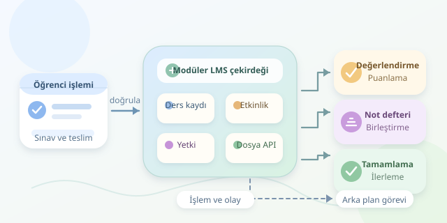

Bir öğrenme yönetim sistemi, PDF dosyalarının saklandığı gösterişli bir klasörden çok daha fazlasıdır. Öğrenci bir sınava girdiğinde cevaplar değerlendirilir, not defteri güncellenir ve uygun koşullarda ilerleme bilgisi değişir. Moodle gibi platformların asıl başarısı, bu parçaları aynı eğitim deneyiminde buluşturmasıdır. Gelin, dijital sınıfın perde arkasındaki yazılım orkestrasını inceleyelim.

``

## Temel yaklaşım: Modüler monolit

Moodle’ın çekirdeği ağırlıklı olarak PHP ile geliştirilmiş, eklenti odaklı bir **modüler monolittir**. Dersler, sınavlar ve ödevler ayrı sorumluluklara sahiptir; ancak bunlar varsayılan olarak bağımsız mikroservisler değildir. Ortak uygulama altyapısı, ilişkisel veritabanı, dosya API’leri ve yetkilendirme mekanizmaları üzerinden birlikte çalışırlar.

Bu tasarımın avantajı, eğitimle ilgili işlemlerin ortak kuralları paylaşmasıdır. Örneğin bir sınav eklentisinin kullanıcı yönetimini yeniden yazması gerekmez. Buna karşılık eklentiler arasındaki bağımlılıkların kontrol edilmesi önemlidir: Her parçanın her tabloya doğrudan erişmesi, bakımı zorlaştıran bir yazılım spagettisi üretir.

| Bileşen | Temel sorumluluk | Diğer parçalarla ilişkisi |
|---|---|---|
| Ders ve kayıt | Öğrenciyi dersle ilişkilendirmek | Erişimin kapsamını belirler |
| Etkinlik | İçeriği veya görevi sunmak | Tamamlama kurallarını taşır |
| Değerlendirme | Yanıtı ya da teslimi puanlamak | Not defterine sonuç sağlar |
| Not defteri | Notları birleştirmek | Başarı görünümünü oluşturur |
| Tamamlama takibi | Koşulların gerçekleşmesini izlemek | İlerleme raporlarını besler |

## Not ile ilerleme neden aynı şey değildir?

Veri modelinde kullanıcı, ders, kayıt, etkinlik, deneme, teslim ve not gibi kavramlar farklı varlıklardır. Aynı öğrencinin aynı sınava birden fazla denemesi olabilir; ancak not defterine yansıyacak sonuç, yapılandırılan değerlendirme yöntemine bağlıdır. En yüksek notu seçmek ile son denemeyi seçmek aynı karar değildir.

Basit bir ağırlıklı not modeli şöyle gösterilebilir:

$$G = \sum_{i=1}^{n} w_i \frac{g_i}{m_i}, \qquad \sum_{i=1}^{n} w_i = 1$$

Burada $g_i$ alınan puan, $m_i$ pozitif maksimum puan, $w_i$ ağırlıktır. Bu örnek normalize edilmiş bir toplam üretir; Moodle’ın gerçek hesaplaması seçilen not birleştirme yöntemine göre değişir.

İlerleme ise farklı bir soruyu yanıtlar:

$$P = 100 \frac{c}{t}$$

$c$, tamamlanan; $t$, tamamlama takibine dahil edilen etkinlik sayısıdır. $t=0$ durumunda oran hesaplanmaz. Bir kaynağı görüntülemek tamamlanma sayılabilirken, bir sınavda geçer not almak gerekebilir. Dolayısıyla yüksek not, otomatik olarak yüksek ilerleme demek değildir.

## Bir sonucun sistem içinde yolculuğu

Tipik bir sınav akışında önce öğrencinin erişimi ve deneme koşulları denetlenir. Cevaplar kaydedilir; otomatik değerlendirilebilen sorular puanlanır, diğerleri öğretmen değerlendirmesini bekleyebilir. Sonuç ilgili kurallarla not defterine aktarılır. Etkinlik tamamlama koşulları ayrıca değerlendirilir; ders tamamlama kuralları da bu bilgileri kullanabilir.

Aşağıdaki Python örneği, güvenilir bir değerlendirme sonucunun işlenmesini gösterir. Bu, Moodle API kodu değil; işlem bütünlüğünü anlatan, varsayımsal veri erişim arayüzleri kullanan bir tasarım örneğidir:

```python
def record_result(db, user_id, activity_id, score, event_id):
    with db.transaction() as tx:
        if tx.processed.exists(event_id):
            return

        activity = tx.activities.get(activity_id)
        tx.enrolments.require(user_id, activity.course_id)
        if not 0 <= score <= activity.max_score:
            raise ValueError("Geçersiz puan")

        tx.grades.upsert(user_id, activity_id, score)
        if activity.requires_passing_grade:
            tx.completion.upsert(
                user_id, activity_id,
                score >= activity.passing_grade
            )

        tx.outbox.add("grade_recorded", {
            "user_id": user_id,
            "activity_id": activity_id
        })
        tx.processed.add(event_id)
```

Veritabanı işlemi, değişikliklerin birlikte kaydedilmesini sağlar. Olay kimliği için benzersizlik kısıtı, yeniden gönderilen sonuçların çift işlenmesini engellemeye yardımcı olur. **Outbox**, bildirimi aynı işlemde saklayıp sonradan yayımlama desenidir; Moodle çekirdeğinin burada gösterilen yapıyı kullandığı varsayılmamalıdır. Çağıran katman ayrıca değerlendirme yetkisini doğrulamalıdır.

## Ölçek, güvenlik ve bakım

Moodle’da olay gözlemcileri, zamanlanmış görevler ve ad hoc görevler farklı işler için kullanılabilir. Uzun süren raporları veya bildirimleri uygun arka plan görevlerine taşımak, öğrencinin ekranını bekletmemeyi sağlar. Ancak gecikmeli güncellemeler arayüzde anlaşılır biçimde gösterilmelidir.

Yetkilendirme yalnızca giriş yapmak değildir. Roller ve yetenekler, bağlama göre değerlendirilir: Bir kullanıcı bir derste öğretmen, başka bir derste öğrenci olabilir. Dosya erişimi de aynı disiplinle korunmalıdır; tahmin edilebilir bağlantılar güvenlik modeli sayılmaz.

Son olarak önbellekleme, veritabanı indeksleri, yedekleme ve eklenti uyumluluğu birlikte düşünülmelidir. İyi LMS mimarisi yalnızca çalışan ekranlar üretmez: İçerik, değerlendirme ve ilerleme arasında tutarlı, açıklanabilir ve güvenli bir öğrenme yolculuğu kurar.
