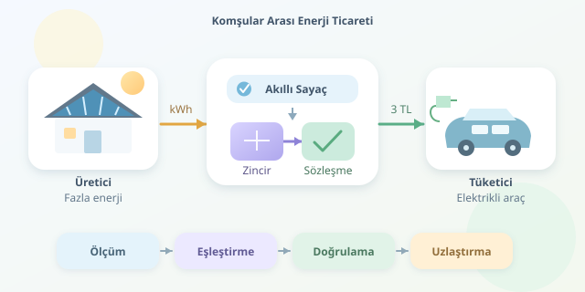

Öğle vakti güneş panelleriniz coşmuş, fakat evde yalnızca buzdolabı çalışıyor. Yan komşunuz ise elektrikli otomobilini şarj ediyor. Fazla üretiminizi ona satabilseydiniz nasıl olurdu? Eşler arası enerji ticareti, bu fikri dijital sayaçlar, piyasa kuralları ve blok zincir kayıtlarıyla buluşturuyor. Ancak mesele, elektriğe kripto para etiketi yapıştırmaktan biraz daha karmaşık!

``

## Önce fizik: Elektronlar adres seçmez

Eşler arası, yani P2P ticarette üretici ve tüketici doğrudan ekonomik anlaşma yapar. Buna rağmen elektrik genellikle mevcut dağıtım şebekesinden akar. Blok zincir, belirli elektronları komşunuzun prizine yönlendirmez; kimin ne kadar enerji sağladığını ve bunun karşılığında ne kazanacağını kaydeder.

Bir zaman aralığındaki satılabilir enerji şöyle modellenebilir:

$$E_{satılabilir}=\max(0,E_{üretim}-E_{tüketim}-E_{batarya})$$

Burada bütün büyüklükler aynı aralığa ait kWh değerleridir. Batarya terimi, depolamaya ayrılan enerjiyi gösterir. Örneğin 8 kWh üretim, 3 kWh tüketim ve 1 kWh depolama varsa satış bütçesi 4 kWh olur. Enerji ile anlık güç değerlerini karıştırmamak gerekir: kWh birikmiş miktar, kW ise üretim veya tüketim hızıdır.

## Ticaretin dört durağı

1. **Ölçüm:** Akıllı sayaçlar, örneğin 15 dakikalık aralıklarda şebekeye verilen ve şebekeden çekilen enerjiyi ölçer.
2. **Eşleştirme:** Yazılım, satış tekliflerini alış talepleriyle fiyat ve miktar üzerinden eşleştirir.
3. **Doğrulama:** Yetkili veri sağlayıcı, sayaç kayıtlarını kontrol ederek blok zincire aktarır.
4. **Uzlaştırma:** Gerçekleşen miktar üzerinden borçlar ve alacaklar hesaplanır; ödeme ilgili mekanizmayla tamamlanır.

Önceden verilen üretim tahmini, teslim edilmiş enerji değildir. Bulutlar geldiğinde oluşan farkın kim tarafından karşılanacağı piyasa kurallarında açıkça tanımlanmalıdır.

## Fiyat neden iki tarafı da mutlu edebilir?

Basitleştirilmiş bir piyasada, komşular arasındaki fiyat şu aralıkta seçilebilir:

$$p_{şebekeye\ satış}<p_{P2P}<p_{şebekeden\ alış}$$

Şebekeye satış bedeli 2 TL/kWh, şebekeden alış bedeli 4 TL/kWh olsun. Komşular 3 TL/kWh üzerinden 3 kWh için anlaşırsa, ücretler hariç iki taraf da 3 TL avantaj elde eder.

| Taraf | Geleneksel işlem | P2P işlem |
|---|---|---|
| Üretici | 6 TL gelir | 9 TL gelir |
| Tüketici | 12 TL gider | 9 TL gider |




Bu rakamlar yalnızca örnektir. Dağıtım bedelleri, vergiler, platform komisyonları ve dengeleme maliyetleri eklendiğinde avantaj küçülebilir. Ekrandaki güzel fiyat, faturanın tamamı değildir!

## Blok zincir neyi çözer, neyi çözmez?

Blok zincirin güçlü tarafı, farklı katılımcıların ortak işlem geçmişini doğrulayabilmesidir. Akıllı sözleşmeler kuralları otomatik uygulayabilir. Ancak yanlış ölçümü doğruya çeviremezler. Sayaç ile zincir arasındaki veri köprüsüne **oracle** denir; bu köprü güven modelinin kritik parçasıdır.

| Yaklaşım | Güçlü taraf | Temel sınırlama |
|---|---|---|
| Merkezi veritabanı | Basit işletim, düşük maliyet | Tek işletmeciye güven |
| Açık blok zincir | Geniş doğrulanabilirlik | İşlem maliyeti ve mahremiyet |
| İzinli blok zincir | Kontrollü erişim, ortak yönetim | Konsorsiyuma bağımlılık |

Dolayısıyla merkeziyetsizlik bir açma-kapama düğmesi değildir. Sayaç yetkilendirmesi, ağ yönetimi ve uyuşmazlık çözümü hâlâ kurumlara dayanabilir.

## Küçük bir Solidity kayıt defteri

Aşağıdaki sözleşme, yetkili oracle tarafından bildirilen ticaret kayıtlarını olay olarak yayımlar. Miktarı Wh cinsinden tam sayı tutarak kayan nokta ihtiyacını önler. Aynı işlem kimliğinin tekrar kaydedilmesini engeller; **ödeme yapmaz ve fiziksel teslimatı doğrulamaz**.

```solidity
pragma solidity ^0.8.20;

contract EnergyLedger {
    address public immutable oracle;
    mapping(bytes32 => bool) public recorded;

    event Trade(
        bytes32 indexed id,
        address seller,
        address buyer,
        uint256 wh
    );

    constructor(address oracle_) {
        require(oracle_ != address(0));
        oracle = oracle_;
    }

    function record(
        bytes32 id, address seller, address buyer, uint256 wh
    ) external {
        require(msg.sender == oracle);
        require(!recorded[id] && wh > 0);
        require(seller != address(0) && buyer != address(0));
        require(seller != buyer);
        recorded[id] = true;
        emit Trade(id, seller, buyer, wh);
    }
}
```

Üretimde buna imzalı sayaç verileri, dönem bazlı enerji bütçeleri, itiraz süreci ve güvenli ödeme altyapısı eklenmelidir. Tekrar kontrolü yalnızca aynı kimliği engeller; farklı kimliklerle fazla enerji bildirilmesini ayrıca önlemek gerekir.

## Mahallenin geleceği, gerçek dünyanın kuralları

Başarılı bir pilot, önce küçük bir bina veya mikroşebekede başlamalıdır. Dağıtım kapasitesi, gerilim sınırları, yerel mevzuat ve katılımcı mahremiyeti tasarımın merkezinde bulunmalıdır. Ham tüketim verilerini açık zincire yazmak, insanların günlük rutinlerini ifşa edebilir; zincirde yalnızca gerekli kayıtlar veya doğrulanabilir özetler tutulmalıdır.

Kısacası blok zincir burada elektrik üretmez; anlaşmaları denetlenebilir kılar. Asıl değer, güneşli çatılarla ihtiyaç duyan komşuları güvenilir ölçüm ve adil fiyatlandırma üzerinden buluşturmaktır.
