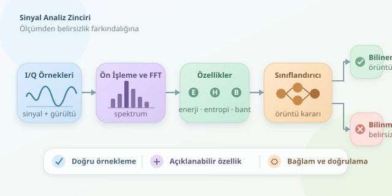

Radyo spektrumunu kalabalık bir kafeye benzetin: herkes konuşuyor, arada kahve makinesi bağırıyor ve siz hangi sesin anlamlı olduğunu ayırmaya çalışıyorsunuz. Elektronik harp sistemlerinde sinyal analizi de benzer bir problemle başlar. Bu yazıda, gerçek iletişimleri dinlemek yerine sentetik veriler üzerinden tespit ve sınıflandırmanın yazılımsal temellerini keşfedeceğiz.



``

## Önce fizik: Yazılımın elindeki veri nedir?

Bir alıcının sayısallaştırdığı ölçümü basitçe $x[n] = s[n] + w[n]$ şeklinde düşünebiliriz. Burada $s[n]$ aranan sinyali, $w[n]$ ise gürültüyü temsil eder. Gerçekte girişimler, yansımalar ve donanım kusurları da ölçüme karışır; dolayısıyla bu model başlangıç için kullanışlıdır, fakat bütün hikâye değildir.

Yazılım çoğunlukla **I/Q örnekleriyle**, yani karmaşık sayılarla çalışır. I ve Q bileşenleri, sinyalin genlik ve faz bilgisini birlikte taşır. Böylece yalnızca “ne kadar güçlü?” sorusunu değil, “zaman içinde nasıl değişiyor?” sorusunu da inceleyebiliriz.

Örnekleme hızı, gözlenebilecek frekans aralığını belirler. Nyquist koşuluna uygun örnekleme ve ön filtreleme yapılmazsa farklı frekanslar birbirine karışabilir. Bu olaya aliasing denir: yazılımın sonradan sihirli biçimde düzeltemeyeceği bir ölçüm hatasıdır.

## Tespit ile sınıflandırma aynı şey değildir

| Aşama | Temel soru | Örnek çıktı | Başlıca risk |
|---|---|---|---|
| Tespit | Anlamlı bir sinyal var mı? | Sinyal adayı bulundu | Gürültüyü sinyal sanmak |
| Özellik çıkarımı | Ölçümün karakteri nasıl? | Enerji, bant genişliği, entropi | Yanıltıcı özellikler |
| Sınıflandırma | Hangi örüntüye benziyor? | Dar bantlı veya gürültü benzeri | Bilinmeyeni zorla etiketlemek |

Önemli ayrım şudur: bir dalga biçimini sınıflandırmak, kaynağının kimliğini veya niyetini belirlemek değildir. Benzer spektral özellikler farklı cihazlardan gelebilir. “Bu sinyal düşmana ait” sonucu, yalnızca birkaç sayısal özellikten güvenilir biçimde çıkarılamaz.

## Enerji ve frekans alanı: İlk büyüteçler

Ortalama örnek gücü şu şekilde hesaplanır:

$$P = \frac{1}{N}\sum_{n=0}^{N-1}\vert x[n]\vert ^2$$

Bu değer tek başına yeterli değildir; yüksek güç, güçlü bir girişimden de kaynaklanabilir. Tespit mantığında gürültü seviyesinin değişebileceği hesaba katılmalıdır. Eşik kararlarının başarısı, kaçırılan sinyaller ve yanlış alarmlar birlikte değerlendirilerek ölçülür.

FFT ise örnekleri frekans bileşenlerine ayırır. Sonlu gözlem aralığının oluşturduğu spektral sızıntıyı azaltmak için pencereleme kullanılır. Bunun bedeli, tepe şeklinin ve frekans çözünürlüğünün etkilenmesidir. Kısacası, daha temiz görünen grafik mutlaka daha kesin ölçüm demek değildir.

## Python ile küçük bir özellik laboratuvarı

Aşağıdaki örnek, sentetik bir karmaşık tona gürültü ekler. Ardından enerji, normalize spektral entropi ve en güçlü frekans kutusunun güç payını hesaplar. Herhangi bir gerçek iletişimi yakalamaz veya çözmez.

```python
import numpy as np


def ozellikler(x):
    x = np.asarray(x, dtype=np.complex128)
    if x.ndim != 1 or x.size < 16:
        raise ValueError("En az 16 örnekli tek boyutlu veri gerekir.")
    if not np.all(np.isfinite(x)):
        raise ValueError("Örnekler sonlu olmalıdır.")

    enerji = float(np.mean(np.abs(x) ** 2))
    pencere = np.hanning(x.size)
    guc = np.abs(np.fft.fft(x * pencere)) ** 2
    if guc.sum() == 0:
        return enerji, 0.0, 0.0

    p = guc / guc.sum()
    entropi = -np.sum(p * np.log2(np.maximum(p, 1e-15)))
    entropi /= np.log2(x.size)
    return enerji, float(entropi), float(p.max())


rng = np.random.default_rng(42)
n = np.arange(2048)
gurultu = (rng.normal(size=n.size)
           + 1j * rng.normal(size=n.size)) / np.sqrt(2)
x = np.exp(2j * np.pi * 0.08 * n) + 0.2 * gurultu
print(ozellikler(x))
```

Buradaki frekans, örnekleme hızına göre normalize edilmiştir. Entropi, spektral gücün kutulara ne kadar yayıldığını özetler: yoğunlaşmış spektrum genellikle düşük, yayılmış spektrum yüksek değer üretir. Ancak sessizlik de düşük entropi verebilir; bu nedenle enerjiyle birlikte yorumlanmalıdır. Tek özellikten hüküm vermek, kahve kokusundan kafedeki herkesi tanımaya benzer!

## Sınıflandırıcıdan önce veri disiplini

Bu özellikler bir karar ağacına veya başka bir denetimli modele girdi olabilir. Eğitim etiketleri, ölçülebilir sinyal özelliklerini tarif etmelidir; örneğin dar bantlı ve geniş bantlı örüntüler. Modelin daha önce görmediği örnekler için **bilinmiyor** seçeneği bulunması önemlidir.

Eğitim ve test verilerini aynı kaydın komşu parçalarından oluşturmak veri sızıntısına yol açabilir. Kayıt oturumu veya cihaz bazında ayrım yapmak daha dürüst bir değerlendirme sağlar. Ayrıca farklı gürültü seviyelerinde başarı, karışıklık matrisi ve sınıf başına duyarlılık incelenmelidir. Tek bir doğruluk yüzdesi, bütün hataları saklayabilir.

## Son söz: Spektrum konuşur, ama bağlam gerekir

Sağlam bir analiz zinciri; doğru örnekleme, dikkatli ön işleme, açıklanabilir özellikler ve belirsizliği kabul eden sınıflandırmadan oluşur. Sentetik deneyler bu mantığı öğrenmenin güvenli yoludur. Gerçek uygulamalarda ise hukuki yetki, veri güvenliği ve bağımsız doğrulama, algoritma seçimi kadar önem taşır.
