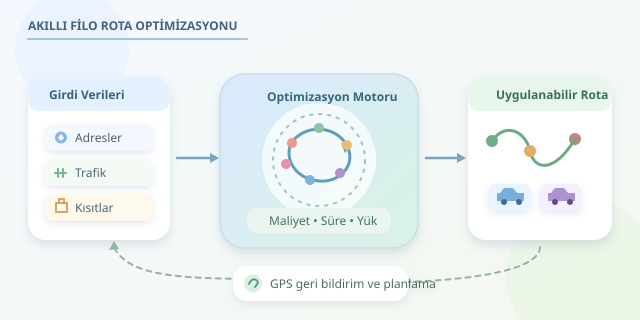

Bir kargo aracının sabah depodan çıkıp bütün paketleri dağıtarak geri dönmesini düşünün. Haritada birkaç noktayı birleştirmek kolay görünür; fakat yüzlerce adres, trafik ve teslimat saatleri devreye girince işler değişir. Gezgin Satıcı Problemi, bu karmaşayı anlamak için harika bir başlangıçtır. Ticari lojistik ise aynı bulmacayı, hareket eden parçalarla çözmeye çalışır!



``

## Temel fikir: Her adresi ziyaret et, maliyeti azalt

Gezgin Satıcı Problemi’nde (TSP) amaç, her noktayı tam bir kez ziyaret edip başlangıca dönen en düşük maliyetli turu bulmaktır. Noktalar müşterileri, aralarındaki bağlantılar ise yolculukları temsil eder. Matematiksel hedef şöyle yazılabilir:

$$\min \sum_i \sum_j c_{ij}x_{ij}$$

Burada $c_{ij}$, iki nokta arasındaki seyahat maliyeti; $x_{ij}$ ise bu bağlantı kullanılıyorsa 1, kullanılmıyorsa 0 değeridir. Her noktaya giriş ve çıkış kısıtları gerekir. Ayrıca bağımsız küçük turlar oluşmasını engelleyen **alt tur kısıtları** eklenmelidir; yoksa çözüm, birbirinden kopuk birkaç halka olabilir.

Simetrik bir problemde olası tur sayısı $(n-1)!/2$ olur. Adres sayısı büyüdükçe bütün seçenekleri denemek hızla pratik olmaktan çıkar. TSP’nin NP-zor olması, bu kombinasyon patlamasını açıklayan temel noktadır.

## Gerçek filolar neden yalnızca TSP değildir?

Dağıtım şirketinde tek araç bulunmaz. Araçların kapasitesi, sürücülerin çalışma süresi ve müşterilerin kabul saatleri vardır. Bu nedenle uygulamada çoğunlukla **Araç Rotalama Problemi (VRP)** ve türevleri çözülür.

| Model | Temel ek koşul | Lojistik örneği |
|---|---|---|
| TSP | Tek araç, bütün noktalar | Teknisyenin ziyaret turu |
| Kapasiteli VRP | Birden fazla araç, yük sınırı | Marketlere ürün dağıtımı |
| Zaman pencereli VRP | Teslimat saat aralıkları | Restoranlara sabah sevkiyatı |
| Dinamik VRP | Gün içinde değişen bilgiler | Anlık kurye siparişleri |

En kısa mesafe her zaman en ucuz operasyon değildir. Ücretli yollar, fazla mesai, bekleme ve gecikme cezaları sonucu değiştirebilir. Soğuk zincirde araç uygunluğu; iadelerde toplama ve teslimat sırası da modele girer. Amaç, kilometre rekoru kırmak değil, **uygulanabilir ve ekonomik dağıtım** yapmaktır.

## Ticari ölçekte çözüm nasıl bulunur?

Önce adresler koordinatlara çevrilir. Ardından yol ağı üzerinden mesafe veya seyahat süresi matrisi hesaplanır. Kuş uçuşu uzaklık yeterli değildir: Tek yönler, köprüler ve trafik nedeniyle gidiş ile dönüş süreleri farklı olabilir. Büyük filolarda bölgeleme ve matris önbellekleme hesaplama yükünü azaltır; ancak bölgeleri katı biçimde ayırmak iyi rotaları dışlayabilir.

Küçük veya uygun yapıdaki modellerde kesin yöntemler kullanılabilir. Büyük operasyonlarda ise başlangıç rotaları oluşturulup yerel arama ve meta-sezgisellerle iyileştirilir. Örneğin **2-opt**, iki bağlantıyı değiştirerek gereksiz dolaşmaları azaltır. Tabu arama veya yönlendirilmiş yerel arama, algoritmanın aynı çözümlerin çevresinde sıkışmasını önlemeye yardımcı olur. Bunlar iyi çözümler bulabilir; optimum garantisi vermez.

## Python ile küçük bir kapasite deneyi

Aşağıdaki örnek, `pip install ortools` ile kurulabilen OR-Tools kullanır. Sıfırıncı nokta depodur; dört müşterinin talepleri iki araca dağıtılır. Matris değerleri dakika, kapasite değerleri ise palet cinsindendir. Hedef, toplam seyahat süresini azaltmaktır.

```python
from ortools.constraint_solver import pywrapcp, routing_enums_pb2

minutes = [
    [0, 8, 12, 7, 15],
    [8, 0, 6, 5, 11],
    [12, 6, 0, 9, 4],
    [7, 5, 9, 0, 10],
    [15, 11, 4, 10, 0],
]
demands = [0, 2, 2, 1, 3]
manager = pywrapcp.RoutingIndexManager(5, 2, 0)
routing = pywrapcp.RoutingModel(manager)

travel = routing.RegisterTransitCallback(
    lambda a, b: minutes[manager.IndexToNode(a)][manager.IndexToNode(b)]
)
routing.SetArcCostEvaluatorOfAllVehicles(travel)
load = routing.RegisterUnaryTransitCallback(
    lambda a: demands[manager.IndexToNode(a)]
)
routing.AddDimensionWithVehicleCapacity(load, 0, [4, 4], True, "Load")

params = pywrapcp.DefaultRoutingSearchParameters()
params.first_solution_strategy = (
    routing_enums_pb2.FirstSolutionStrategy.PATH_CHEAPEST_ARC
)
params.local_search_metaheuristic = (
    routing_enums_pb2.LocalSearchMetaheuristic.GUIDED_LOCAL_SEARCH
)
params.time_limit.seconds = 3
solution = routing.SolveWithParameters(params)

if solution:
    for vehicle in range(2):
        index, route = routing.Start(vehicle), []
        while not routing.IsEnd(index):
            route.append(manager.IndexToNode(index))
            index = solution.Value(routing.NextVar(index))
        route.append(manager.IndexToNode(index))
        print(vehicle, route)
else:
    print("Verilen koşullarda çözüm bulunamadı.")
```

Kapasite boyutu, araç başına dört palet sınırını uygular. Üç saniyelik süre, çözüm kalitesi ile hesaplama bütçesi arasında denge kurar. Örnek zaman pencerelerini veya teslimat hizmet sürelerini içermez; üretimde bunlar ayrıca modellenmelidir.

## Başarı, haritada güzel çizgilerden fazlasıdır

Rotalar geçmiş operasyonlarla karşılaştırılmalı; toplam maliyet, zamanında teslimat ve sürücü mesaisi birlikte izlenmelidir. GPS verisi, gerçekleşen süreleri günceller. Yeni sipariş veya yol kapanması geldiğinde kalan duraklar yeniden planlanabilir; ancak sürücünün rotasını sürekli değiştirmek operasyonu zorlaştırır.

Kısacası ticari çözüm, bir algoritmadan ibaret değildir: Temiz veri, doğru kısıtlar, hızlı arama ve saha geri bildirimi birlikte çalışır. En iyi rota, yalnızca bilgisayarın sevdiği değil, sürücünün gerçekten uygulayabildiği rotadır.
