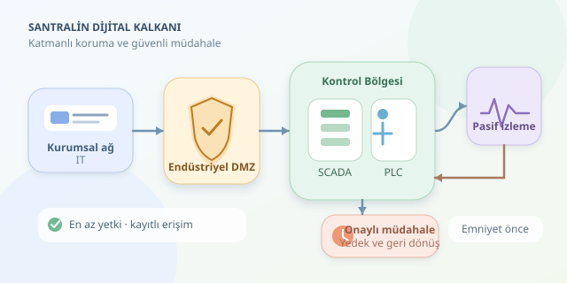

Bir enerji santralinde siber güvenlik, yalnızca bilgisayarları virüslerden korumak değildir. Yanlış bir komut, elektrik üretimini aksatabilir veya fiziksel ekipmana zarar verebilir. Bu yüzden savunma yazılımları, dijital dünyanın kurallarını mühendisliğin güvenlik sınırlarıyla birleştirir. Buradaki hedef, saldırganları durdururken santralin güvenilir biçimde çalışmasını sürdürmektir: Kapıyı kilitleyelim, ama jeneratörün anahtarını içeride unutmayalım!

``

## Önce Mantık: OT Neden Farklıdır?

Bilgi teknolojileri, yani IT, verileri işler. Operasyonel teknoloji, yani OT, fiziksel süreçleri izler ve kontrol eder. PLC kontrolörleri sensör verilerine göre ekipmanları yönetirken SCADA sistemleri operatörlere izleme ve kumanda imkânı sağlar. Bu cihazların bir kısmı eski protokollerle çalışır; kimlik doğrulama veya şifreleme desteği sınırlı olabilir. Dolayısıyla klasik bir güvenlik aracını kurmak, kendiliğinden güvenli bir santral oluşturmaz.

Basit bir risk modeli $R = P \times I$ şeklindedir. Burada $P$ olayın gerçekleşme olasılığı, $I$ ise etkisidir. Ancak etki yalnızca parasal kayıp değildir: çalışan güvenliği, çevresel sonuçlar ve hizmet kesintisi de değerlendirilmelidir. Bu formül bir başlangıçtır; ayrıntılı mühendislik analizinin yerine geçmez.

| Boyut | Kurumsal IT | Kritik OT |
|---|---|---|
| Öncelik | Veri güvenliği ve hizmet sürekliliği | Emniyet ve süreç sürekliliği |
| Güncelleme | Daha sık uygulanabilir | Test ve bakım penceresi gerekir |
| Tarama | Aktif tarama yaygındır | Pasif izleme sıklıkla tercih edilir |
| Hata etkisi | Veri veya hizmet kaybı | Fiziksel süreç etkilenebilir |

## Katmanlı Savunma: Tek Duvar Yetmez

İlk adım, cihazların ve iletişim yollarının envanterini çıkarmaktır. Hangi kontrolör hangi sunucuyla konuşuyor? Hangi protokole gerçekten ihtiyaç var? Bilinmeyen bağlantılar, savunmanın kör noktalarıdır.

Ardından ağ, işlev ve risk seviyesine göre bölgelere ayrılır. Kurumsal ağ ile kontrol ağı arasına endüstriyel bir DMZ yerleştirilir. Güvenlik duvarları, yalnızca tanımlanmış kaynak, hedef, protokol ve yön kombinasyonlarına izin verir. Varsayılan yaklaşım, “Her şey serbest” değil, “Gerekli olduğu kanıtlanan iletişim serbest” olmalıdır.

Uzaktan bakım erişimi de doğrudan kontrolörlere açılmaz. Çok faktörlü kimlik doğrulama, süreli yetkilendirme ve kayıt altına alınan oturumlarla kontrollü geçiş sunucuları kullanılır. Yetkiler görevle sınırlanır; izleme yapan bir hesap, süreç parametrelerini değiştirememelidir. Böylece çalınan tek bir parola, bütün tesise açılan sihirli anahtara dönüşmez.

## Telemetride Anormallik Yakalamak

Yazılım, ağ trafiğinin yanında süreç telemetrisini de inceleyebilir. Basit bir yöntem, ölçümün normal davranıştan uzaklığını hesaplamaktır:

$$z = \frac{x - \mu}{\sigma}$$

Burada $x$ ölçüm, $\mu$ referans ortalaması ve $\sigma$ standart sapmadır. Aşağıdaki Python örneği, hayali bir sensörün önceden kaydedilmiş verilerinde üç ardışık sapmayı işaretler. Gerçek ekipmana bağlanmaz ve kontrol komutu göndermez.

```python
from collections import defaultdict, deque
from math import isfinite

BASELINES = {"sensor_demo": (100.0, 2.0)}
history = defaultdict(lambda: deque(maxlen=3))

def inspect(asset: str, value: float) -> dict:
    if asset not in BASELINES:
        return {"asset": asset, "status": "unknown_asset"}
    if not isfinite(value):
        history[asset].clear()
        return {"asset": asset, "status": "invalid_data"}

    mean, std = BASELINES[asset]
    if std <= 0:
        raise ValueError("Standart sapma pozitif olmalı")

    score = abs((value - mean) / std)
    window = history[asset]
    window.append(score >= 4.0)
    alert = len(window) == 3 and all(window)
    return {"asset": asset, "score": score, "alert": alert}

for reading in [101.0, 110.0, 111.0, 109.0]:
    print(inspect("sensor_demo", reading))
```

Varlık başına ayrı pencere tutmak, farklı sensörlerin birbirini etkilemesini önler. Ardışık ölçüm koşulu, tek seferlik sıçramaların oluşturduğu alarm gürültüsünü azaltabilir. Ancak eşik tamamen örnektir: başlangıç, duruş ve normal üretim için farklı referanslar gerekir. Ölçüm zamanları, veri kalitesi ve sensör arızaları da kontrol edilmelidir. Anormallik, tek başına saldırı kanıtı değildir.

## Alarmdan Güvenli Müdahaleye

Alarmlar merkezi günlük yönetiminde erişim kayıtları ve ağ olaylarıyla ilişkilendirilir. Beklenmeyen parametre değişikliğiyle aynı anda görülen yetkisiz oturum, tek başına yüksek sensör değerinden daha güçlü bir işarettir. Yine de otomatik olarak kontrolörü kapatmak tehlikeli olabilir. Müdahale, önceden hazırlanmış ve operasyon ekibiyle onaylanmış senaryolara dayanmalıdır.

Yamalar önce temsilî test ortamında denenir; geri dönüş planıyla uygulanır. Kontrolör yapılandırmaları ve kritik sunucular yedeklenir, geri yükleme düzenli olarak sınanır. Yazılım paketlerinin bütünlüğü doğrulanır; tedarikçi erişimleri denetlenir. Bağımsız emniyet katmanları da siber izleme sisteminin yerine değil, yanında bulunur.

Sonuçta güçlü koruma, tek bir antivirüsün kahramanlığı değildir. Envanter, segmentasyon, sınırlı yetki, dikkatli izleme ve denenmiş kurtarma planları birlikte çalışır. Santralin dijital kalkanı, en parlak araçtan çok, hiçbir katmanın tek başına kusursuz olmadığını kabul eden tasarımla güçlenir.
