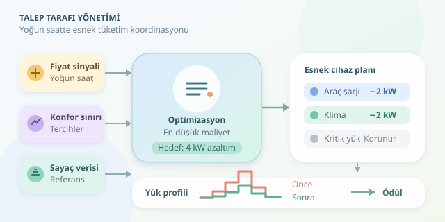

Akşam herkes klimayı açarken, elektrikli otomobilini şarja takarken ve fırını çalıştırırken elektrik şebekesi de mesaiye kalır. Peki yeni santraller devreye almak yerine bazı tüketimleri birkaç saat erteleyebilsek? Talep Tarafı Yönetimi, yani Demand Response, tam olarak bunu hedefler: kullanıcıların konfor sınırlarını koruyarak tüketimi otomatik ayarlamak ve katılımcılara ekonomik bir neden sunmak.

``

## Temel fikir: Tüketim de esnek olabilir

Elektrik sisteminde üretim ve tüketim sürekli dengelenmelidir. Talebin yükseldiği saatlerde pahalı üretim kaynakları devreye girebilir; iletim ve dağıtım altyapısının sınırları da zorlanabilir. Demand Response, bu anlarda tüketimi azaltarak veya başka saatlere kaydırarak sisteme esneklik sağlar.

Burada **güç** ile **enerji** ayrımı önemlidir. Güç anlık tüketim hızıdır; enerji ise zaman boyunca tüketilen toplam miktardır:

$$E = P \Delta t$$

Örneğin şarj gücünü bir saat boyunca 3 kW azaltmak, o zaman aralığında 3 kWh daha az tüketmek demektir. Ancak araç daha sonra şarj ediliyorsa toplam enerji tasarrufu oluşmayabilir. Kazanım, tüketimin yoğun saatten taşınmasıdır; elektriğe sihirli bir yok olma büyüsü uygulanmaz.

## Kullanıcı neden katılsın?

Algoritma tek başına teşvik değildir. Kullanıcının davranışını değiştiren şey fiyat sinyali, ödül veya önceden kabul ettiği bir kontrol sözleşmesidir.

| Yaklaşım | Teşvik mekanizması | Otomasyonun görevi |
|---|---|---|
| Zaman bazlı tarife | Yoğun saatlerde yüksek fiyat | Esnek işleri ucuz saate taşımak |
| Olay bazlı ödül | Doğrulanan azaltım için ödeme | Bildirilen dönemde tüketimi düşürmek |
| Sözleşmeli kontrol | Katılım veya kullanılabilirlik bedeli | İzin verilen cihazları sınırlamak |

Akıllı ev sistemi, kullanıcının tercihlerini önceden öğrenir. “Otomobil sabah yüzde seksen dolu olsun” veya “oda sıcaklığı 26 dereceyi geçmesin” gibi koşullar, kontrol kararının sınırlarını belirler. Kullanıcı isterse etkinlikten çıkabilmelidir.

## Algoritmanın matematiksel pazarlığı

Bir koordinatörün toplam $R$ kW azaltım istediğini düşünelim. Her cihazın güvenle sunabileceği azaltım $a_i$, seçilen azaltım $x_i$, kullanıcıya ait birim esneklik maliyeti ise $c_i$ olsun:

$$\min \Delta t\sum_i c_i x_i$$

$$0 \leq x_i \leq a_i, \qquad \sum_i x_i \geq R$$

Burada $c_i$, TL/kWh cinsinden bildirilen bir teklif veya parasallaştırılmış rahatsızlık maliyeti olabilir. Amaç, hedef azaltımı en düşük toplam maliyetle sağlamaktır. Sıcaklık, cihaz çalışma süresi ve batarya doluluğu gibi ek kısıtlar gerçek uygulamada modele dahil edilir.

## Python ile basit bir seçim algoritması

Aşağıdaki örnek, azaltımı sürekli ayarlanabilen cihazları birim maliyetine göre sıralar. Kapasitelerin konfor ve güvenlik kontrollerinden geçirilerek belirlendiğini varsayar.

```python
def azaltim_plani(cihazlar, hedef_kw):
    if hedef_kw < 0:
        raise ValueError('Hedef negatif olamaz')

    kalan = hedef_kw
    plan = {}
    sirali = sorted(cihazlar, key=lambda c: c['maliyet'])

    for cihaz in sirali:
        miktar = min(cihaz['kapasite_kw'], kalan)
        if miktar > 0:
            plan[cihaz['ad']] = miktar
            kalan -= miktar
        if kalan <= 0:
            break

    return plan, kalan

cihazlar = [
    {'ad': 'sarj', 'kapasite_kw': 2, 'maliyet': 2},
    {'ad': 'klima', 'kapasite_kw': 3, 'maliyet': 3},
    {'ad': 'isitici', 'kapasite_kw': 1, 'maliyet': 5},
]

plan, eksik = azaltim_plani(cihazlar, hedef_kw=4)
print(plan, eksik)
```

Sonuç, şarjdan 2 kW ve klimadan 2 kW azaltımdır. Bir saatlik etkinlik için modellenen maliyet 10 TL olur. Bu tutar otomatik olarak kullanıcıya yapılacak ödeme değildir; ödeme ayrıca sözleşmeyle belirlenir. Kapasite yetmezse fonksiyon karşılanamayan hedefi döndürür.

Bu açgözlü yaklaşım, bağımsız ve bölünebilir azaltımlar için uygundur. Cihaz yalnızca açılıp kapanabiliyorsa veya kararlar zaman içinde birbirini etkiliyorsa aynı yöntem optimum sonucu garanti etmez. Karma tamsayılı optimizasyon ve model öngörülü kontrol, bu daha zor durumları ele alabilir.

## Ödülü ölçmek, kontrol kadar önemlidir

Ödüllü programlarda sayaç verisi, olay olmasaydı beklenen tüketimle karşılaştırılır. Bu karşılaştırma değerine **referans tüketim** denir. Basitleştirilmiş olarak ödül, doğrulanan azaltılmış enerji ile TL/kWh ödül oranının çarpımıdır.

Referans tüketim doğrudan gözlenemediğinden hava durumu, geçmiş kullanım ve belirsizlik hesaba katılmalıdır. Etkinlik öncesinde tüketimi yapay biçimde artırarak ödül kazanmayı engelleyen kurallar da gerekir. Aksi halde algoritma şebekeyi değil, yanlış teşviki optimize eder!

## Başarının son kontrolü

Etkinlik bittiğinde bütün cihazları aynı anda çalıştırmak yeni bir zirve yaratabilir. Bu yüzden yükler kademeli geri alınmalı, ertelenen enerji sonraki saatlere planlanmalıdır. Kritik cihazlar korunmalı; haberleşme kesildiğinde güvenli yerel kontrol devam etmelidir.

İyi Demand Response, kullanıcıyı karanlıkta bırakmaz. Ölçülebilir esnekliği, anlaşılır ödülleri ve güvenilir kontrolü birleştirerek şebekenin yoğun saat mesaisini hafifletir.
