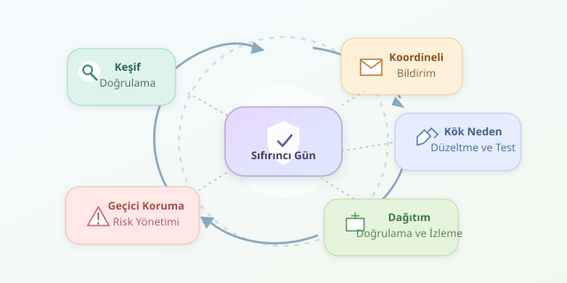

Bir uygulama yıllardır sorunsuz çalışırken, beklenmedik bir girdi bütün dengeleri değiştirebilir. Araştırmacı için heyecan verici olan bu an, geliştirici için mesainin uzaması demektir. Sıfırıncı gün açıklarının hikâyesi tam burada başlar: Henüz uygun bir yama bulunmayan kusur, keşiften doğrulamaya, bildirimden kalıcı korumaya uzanan bir yolculuğa çıkar.




``

## Önce kavramları netleştirelim

Güvenlik açığı, sistemin güvenlik beklentilerini ihlal etmeye elverişli bir kusurdur. Açığı kullanmaya yarayan yöntem veya kod ise **exploit** olarak adlandırılır. Her hata güvenlik açığı değildir; her güvenlik açığının da hazır bir exploit’i bulunmaz.

Zero-day teriminin kullanımı bağlama göre değişse de merkezinde, savunmacıların henüz uygun yamaya sahip olmadığı açıklık vardır. Açığın kamuoyunca bilinmesi tek başına belirleyici değildir. Araştırmacının gizlice keşfettiği bir kusur ile saldırganların aktif kullandığı kusur, aynı aciliyete sahip olmayabilir.

| Durum | Yama mevcut mu? | Savunmacının yaklaşımı |
|---|---|---|
| Gizlice keşfedilmiş açık | Genellikle hayır | Doğrulama ve koordinasyon |
| Aktif kullanılan zero-day | Hayır | Acil azaltım ve inceleme |
| Yaması yayımlanmış açık | Evet | Öncelikli güncelleme |
| Yaması uygulanmış sistem | Uygulanmış | Etkinlik doğrulama ve izleme |

## 1. Keşif ve doğrulama

Keşif; kod incelemesi, beklenmedik girdiler üreten **fuzzing**, hata raporları veya olay incelemesi sırasında gerçekleşebilir. Çökme görmek başlangıçtır, sonuç değil: Araştırmacı, davranışın güvenlik sınırını gerçekten aşıp aşmadığını değerlendirmelidir.

Bu çalışma yalnızca yetkili ortamlarda yapılmalıdır. Etkilenen sürüm, gerekli koşullar ve güvenlik etkisi kaydedilir; mümkün olan en küçük, zararsız yeniden üretim örneği hazırlanır. Amaç “bakın ne kadar zarar verebiliyorum” gösterisi değil, geliştiricinin sorunu güvenilir biçimde anlayabilmesidir. Gerçek kullanıcı verilerini toplamak doğrulamanın doğal bir parçası değildir.

## 2. Koordineli bildirim

Araştırmacı, üreticinin güvenlik iletişim kanalına veya hata ödül programına başvurur. Rapor; teknik bulguları, etkilenen bileşenleri ve yeniden üretim koşullarını içerir. Gerekirse bir koordinasyon kuruluşu taraflar arasındaki iletişimi kolaylaştırır.

Taraflar açıklama takvimini birlikte değerlendirir. Sabit bir süre her durumda doğru değildir: Aktif saldırılar, düzeltmenin karmaşıklığı ve kullanıcıların korunması takvimi etkiler. CVE gibi bir tanımlayıcı takibi kolaylaştırır; ancak atanması, yamanın hazır olduğunu göstermez.

## 3. Kök neden, düzeltme ve test

Üretici önce kapsamı belirler: Hangi sürümler, platformlar ve bağımlılıklar etkileniyor? Ardından yalnızca görünen belirtiyi değil, **kök nedeni** düzeltir. Eksik yetki kontrolünü arayüzde gizlemek, sunucudaki açığı kapatmaz; kapıya perde asmak kilit takmak değildir.

Yama, açığı yeniden üreten testin artık başarısız olduğunu göstermeli; normal işlevleri de bozmamalıdır. Regresyon testleri, benzer kod yollarının incelenmesi ve bağımlılık kontrolleri bu nedenle önemlidir.

## 4. Beklerken riski yönetmek

Yama hazırlanırken savunma durmaz. Etkilenen özelliği kapatmak, erişimi daraltmak veya hizmeti izole etmek geçici koruma sağlayabilir. Kavramsal olarak $R \approx P \times I$: Risk, istismar olasılığı ve etkinin birlikte değerlendirilmesidir. Bu ifade, kesin bir ölçüm değil düşünme aracıdır.

Aşağıdaki Python örneği, etki, erişilebilirlik ve istismar kanıtını kullanarak güncelleme kuyruğu oluşturur. Exploit üretmez; savunma önceliklendirmesi yapar.

```python
from dataclasses import dataclass

@dataclass(frozen=True)
class Finding:
    name: str
    impact: float
    exposure: float
    evidence: float

    def priority(self) -> float:
        values = (self.impact, self.exposure, self.evidence)
        if any(not 0 <= value <= 10 for value in values):
            raise ValueError("Puanlar 0-10 arasında olmalı")
        return (0.60 * self.impact
                + 0.25 * self.exposure
                + 0.15 * self.evidence)

findings = [
    Finding("İnternete açık servis", 9, 10, 8),
    Finding("İzole iç araç", 7, 2, 0),
]
for item in sorted(findings, key=lambda x: x.priority(), reverse=True):
    print(item.name, round(item.priority(), 2))
```

Ağırlıklar örnektir; kurumun bağlamına göre değiştirilmelidir. Düşük kanıt puanı, saldırı olmadığı anlamına gelmez. Aktif istismar ve kritik iş etkisi ayrıca değerlendirilir.

## 5. Dağıtım, doğrulama ve kapanış

Yamanın yayımlanması final değil, dağıtımın başlangıcıdır. Ekipler envanter çıkarır, güncellemeyi kontrollü biçimde uygular ve çalışan sürümü doğrular. Yeniden başlatılmamış bir süreç eski kodu kullanıyor olabilir!

Operasyonel takip için $T = t_{koruma} - t_{bildirim}$ ölçülebilir. Bu, bildirimden etkin korumaya geçen süredir; açığın keşiften önceki gerçek maruziyetini göstermez.

Aktif istismar şüphesi varsa yama tek başına yeterli değildir. Olay incelemesi, kalıcılık kontrolleri ve gerekirse kimlik bilgilerinin yenilenmesi gerekir. Son değerlendirme ise aynı hata sınıfını geliştirme sürecinde önlemeye odaklanır. Böylece hikâye yalnızca bir yamayla değil, daha dayanıklı bir sistemle biter.
