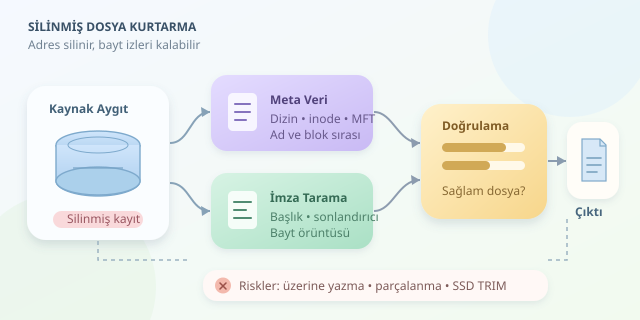

Bir dosyayı sildiğinizde bilgisayarınız çoğu zaman veriyi anında yok etmez; yalnızca ona giden adres tarifini kaldırır. Kitabın sayfaları dururken kütüphane kataloğundan kaydının silinmesi gibi! Veri kurtarma algoritmaları, geride kalan kayıtları ve bayt örüntülerini inceleyerek bu kayıp kitabı yeniden bulmaya çalışır. Ancak her kayıp dosyanın mutlu sonu yoktur.

``

## Silmek neden her zaman yok etmek değildir?

Dosya sistemleri, dosya adlarını ve içeriklerin depolama üzerindeki konumlarını ayrı yapılarla yönetir. Silme işlemi genellikle dizin kaydını değiştirir ve dosyanın kullandığı blokları yeniden tahsis edilebilir olarak işaretler. İçerik, yeni yazmalar gerçekleşene kadar bu bloklarda kalabilir. Böylece dosya mantıksal olarak kaybolurken, baytları bir süre daha okunabilir durumda olabilir.

Buradaki “fiziksel iz sürme”, çoğunlukla aygıttan okunabilen sektörlerdeki kalıntıları incelemek anlamına gelir; doğrudan manyetik yüzeyi veya bellek hücrelerini laboratuvarda çözümlemek değildir. Kurtarma yazılımları genellikle ham aygıt ya da onun sektör düzeyindeki imajı üzerinde çalışır.

## İki temel yaklaşım: Haritayı bulmak veya parçaları tanımak

İlk yaklaşım, dosya sisteminin meta verilerinden yararlanır. İkinci yaklaşım ise dosya sistemini büyük ölçüde görmezden gelerek içerik imzalarını arar; buna **file carving** denir.

| Yaklaşım | Dayandığı iz | Güçlü yanı | Temel sınırı |
|---|---|---|---|
| Meta veri tabanlı kurtarma | Dizin kayıtları, inode veya MFT | Adı ve blok sırasını koruyabilir | Kayıtlar yeniden kullanılmış olabilir |
| İmza tabanlı carving | Başlıklar, sonlandırıcılar, iç yapı | Kayıt olmadan içerik bulabilir | Parçalanmış dosyalarda zorlanır |

Örneğin NTFS üzerinde silinmiş bir MFT kaydındaki veri konumları henüz bozulmamış olabilir. FAT üzerinde başlangıç kümesi kalırken zincir bilgisi kaybolabilir. ext4 üzerinde silme sırasında inode bilgileri değişebilir; günlük kayıtları bazen ipucu sağlar. Günlük, bütün dosyaların gizli yedeği değildir. Bu nedenle aynı algoritma her dosya sisteminde aynı başarıyı göstermez.

## Blokların hayatta kalma ihtimali

Bir dosyanın $n$ bloktan oluştuğunu, her bloğun üzerine yazılma olasılığının $p$ olduğunu düşünelim. Olayları bağımsız varsayan basitleştirilmiş modelde, tüm blokların korunma olasılığı şöyledir:

$$P = (1-p)^n$$

Bu, gerçek diskin kesin davranışını hesaplayan bir formül değildir. Yazmalar çoğu zaman ilişkilidir ve eşit olasılıklı değildir. Yine de önemli bir sezgi verir: Daha fazla blok kullanan dosyanın tamamen sağlam kalması daha zor olabilir. Bir fotoğrafın başlığı bulunabilir, fakat ortasındaki birkaç blok değişmişse görüntünün bir bölümü bozulabilir.

## Kurtarmadan önce: Delili koruyun

1. **Kaynak diske yazmayı durdurun.** Program kurmak bile kurtarılacak blokları değiştirebilir.
2. **Mümkünse yazma engelleyici kullanın.** Kaynağın analiz sırasında değişmesini önleyin.
3. **Sektör düzeyinde imaj alın.** Çalışmayı özgün aygıt yerine kopya üzerinde yürütün.
4. **İmajın özetini kaydedin.** SHA-256 gibi bir özet, sonraki değişiklikleri tespit etmeye yardımcı olur.
5. **Sonuçları başka diske yazın.** Kurtarma işlemi kendi bulgularının üzerine basmasın!

## Python ile basit JPEG izi arama

Aşağıdaki örnek, bir imajda JPEG başlangıç ve bitiş işaretlerini arar. Bulduğu aralıkları ayrı dosyalara çıkarır. `mmap`, bütün imajı tek bir Python bayt dizisine kopyalamadan taramayı sağlar. Çıktı yolunun gerçekten başka bir diskte olduğundan emin olun.

```python
from pathlib import Path
import mmap

output = Path('/mnt/baska_disk/kurtarilan')
output.mkdir(parents=True, exist_ok=True)

with open('disk.img', 'rb') as source:
    with mmap.mmap(source.fileno(), 0,
                   access=mmap.ACCESS_READ) as image:
        position = 0
        while True:
            start = image.find(b'\xff\xd8\xff', position)
            if start == -1:
                break
            end = image.find(b'\xff\xd9', start + 3)
            if end == -1:
                break
            end += 2
            candidate = output / f'jpeg_{start:x}.jpg'
            candidate.write_bytes(image[start:end])
            position = end
```

Bu kod bir eğitim örneğidir, tam JPEG ayrıştırıcısı değildir. Gömülü küçük resimler, yanlış eşleşmeler veya eksik sonlandırıcılar hatalı sonuç üretebilir. Üretim araçları segment uzunluklarını ve dosya yapısını doğrular; parçalanmış dosyalar için ek eşleştirme algoritmaları kullanır. İmza bulmak, sağlam dosya bulmakla eş anlamlı değildir.

## Son engel: SSD, TRIM ve parçalanma

HDD üzerinde henüz üzerine yazılmamış bloklar okunabilir kalabilir. SSD üzerinde TRIM, silinen alanların artık kullanılmadığını denetleyiciye bildirir. Denetleyicinin temizleme süreçleri ve mantıksal adres eşlemeleri nedeniyle eski içerik normal okuma arayüzünden erişilemez hâle gelebilir.

Parçalanma da kurtarmayı zorlaştırır: Dosyanın devamı fiziksel olarak hemen yanında bulunmayabilir. Başarılı kurtarma; sağlam bloklar, korunmuş konum bilgisi ve doğrulanabilir dosya yapısının birleşimidir. En iyi algoritma bile üzerine yazılmış içeriği güvenilir biçimde geri getiremez. Bu yüzden veri kurtarmanın en etkili yardımcısı, erken müdahale ve düzenli yedektir.



