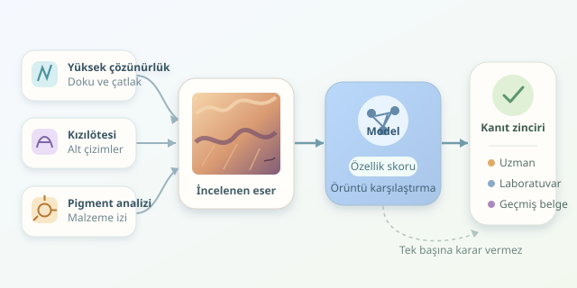

Bir tablonun köşesindeki imza gerçek görünebilir; peki fırça darbeleri, pigmentler ve tuval dokusu aynı hikâyeyi anlatıyor mu? Makine öğrenmesi, sanat eserlerini dijital bir dedektif gibi inceleyerek gözden kaçan örüntüleri yakalayabilir. Ancak önemli bir ayrım var: Algoritma özgünlüğü tek başına kesinleştirmez; uzmanların, laboratuvar analizlerinin ve eserin geçmişine ilişkin belgelerin oluşturduğu kanıt zincirini güçlendirir.

``

## Dijital dedektif neyi inceler?

Bir eser, yalnızca renkli piksellerden oluşmaz. Sanatçının el hareketleri, boya katmanları, kullanılan malzemeler ve yaşlanma süreçleri de görüntüye yansır. Makine öğrenmesi bu izlerden sayısal özellikler çıkarır ve onları güvenilir referans eserlerle karşılaştırır.

Örneğin bir evrişimli sinir ağı, fırça darbelerindeki yerel örüntüleri öğrenebilir. Fourier analizi tekrarlayan dokuları, dalgacık analizi ise farklı ölçeklerdeki değişimleri incelemeye yardımcı olur. Fakat modelin bulduğu benzerlik, aynı ressamın çalıştığını kanıtlamaz: Atölye üretimi, başarılı taklitler ve restorasyonlar da benzer izler bırakabilir.

| Yöntem | Sağladığı ipucu | Temel sınırlama |
|---|---|---|
| Yüksek çözünürlüklü fotoğraf | Fırça, çatlak ve yüzey dokusu | Işık ve kamera sonucu etkiler |
| Kızılötesi görüntüleme | Bazı alt çizimler ve değişiklikler | Her malzemede aynı başarıyı göstermez |
| XRF veya Raman analizi | Elementler ya da pigment bileşimi | Yorumlama uzmanlık gerektirir |
| Provenans araştırması | Sahiplik ve sergilenme geçmişi | Belgeler eksik veya yanıltıcı olabilir |




Dönemle uyuşmayan bir pigment şüphe yaratabilir; ancak bunun sonradan yapılan bir onarımdan kaynaklanıp kaynaklanmadığı ayrıca araştırılmalıdır.

## İyi veri, iyi dedektif

İlk adım, kontrollü görüntü toplamaktır. Sabit ışık, renk kalibrasyonu, fiziksel ölçek ve benzer çekim mesafesi önemlidir. Aksi hâlde model, sanatçının üslubu yerine müzenin fotoğraf makinesini tanımayı öğrenebilir. Dedektifimiz suçluyu değil, flaşı yakalamış olur!

Referans ve sahte eser etiketleri uzman değerlendirmeleriyle desteklenmelidir. Aynı tablodan alınan yüzlerce küçük görüntü parçasını eğitim ve test kümelerine rastgele dağıtmak ise veri sızıntısı oluşturur. Model daha önce gördüğü yüzeyi yeniden tanır ve başarısı olduğundan yüksek görünür.

Bu nedenle bölme işlemi **eser kimliğine göre** yapılmalıdır. Ayrıca farklı koleksiyonlar, çekim cihazları ve dönemler üzerinde dış doğrulama gerçekleştirilmelidir. Sadece tek koleksiyonla ölçülen başarı, başka bir müzeye taşındığında kaybolabilir.

## Modelin teorik mantığı

Her görüntü parçasını bir özellik vektörü $x$ ile temsil ettiğimizi düşünelim. Lojistik regresyon bu özellikleri ağırlıklandırarak $z=w^T x+b$ değerini üretir. Ardından sigmoid fonksiyonu bir sınıflandırma skoru verir:

$$s(x)=\frac{1}{1+e^{-z}}$$

Burada etiket $1$ şüpheli veya sahte sınıfını, $0$ referans sınıfını temsil edebilir. Eğitim sırasında ağırlıklar, etiketlerle tahminler arasındaki hatayı azaltacak şekilde güncellenir. Düzenlileştirme, modelin küçük veri kümelerindeki tesadüfleri ezberlemesini sınırlar. Ancak öğrenilen ilişki, nedensellik veya özgünlük belgesi değildir.

## Python ile örnek bir başlangıç

Aşağıdaki kod, önceden çıkarılmış görüntü özelliklerini kullanır. Dosyada `X` özellikleri, `y` etiketleri ve `eser_id` bulunmalıdır. Aynı eserin parçalarını birlikte tutar; ardından parça skorlarının ortalamasıyla eser düzeyinde değerlendirme yapar.

```python
import numpy as np
import pandas as pd
from sklearn.model_selection import GroupShuffleSplit
from sklearn.pipeline import make_pipeline
from sklearn.preprocessing import StandardScaler
from sklearn.linear_model import LogisticRegression
from sklearn.metrics import roc_auc_score

veri = np.load("eser_ozellikleri.npz")
X, y, kimlik = veri["X"], veri["y"], veri["eser_id"]

bolucu = GroupShuffleSplit(
    n_splits=1, test_size=0.25, random_state=42
)
egitim, test = next(bolucu.split(X, y, groups=kimlik))

model = make_pipeline(
    StandardScaler(),
    LogisticRegression(max_iter=2000, class_weight="balanced")
)
model.fit(X[egitim], y[egitim])

sonuc = pd.DataFrame({
    "eser": kimlik[test],
    "etiket": y[test],
    "skor": model.predict_proba(X[test])[:, 1]
}).groupby("eser").agg(
    etiket=("etiket", "first"), skor=("skor", "mean")
)
print(roc_auc_score(sonuc["etiket"], sonuc["skor"]))
```

Ölçekleyici yalnızca eğitim verisiyle öğrenilir. Kod, her eserin tek etiketi olduğunu varsayar; eğitim ve test bölümlerinde iki sınıfın da bulunduğu kontrol edilmelidir. Ortalama skor pratik bir başlangıçtır, evrensel bir birleştirme kuralı değildir.

## Skordan karara: Son sözü kim söyler?

ROC-AUC, sınıfları sıralama becerisini ölçer; tek başına yeterli değildir. Sahteyi kaçırma oranı, gerçek eseri yanlış suçlama oranı ve sınıf dengesizliğinde precision-recall ölçümleri de raporlanmalıdır. Karar eşikleri ayrı doğrulama verisinde seçilmeli, son test kümesine dokunulmamalıdır.

`predict_proba` çıktısı, özellikle sınıf ağırlıkları kullanıldığında, kalibrasyon yapılmadan gerçek dünyadaki sahtecilik olasılığı sayılmamalıdır. Belirsiz veya eğitim dağılımından uzak eserlerde sistem karar vermekten kaçınabilir. Isı haritaları incelemeyi yönlendirebilir, fakat kanıt yerine geçmez.

En sağlam sonuç, dijital bulguların malzeme analizleri ve sanat tarihi bilgisiyle birleşmesidir. Makine öğrenmesi burada hâkim değil, yorulmadan çalışan bir araştırma asistanıdır.
