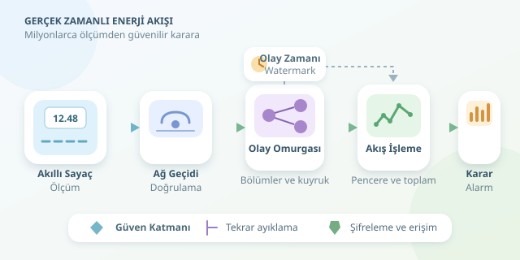

Milyonlarca evde kettle çalışıyor, klimalar devreye giriyor, elektrikli araçlar şarja takılıyor. Akıllı sayaçlar bu hareketliliği ölçümlere dönüştürüyor; fakat asıl mesele veriyi toplamak değil, güvenilir ve zamanında anlamlandırmak. Bir elektrik dağıtım şirketinin dijital sinir sistemi nasıl çalışır? Gelin, sayaçtan analitik ekrana uzanan yolculuğu teorisi ve çalışan bir örnekle keşfedelim.
``

## Önce ölçeği hesaplayalım

Beş milyon sayaç, her on beş dakikada bir ölçüm gönderiyorsa ortalama olay hızı $R=N/T$ olur. Burada $N$ sayaç sayısı, $T$ ise saniye cinsinden gönderim aralığıdır:

$$R = 5.000.000 / 900 \approx 5.556$$

Yani saniyede yaklaşık 5.556 kayıt! Aralık bir dakikaya düşerse yaklaşık 83.333 kayıt gelir. Üstelik sayaçlar aynı anda konuşursa ortalama değer kapasite planlamasında yetersiz kalır; tepe yüklerini de hesaba katmak gerekir.

“Gerçek zamanlı” ifadesi de sihir değildir. On beş dakikada bir raporlayan sayaçtan saniyelik tüketim ayrıntısı çıkaramazsınız. Analitik gecikmesi kadar ölçüm sıklığı da önemlidir.

## Verinin geçtiği duraklar

Tipik akış şöyledir: **Sayaç → ağ geçidi → mesaj omurgası → akış işlemcisi → veri depoları.**

Sayaç, ölçümleri haberleşme altyapısına gönderir. Ağ geçidi cihaz kimliğini doğrular, kayıt biçimini kontrol eder ve veriyi Kafka gibi dayanıklı bir olay günlüğüne aktarır. MQTT, cihazlarla ağ geçidi arasındaki seçeneklerden biridir; her saha aynı protokolü kullanmaz.

Kafka bölümleri paralel işlemeyi sağlar. Sayaç kimliğini bölüm anahtarı yapmak, aynı sayacın kayıtlarını aynı bölüme yönlendirir. İşlemci yavaşladığında kuyruk geçici tampon görevi görür; ancak depolama sonsuz değildir. Kuyruk gecikmesi izlenmeli ve kapasite gerektiğinde artırılmalıdır.

| Yaklaşım | Güçlü tarafı | Temel sınırı |
|---|---|---|
| Toplu işleme | Büyük tarihsel hesaplamalar | Sonuçlar gecikir |
| Akış işleme | Hızlı alarm ve güncelleme | Zaman ve durum yönetimi karmaşıktır |
| Birlikte kullanım | Hızlı sonuç ve sonradan düzeltme | İki akışın tutarlılığı gerekir |




## Zaman, tekrarlar ve eksik ölçümler

**Olay zamanı**, ölçümün gerçekleştiği; **işleme zamanı**, sunucuya ulaştığı zamandır. Bağlantısı kesilen sayaç geçmiş kayıtları sonradan gönderebilir. Bu nedenle pencereleri yalnızca sunucu saatine göre oluşturmak hatalı sonuçlar doğurabilir.

Watermark, olay zamanındaki ilerlemeye göre geç veriler için belirlenen toleranstır; bir teslimat garantisi değildir. Tolerans dışındaki kayıtlar ayrıca saklanıp tarihsel düzeltmede kullanılmalıdır. Tekrar gönderimleri ise benzersiz olay kimliğiyle ayıklanır.

Sayaç toplam enerji endeksi gönderiyorsa dönem tüketimi $E_t=C_t-C_{t-1}$ üzerinden hesaplanır. Sayaç değişimi ve endeks sıfırlanması ayrıca ele alınmalıdır. Eksik kayıtları doğrudan sıfır tüketim saymak da yanıltıcıdır.

## Spark ile pencere hesabı

Aşağıdaki Spark 3.5+ örneği Kafka’daki JSON kayıtlarını okur, tekrarları ayıklar ve bölge bazında enerji toplar. `kwh` dönemlik enerjiyi, `event_time` ise hizalanmış on beş dakikalık dönemin başlangıcını temsil eder; ham toplam endeks değildir.

```python
from pyspark.sql import SparkSession
from pyspark.sql.functions import col, from_json, window, sum as sum_

spark = SparkSession.builder.appName("meter-stream").getOrCreate()
schema = "meter_id STRING, event_id STRING, region STRING, event_time TIMESTAMP, kwh DOUBLE"

raw = (spark.readStream.format("kafka")
    .option("kafka.bootstrap.servers", "localhost:9092")
    .option("subscribe", "meter-readings")
    .load())

clean = (raw.select(from_json(col("value").cast("string"), schema).alias("m"))
    .select("m.*")
    .filter("event_time IS NOT NULL AND kwh >= 0")
    .withWatermark("event_time", "2 minutes")
    .dropDuplicatesWithinWatermark(["meter_id", "event_id"]))

result = (clean.groupBy(window("event_time", "15 minutes"), "region")
    .agg(sum_("kwh").alias("total_kwh")))

query = (result.writeStream.format("console")
    .outputMode("update")
    .option("checkpointLocation", "/tmp/meter-checkpoint")
    .start())
query.awaitTermination()
```

Watermark, işlemci durumunun sınırsız büyümesini önlemeye yardımcı olur. Konsol çıktısı geliştirme içindir; üretimde kalıcı checkpoint depolaması ve güncellenen pencere sonuçlarını güvenle yazabilen bir hedef gerekir. Bozuk kayıtlar da sessizce kaybolmak yerine ayrı bir hata akışına yönlendirilmelidir.

## Veriden karara, karardan güvene

Bölgesel toplamlar talep tahminini besler. Bir hanenin tüketimi, benzer saatlerdeki geçmiş ortalamasıyla karşılaştırılabilir: $z=(x-m)/s$. Burada $m$ ortalama, $s$ standart sapmadır. Büyük sapma inceleme başlatabilir; tek başına arıza veya kaçak kanıtı değildir. Mevsim, tatil ve hava sıcaklığı hesaba katılmalıdır.

Ham olaylar yeniden hesaplama için veri gölünde, hızlı sorgulanan özetler analitik depoda tutulabilir. Tüketim verisi evde bulunma alışkanlıklarını açığa çıkarabileceğinden şifreleme, erişim sınırları ve KVKK kapsamında saklama politikaları kritik önemdedir.

Son olarak, “exactly-once” etiketi tek başına uçtan uca garanti sağlamaz: kaynak, checkpoint ve hedef birlikte tasarlanmalıdır. Başarılı sistem yalnızca hızlı grafik çizmez; bağlantı kesildiğinde, kayıt tekrarlandığında ve kettle ordusu aynı anda çalıştığında da güvenilir kalır.
