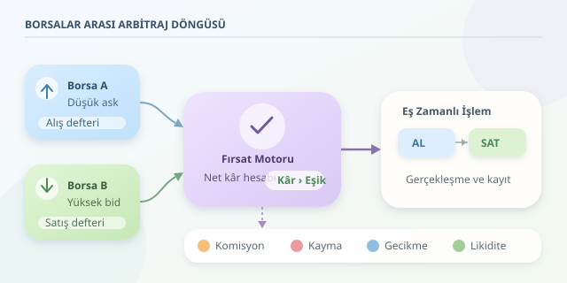

Aynı varlık bir borsada daha ucuz, diğerinde daha pahalıysa, aradaki fark küçük bir fırsat penceresi açar. Arbitraj botları bu pencereyi sürekli izleyen, hesap yapan ve koşullar uygunsa emir gönderen yazılımlardır. Ancak ekranda görünen fiyat farkı, cebinize girecek kâr değildir: Komisyonlar, likidite ve gecikme de masaya oturur!

``

## Fiyatlar neden farklılaşır?

Borsalar tek bir ortak emir defteri kullanmaz. Her platformun kullanıcıları, alış emirleri, satış emirleri ve likiditesi farklıdır. Bir borsada güçlü alım talebi oluştuğunda fiyat yükselirken, başka bir borsa henüz aynı hareketi yaşamamış olabilir. Para yatırma kısıtları ve bölgesel koşullar da ayrışmayı büyütebilir.

Arbitraj, bu parçalı yapının oluşturduğu geçici uyumsuzluklardan yararlanır. Botlar ucuz tarafta alıp pahalı tarafta sattıkça fiyatların yakınlaşmasına katkı sağlar. Yani fırsatı yakalayan yarışmacılar, aynı zamanda fırsatı küçültür.

| Yaklaşım | İşlem düzeni | Temel zorluk |
|---|---|---|
| Borsalar arası arbitraj | Aynı varlığı farklı platformlarda alıp satmak | Sermayeyi ve envanteri dağıtmak |
| Üçgensel arbitraj | Üç işlem çifti üzerinden başlangıç varlığına dönmek | Üç bacağın maliyetini ve gerçekleşmesini yönetmek |




## Matematik: Fark değil, net sonuç önemlidir

Bot, son gerçekleşen işlem fiyatlarını karşılaştırmakla yetinmemelidir. Alış için satıcıların sunduğu **ask**, satış için alıcıların sunduğu **bid** fiyatı önemlidir. Belirli bir miktarın tahmini sonucu şöyle modellenebilir:

$$K = q[P_B(1-f_B)-P_A(1+f_A)]-C$$

Burada $q$ miktarı, $P_A$ alış fiyatını, $P_B$ satış fiyatını, $f_A$ ve $f_B$ komisyon oranlarını gösterir. $C$ ise kayma, finansman ve envanteri yeniden dengeleme gibi ek maliyetler için ayrılan tahmini bütçedir.

Örneğin A borsasında alış fiyatı 100, B borsasında satış fiyatı 101 olsun. On birimlik işlemde brüt fark 10 birimdir. Her iki tarafta yüzde 0,1 komisyon uygulanırsa toplam komisyon 2,01 olur. Ek maliyet bütçesi 2 ise tahmini net sonuç yalnızca 5,99 birimdir.

| Hesaplama | Sonuç | Yorum |
|---|---:|---|
| Yalnızca fiyat farkı | 10 | Fazla iyimser görünüm |
| Komisyon sonrası | 7,99 | Hâlâ bütün maliyetler yok |
| Ek maliyet bütçesi sonrası | 5,99 | İşlem kararı için daha anlamlı tahmin |

## Botun çalışma döngüsü

**Veri toplama → doğrulama → hesaplama → emir gönderme → mutabakat** zinciri, sistemin omurgasıdır. WebSocket bağlantılarıyla emir defteri güncellemeleri alınabilir; bağlantı kopmaları ve eksik mesajlar ayrıca izlenmelidir.

Bot önce verinin güncelliğini ve hedef miktarı karşılayacak derinliği kontrol eder. Büyük emirlerde tek fiyat yerine defterdeki kademelerden hesaplanan ağırlıklı ortalama gerçekleşme fiyatı kullanılmalıdır. Ardından maliyetleri düşer ve güvenlik eşiğini aşan fırsatları değerlendirir.

Pratikte her fırsatta varlığı bir borsadan diğerine taşımak yavaş kalabilir. Bu nedenle A tarafında para, B tarafında satılabilecek varlık önceden tutulur. Alış ve satış yakın zamanlı yapılır; bozulan envanter dengesi daha sonra düzeltilir. Bu düzen hız kazandırır fakat sermaye ihtiyacını artırır.

## Python ile küçük bir fırsat filtresi

Aşağıdaki örnek gerçek emir göndermez. Aynı işlem çifti için alınmış iki emir defterinin ilk kademesini değerlendirir; miktar bu kademeyi aşıyorsa fırsatı reddeder. Böylece görünen fiyatın bütün miktara uygulanabileceği varsayımını sınırlar.

```python
def firsat(a, b, simdi_ms, miktar=10, esik=1):
    yas = max(
        simdi_ms - a["alindi_ms"],
        simdi_ms - b["alindi_ms"]
    )
    if yas > 500 or not a["asks"] or not b["bids"]:
        return None

    alis, alis_hacmi = a["asks"][0]
    satis, satis_hacmi = b["bids"][0]
    if miktar <= 0 or miktar > min(alis_hacmi, satis_hacmi):
        return None

    ucret_a = ucret_b = 0.001
    ek_maliyet = 2.0
    net = miktar * (
        satis * (1 - ucret_b) - alis * (1 + ucret_a)
    ) - ek_maliyet

    if net <= esik:
        return None
    return {"miktar": miktar, "tahmini_net": round(net, 2)}
```

`alindi_ms`, veri toplayıcının eklediği yerel alınma zamanıdır; tek başına borsadaki verinin tazeliğini garanti etmez. Üretimde kaynak zamanları, ağ gecikmesi, gerçek hesap komisyonları, minimum emir tutarları ve miktar hassasiyeti de doğrulanmalıdır. Buradaki sabit maliyetler yalnızca öğretici varsayımlardır.

## Asıl mesele: İki bacak da gerçekleşecek mi?

Bir emir gerçekleşirken diğeri reddedilebilir veya kısmen dolabilir. Böylece bot arbitraj yerine açık piyasa pozisyonu taşımaya başlar. IOC emirleri bekleyen miktarı iptal edebilir, ancak iki ayrı borsada atomik gerçekleşme sağlamaz.

Bu yüzden pozisyon limitleri, başarısız bacak için telafi politikası, acil durdurma ve ayrıntılı kayıtlar şarttır. API anahtarlarında para çekme yetkisini kapatmak da önemlidir. Önce simülasyon, ardından küçük ölçekli test yapılmalıdır. Başarılı arbitraj sistemi, yalnızca hızlı hesaplayan değil, yanlış giden işlemi güvenle yöneten sistemdir.
